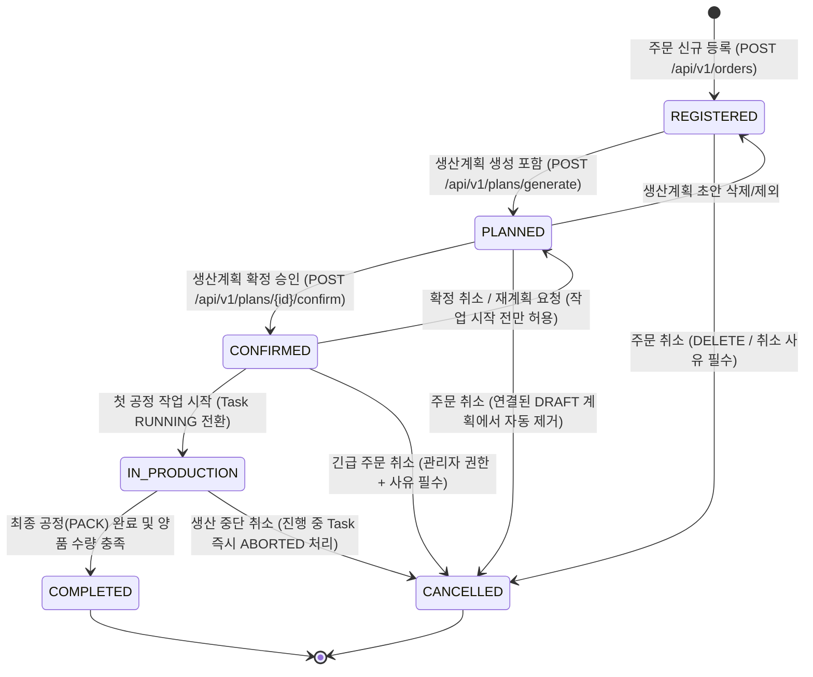
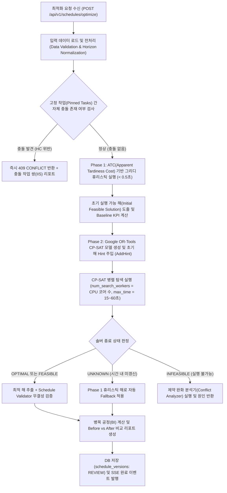
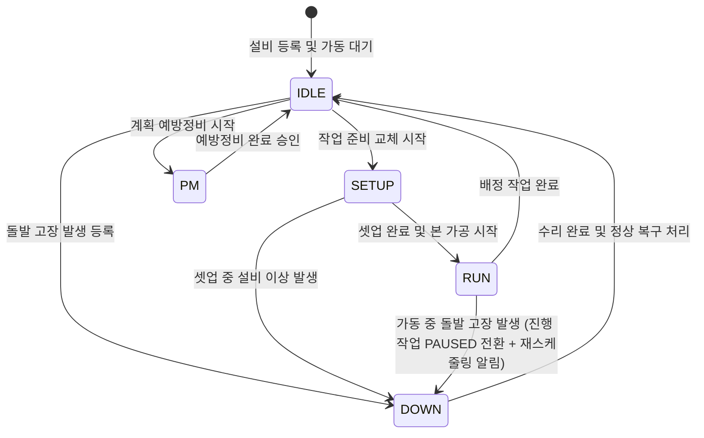
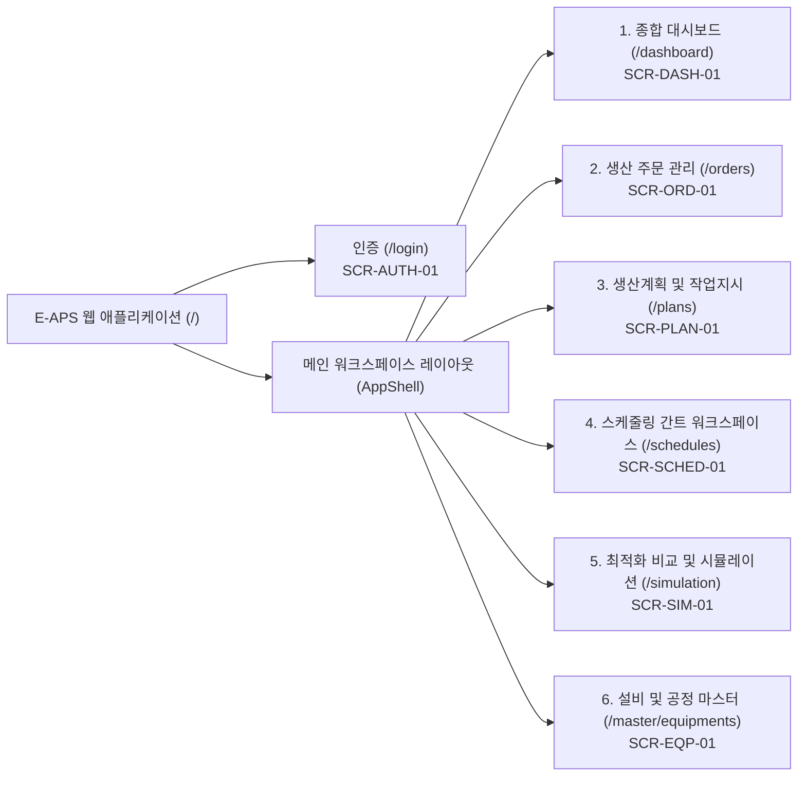
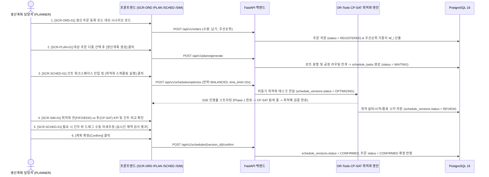
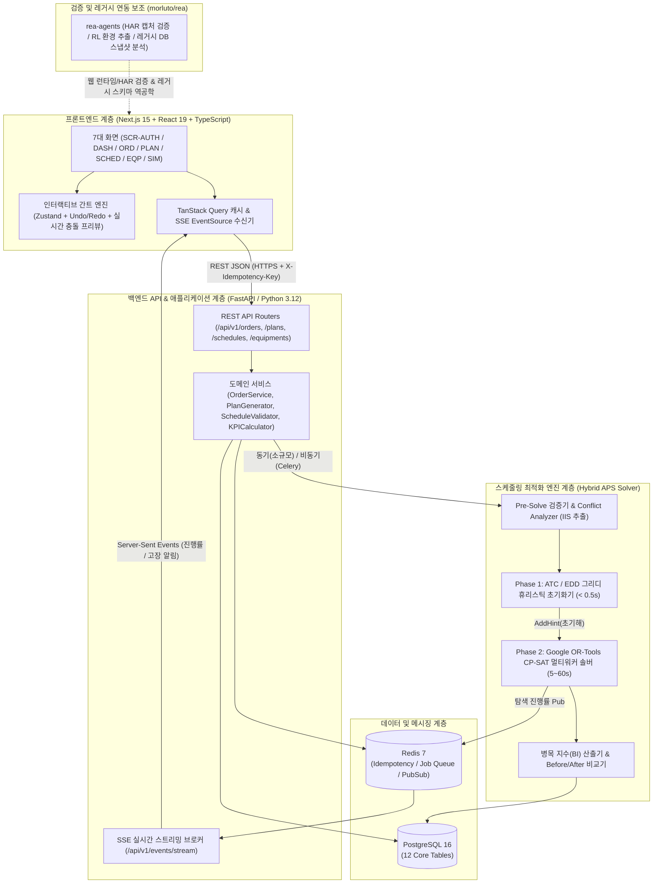
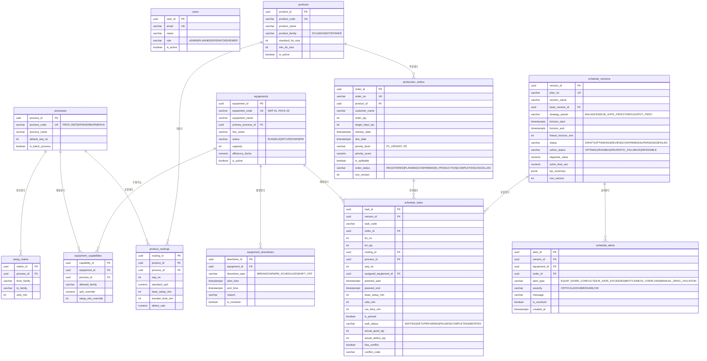

# 전자 생산계획 및 스케줄링 최적화 시스템 (E-APS) — 상세 구현 설계서

- **문서 버전:** v1.0.0 (Production-Ready Baseline)
- **작성 일자:** 2026-10-26
- **문서 상태:** 확정 (Approved for Implementation)
- **시스템 명칭:** **E-APS** (Electronics Advanced Planning & Scheduling System)
- **대상 독자:** 프론트엔드 개발자, 백엔드/최적화 엔진 개발자, UI/UX 디자이너, QA 엔지니어

---

## 목차 (Table of Contents)

1. **[제1장. 프로젝트 개요 및 참고 저장소(`morluto/rea`) 기술 분석](#제1장-프로젝트-개요-및-참고-저장소morlutorea-기술-분석)**
   - 1.1 프로젝트 목적 및 도메인 범위
   - 1.2 요구사항 식별자 및 표기 규칙
   - 1.3 참고 저장소(`https://github.com/morluto/rea`) 정밀 기술 분석 및 활용 경계 정의
2. **[제2장. 핵심 기능 및 비즈니스 로직 상세 명세](#제2장-핵심-기능-및-비즈니스-로직-상세-명세)**
   - 2.1 생산계획 관리 (`REQ-PLAN-001` ~ `REQ-PLAN-006`)
   - 2.2 생산 스케줄링 최적화 엔진 (`REQ-OPT-001` ~ `REQ-OPT-009`)
   - 2.3 설비 및 공정 마스터 관리 (`REQ-EQP-001` ~ `REQ-EQP-005`)
   - 2.4 모니터링 및 시각화 비즈니스 로직 (`REQ-MON-001` ~ `REQ-MON-007`)
3. **[제3장. UI/UX 상세 설계](#제3장-uiux-상세-설계)**
   - 3.1 전체 서비스 구조 (IA, RBAC 권한, 메뉴 트리, 주요 업무 흐름)
   - 3.2 화면별 상세 명세 (`SCR-AUTH-01` ~ `SCR-SIM-01`, 총 7개 화면)
   - 3.3 디자인 시스템 (색상, 타이포그래피, 그리드, 간격, 반응형, 다크 모드)
   - 3.4 공통 컴포넌트 상세 규격 (`CMP-01` ~ `CMP-17`, 인터랙티브 간트 차트 특화 명세 포함)
   - 3.5 접근성(WCAG 2.1 AA) 및 예외/복구 처리 규칙
4. **[제4장. 시스템 아키텍처 및 데이터 설계](#제4장-시스템-아키텍처-및-데이터-설계)**
   - 4.1 기술 스택 선정 및 대안 비교
   - 4.2 시스템 아키텍처 및 프로젝트 디렉터리 구조
   - 4.3 데이터베이스 ERD 및 테이블 상세 정의 (12개 핵심 테이블)
   - 4.4 RESTful API 및 실시간 SSE 엔드포인트 상세 명세
   - 4.5 인증/인가, 트랜잭션, 동시성 제어, 캐싱, 비동기 최적화 워커 설계
5. **[제5장. 실제 시연 가능한 MVP 데모 설계 및 가상 데이터셋](#제5장-실제-시연-가능한-mvp-데모-설계-및-가상-데이터셋)**
   - 5.1 전자 제조 공정(SMT·DIP·AOI/ICT·Burn-in·Packing) 가상 마스터 데이터
   - 5.2 가상 생산 주문 데이터 (12건) 및 설비 가용시간 설정
   - 5.3 4대 핵심 데모 시나리오 (정상 계획, 납기 충돌, 설비 고장 재스케줄링, 긴급 주문 삽입)
   - 5.4 최적화 전후(Before vs After) 성능 비교 방법 및 데모 실행 환경 구성
6. **[제6장. 테스트 및 검증 기준](#제6장-테스트-및-검증-기준)**
   - 6.1 기능별 단위/통합 테스트 케이스 명세
   - 6.2 스케줄링 최적화 결과 무결성 검증기(Schedule Validator) 명세
   - 6.3 성능 측정 목표, 데이터 규모별 벤치마크 기준 및 구현 시 주의사항
7. **[제7장. 개발 Phase 구성 및 요구사항 추적성 매트릭스](#제7장-개발-phase-구성-및-요구사항-추적성-매트릭스)**
   - 7.1 Phase 1 ~ Phase 5 단계별 구현 로드맵 (MVP 필수 vs 향후 확장 구분)
   - 7.2 양방향 추적성 매트릭스 (요구사항 ↔ 화면 ↔ API ↔ DB ↔ 테스트 케이스)
   - 7.3 설계 완결성 자체 검토 결과

---

## 제1장. 프로젝트 개요 및 참고 저장소(`morluto/rea`) 기술 분석

### 1.1 프로젝트 목적 및 도메인 범위

본 문서는 전자 제조업(예: 산업용 제어보드, 차량용 인포테인먼트 PBA, 스마트 가전 메인보드, 고속 통신 모듈 등)의 다품종 변량 생산 환경을 위한 **전자 생산계획 및 스케줄링 최적화 시스템(E-APS)**의 단일 구현 설계서(Single Source of Truth)이다.

- **핵심 도메인 공정 (5단계 표준 라우팅):**
  1. `PROC-SMT` (표면실장 공정: Solder Paste 인쇄 → Chip Mounter → Reflow 솔더링)
  2. `PROC-DIP` (수삽 및 PBA 후공정: 이형 부품 삽입 및 Wave Soldering)
  3. `PROC-INSP` (자동광학/회로 검사 공정: AOI 및 ICT In-Circuit Test)
  4. `PROC-BURN` (신뢰성 에이징 공정: 고온/고습 챔버 Burn-in Test)
  5. `PROC-PACK` (최종 조립, 펌웨어 플래싱 및 출하 포장 공정)
- **목표 수준:**
  1. **즉시 시연 가능한 실동작 MVP 구축:** 실제 수리최적화 솔버(Google OR-Tools CP-SAT)와 인터랙티브 웹 간트 차트가 연동되어 가상 데이터 기반의 4대 시나리오(초기 최적화, 병목 해소, 설비 돌발 고장 재스케줄링, 긴급 주문 삽입)를 실시간 시연할 수 있어야 한다.
  2. **실제 제조 현장 확장 아키텍처:** ERP/MES 수주·설비 인터페이스 연동, 다중 공장/라인 확장, 작업 고정(Pinning) 및 동결 구간(Freeze Horizon) 기반 롤링 스케줄링이 가능한 구조로 설계한다.

---

### 1.2 요구사항 식별자 및 표기 규칙

본 설계서의 모든 항목은 명확한 검증과 추적을 위해 아래 분류 체계를 따른다.

| 구분 코드 | 의미 | 설명 및 적용 기준 |
| :--- | :--- | :--- |
| **`[REQ-*]`** | **필수 요구사항 (Requirement)** | MVP 또는 확장 단계에서 반드시 구현 및 테스트로 검증되어야 하는 확정 규격 |
| **`[ASM-*]`** | **설계상 가정 (Assumption)** | 사용자 요구사항에 명시되지 않았으나 전자 제조 도메인 표준에 기반하여 설정한 합리적 기본안 및 근거 |
| **`[REC-*]`** | **권장사항 (Recommendation)** | 운영 안정성, 성능 최적화, 현업 사용성 향상을 위해 권장하는 설계 옵션 |

**고유 ID 명명 규칙:**
- 기능/비즈니스 로직: `REQ-PLAN-001` (생산계획), `REQ-OPT-001` (최적화), `REQ-EQP-001` (설비/공정), `REQ-MON-001` (모니터링)
- 제약조건 규칙: `HC-001` (Hard Constraint), `SC-001` (Soft Constraint)
- UI 화면 및 컴포넌트: `SCR-DASH-01` (화면 ID), `CMP-01` (공통 컴포넌트 ID)
- 아키텍처/DB/API/테스트: `REQ-ARCH-001`, `TBL-01`, `API-PLAN-01`, `TC-PLAN-001`

---

### 1.3 참고 저장소(`https://github.com/morluto/rea`) 정밀 기술 분석 및 활용 경계 정의

> [!IMPORTANT]
> **사실 기반 기술 검증 원칙 준수:** `https://github.com/morluto/rea` 저장소의 실제 소스 트리와 문서를 정밀 분석하여, **실제 존재하는 기능만 활용**하고 저장소가 지원하지 않는 생산계획·스케줄링 최적화 기능은 전량 별도 설계·구현한다.

#### 1.3.1 `morluto/rea` 저장소 실체 분석
- **저장소 식별:** `morluto/rea` (**REA: Reverse Engineer Anything**, npm 패키지명: `rea-agents`, 라이선스: MIT, 주 언어: TypeScript, 런타임 요건: Node.js `>=22.23.4` / `>=24.22.1` / `>=26.12.1`).
- **핵심 정체성:** AI 에이전트(MCP 프로토콜 지원) 및 CLI를 통해 애플리케이션 동작, 웹사이트, 네트워크 캡처, 로컬 SQLite DB, .NET/JavaScript/Electron 앱, 네이티브 바이너리 등을 역공학(Reverse Engineering)하고 실행 가능한 에이전트 테스트 환경(RL Environment)을 추출하는 로컬 분석 툴킷이다.
- **참고 저장소가 실제 지원하는 기능 (확인 완료):**
  1. **Websites & Browser Observation (`docs/browser-observation.md`):** Chrome 계열 브라우저를 통한 웹 페이지 DOM 구조, 로드된 스크립트, 네트워크 요청/응답 관찰 및 스크린샷 캡처.
  2. **Saved Network Captures & RL Environment Build (`docs/web-network-captures.md`, `rea environment-build`):** 녹화된 `.har` (HTTP Archive) 또는 Fiddler `.saz` 네트워크 캡처 파일을 분석하여 API 스키마를 추출하고, `rea environment-build ./session.har ./my-env --json` 명령으로 에이전트가 호출 가능한 로컬 샌드박스/테스트 환경을 생성.
  3. **SQLite Database Inspection:** 로컬 SQLite 데이터베이스/WAL 스냅샷의 테이블, 컬럼, 인덱스, 뷰, 트리거 및 행 데이터 정적 검사 (`Node.js >= 24.15` 내장 SQLite 활용).
  4. **Static JavaScript / Electron / .NET Assembly Inspection:** 번들된 웹/데스크톱 앱의 모듈, 라우트, IPC 구조 및 .NET CIL 어셈블리 메타데이터 정적 분석(구형 공장용 C# WinForms/WPF MES 클라이언트 분석 가능).
  5. **Logic Signals & Firmware Inspection:** Linux 환경에서 `sigrok-cli` 기반 로직 신호 디코딩 및 펌웨어(Binwalk/Unblob) 구조 분석.
- **참고 저장소가 지원하지 않는 기능 (확인 완료):**
  - 생산 주문/계획 관리(CRUD), 공정 라우팅 모델, 설비 캘린더 관리 기능 **없음**.
  - 스케줄링 최적화 알고리즘(CP-SAT, MILP, 유전 알고리즘, 휴리스틱 등) **없음**.
  - 생산 현황 대시보드나 간트 차트(Gantt Chart) UI 컴포넌트 **없음**.

#### 1.3.2 본 프로젝트(E-APS)에서의 `morluto/rea` 활용 영역 vs 자체 구현 영역 매핑

| 구분 | 대상 모듈 / 작업 | `morluto/rea` 활용 여부 | 구체적 활용 방식 또는 자체 설계·구현 방안 |
| :--- | :--- | :---: | :--- |
| **자체 설계·구현 (Core System)** | 생산계획/주문/설비/공정 백엔드 및 DB | 미사용 (자체 구현) | FastAPI + PostgreSQL 16 + SQLAlchemy 2.0 기반으로 도메인 엔티티, 상태 전이 머신, 트랜잭션 로직을 100% 자체 설계 및 구현 |
| **자체 설계·구현 (Optimization)** | 생산 스케줄링 최적화 엔진 | 미사용 (자체 구현) | Google OR-Tools (`ortools.sat.python.cp_model`) + 우선순위 휴리스틱(EDD/ATC) 2단계 하이브리드 솔버 자체 설계 및 구현 |
| **자체 설계·구현 (Frontend UI)** | 간트 차트, 대시보드, 관리 화면 전체 | 미사용 (자체 구현) | Next.js 15 + React 19 + TypeScript + Tailwind CSS 기반으로 7개 전체 화면 및 17개 공통 컴포넌트 자체 구현 |
| **`rea` 실제 기능 활용 1 (QA/검증)** | 웹 UI 런타임/네트워크 검증 및 데모 샌드박스 추출 | **활용 (`rea-agents`)** | 개발된 E-APS 웹 앱의 시연 세션을 `.har`로 캡처 후 `rea environment-build ./eaps-demo.har ./eaps-mock-env --json`을 통해 API 정합성 검증 및 오프라인 에이전트 테스트 환경 생성에 활용 |
| **`rea` 실제 기능 활용 2 (현장 확장)** | 레거시 제조 현장 MES/설비 로컬 DB 스키마 역공학 | **활용 (`rea-agents`)** | 향후 실제 제조 현장 도입 시, 문서화되지 않은 기존 레거시 MES 클라이언트(.NET 어셈블리/Electron)의 로컬 SQLite 스냅샷 및 네트워크 패킷(HAR)을 `rea`로 정적 분석하여 ERP/MES 연동 어댑터 스키마 도출에 활용 |

---

## 제2장. 핵심 기능 및 비즈니스 로직 상세 명세

### 2.1 생산계획 관리 (`REQ-PLAN-001` ~ `REQ-PLAN-006`)

#### 2.1.1 요구사항 목록 및 명세 요약

| 요구사항 ID | 기능명 | 우선순위 | 설명 및 측정 가능 완료 기준 |
| :--- | :--- | :---: | :--- |
| `REQ-PLAN-001` | 생산 주문(Production Order) CRUD | MVP 필수 | 생산 주문의 등록·조회·수정·논리삭제를 처리하며, 주문번호(`order_no`) 자동 채번 및 납기일 유효성 검증을 100% 수행한다. |
| `REQ-PLAN-002` | 제품별 생산 수량·납기·로트 분할 계산 | MVP 필수 | 주문 수량(`order_qty`), 안전 생산 여유율(불량 대비 보정), 설비별 표준 로트 크기(`lot_size`)를 기반으로 작업 배치(Batch/Lot) 수량을 자동 산출한다. |
| `REQ-PLAN-003` | 생산 우선순위 점수(Priority Score) 산정 | MVP 필수 | 고객 수동 등급(1~5등급)과 납기 긴급도(Critical Ratio), 고객사 중요도를 결합하여 0.00~100.00점 사이의 정량적 우선순위 가중치 $w_i$를 계산한다. |
| `REQ-PLAN-004` | 생산계획 자동 생성 및 수동 조정 | MVP 필수 | 확정 대기 주문을 선택하여 제품의 공정 라우팅(`product_routings`)에 따른 세부 공정 작업(`schedule_tasks`)을 자동 전개하고, 계획 담당자가 수량/일정/배정 설비를 수동 조정할 수 있다. |
| `REQ-PLAN-005` | 생산계획 상태 전이(확정·변경·취소) 관리 | MVP 필수 | 생산계획의 생명주기(`DRAFT` → `OPTIMIZING` → `REVIEW` → `CONFIRMED` → `IN_PROGRESS` → `COMPLETED` / `CANCELLED`)를 엄격한 상태 머신으로 통제한다. |
| `REQ-PLAN-006` | 세부 공정 작업(Task) 진행 상태 관리 | MVP 필수 | 각 공정 작업의 상태(`WAITING`, `SETUP`, `RUNNING`, `PAUSED`, `COMPLETED`, `ABORTED`) 및 실적 수량/진행률(%)을 실시간 갱신하고 상위 계획 및 주문 상태를 자동 동기화한다. |

---

#### 2.1.2 상세 계산식 및 비즈니스 규칙

##### (1) 주문번호 및 계획번호 채번 규칙 (`REQ-PLAN-001`)
- **생산 주문번호(`order_no`):** `PO-{YYYYMMDD}-{4자리 일련번호}` (예: `PO-20261026-0001`)
  - 일련번호는 해당 일자(KST 기준 `00:00:00` ~ `23:59:59`) 내 생성 순으로 `0001`부터 `9999`까지 DB Sequence 또는 원자적 카운터로 부여한다.
- **생산 계획번호(`plan_no`):** `PLN-{YYYYMMDD}-V{버전번호 2자리}` (예: `PLN-20261026-V01`)
- **작업 지시번호(`task_code`):** `TSK-{주문일련번호 4자리}-{로트번호 2자리}-P{공정순번 2자리}` (예: `TSK-0001-01-P10`)

##### (2) 계획 생산 수량(Planned Quantity) 및 로트 분할(Lot Splitting) 계산식 (`REQ-PLAN-002`)
`[ASM-PLAN-01]` 전자 제조 공정에서는 공정 불량률(Yield Loss)을 감안하여 주문 수량보다 여유 수량을 투입할 수 있으며, 대량 주문의 경우 설비 간 병렬 진행 및 재공품(WIP) 대기를 줄이기 위해 표준 로트 크기(`standard_lot_size`) 단위로 분할 생산한다.

1. **투입 목표 수량($Q_{\text{target}, i}$) 계산:**
   $$Q_{\text{target}, i} = \left\lceil \frac{Q_{\text{order}, i}}{\prod_{k=1}^{K_i} (1 - r_{\text{defect}, i, k})} \right\rceil$$
   - $Q_{\text{order}, i}$: 주문 $i$의 고객 요청 수량 (`INT`, 범위: $1 \le Q_{\text{order}, i} \le 1,000,000$)
   - $r_{\text{defect}, i, k}$: 제품 $i$의 $k$번째 공정 예상 불량률 (범위: $0.000 \le r_{\text{defect}} \le 0.200$, 기본값 `0.000` — 사용자가 "수율 보정 미적용" 선택 시 $Q_{\text{target}, i} = Q_{\text{order}, i}$)
2. **로트 분할 개수($N_{\text{lot}, i}$) 및 로트별 수량($q_{i, l}$) 계산:**
   - 제품의 표준 로트 크기 $L_{\text{std}, i}$ (`INT`, 기본값 `500` EA, 최소 로트 크기 $L_{\text{min}, i} = 50$ EA)가 설정된 경우:
   $$N_{\text{lot}, i} = \begin{cases} 1 & \text{if } \text{is\_splittable} = \text{false} \text{ or } Q_{\text{target}, i} \le L_{\text{std}, i} \\ \left\lceil \frac{Q_{\text{target}, i}}{L_{\text{std}, i}} \right\rceil & \text{if } \text{is\_splittable} = \text{true} \text{ and } Q_{\text{target}, i} > L_{\text{std}, i} \end{cases}$$
   - 마지막 로트 잔량이 최소 로트 크기 $L_{\text{min}, i}$ 미만인 경우($(Q_{\text{target}, i} \bmod L_{\text{std}, i}) < L_{\text{min}, i}$), 마지막 잔량을 직전 로트($(N_{\text{lot}, i}-1)$번째 로트)에 병합하여 과소 로트 발생으로 인한 셋업 낭비를 방지한다.

##### (3) 생산 우선순위 가중치($W_i$) 계산식 (`REQ-PLAN-003`)
각 생산 주문 $i$는 수동 설정 등급(`priority_level`)과 납기 여유율을 결합한 **종합 우선순위 가중치 $W_i \in [1.0, 100.0]$**을 가지며, 이 값은 스케줄링 최적화 목적함수의 납기 지연 페널티 계수로 직접 입력된다.

1. **수동 우선순위 등급 매핑 점수($S_{\text{manual}, i}$):**
   | `priority_level` 코드 | 등급 명칭 | 기본 점수($S_{\text{manual}, i}$) | 최적화 가중 배수($m_i$) | 사용 기준 |
   | :---: | :--- | :---: | :---: | :--- |
   | `P1_URGENT` | 1등급 (긴급/VIP) | `100` | `10.0` | 라인 정지 위기 고객, 경영진 특명 긴급 수주 |
   | `P2_HIGH` | 2등급 (높음) | `75` | `5.0` | 주요 전략 고객사 확정 수주, 납기 변경 불가 주문 |
   | `P3_NORMAL` | 3등급 (보통 - 기본값) | `50` | `2.0` | 일반 양산 주문 |
   | `P4_LOW` | 4등급 (낮음) | `25` | `1.0` | 납기 여유 주문, 사내 안전재고 보충용 생산 |
   | `P5_HOLD_CANDIDATE` | 5등급 (유예 가능) | `10` | `0.5` | 시제품/샘플 생산 또는 유휴 설비 활용 목적 주문 |

2. **납기 긴급도 지수(Critical Ratio, $CR_i$) 및 종합 우선순위 점수($W_i$):**
   $$CR_i = \frac{\max(0, \text{DueDate}_i - t_{\text{now}})}{\sum_{k=1}^{K_i} T_{\text{est}, i, k}}$$
   $$S_{\text{urgency}, i} = \text{clamp}\left(100 \times \left(1 - \frac{CR_i}{5.0}\right), 0, 100\right)$$
   $$W_i = \text{round}\left(0.6 \times S_{\text{manual}, i} + 0.4 \times S_{\text{urgency}, i}, 2\right)$$
   - $\text{DueDate}_i$: 주문 $i$의 납기 시각 (분 단위 Timestamp)
   - $t_{\text{now}}$: 계획 기준 시각 (`plan_horizon_start`)
   - $\sum_{k=1}^{K_i} T_{\text{est}, i, k}$: 주문 $i$의 전 공정 예상 순수 작업 소요시간 합계 (분)
   - $CR_i < 1.0$인 경우(남은 시간이 총 작업 소요시간보다 작은 경우), 주문 등록/조회 시 즉시 `WARNING: LEAD_TIME_SHORTAGE` 플래그를 활성화한다.

---

#### 2.1.3 상태 전이 규칙 (State Machine Specification)

##### (1) 생산 주문(`production_orders`) 상태 전이 다이어그램 및 규칙 (`REQ-PLAN-001`, `REQ-PLAN-005`)



| 현재 상태 (`status`) | 목표 상태 (`next_status`) | 허용 조건 (Guard Condition) | 상태 전이 시 부수 효과 (Side Effects) | 위반 시 에러 코드 및 HTTP 상태 |
| :--- | :--- | :--- | :--- | :--- |
| `REGISTERED` | `PLANNED` | 주문 수량 $> 0$, 품목 라우팅 마스터가 1개 이상 존재할 것 | 해당 주문의 공정 라우팅을 읽어 `schedule_tasks` 레코드들을 `WAITING` 상태로 생성 | `400 ORD_ROUTING_MISSING` |
| `PLANNED` | `CONFIRMED` | 소속된 모든 `schedule_tasks`에 설비(`equipment_id`), 시작(`start_time`), 종료(`end_time`)가 배정되고 Hard Constraint 위반이 `0`건일 것 | 배정된 설비 타임슬롯 예약 확정, 변경 이력(`audit_logs`) 기록, 알림 발송 | `409 PLAN_HAS_HARD_CONFLICTS` |
| `CONFIRMED` | `PLANNED` | 하위 `schedule_tasks` 중 `RUNNING` 또는 `COMPLETED` 상태인 작업이 `0`건일 것 | 확정 잠금 해제 및 수정 가능 상태(`REVIEW`)로 환원 | `409 ORD_ALREADY_STARTED` |
| `CONFIRMED` / `IN_PRODUCTION` | `CANCELLED` | 요청자 역할이 `ADMIN` 또는 `PLANNER`이고 `cancel_reason` 길이가 10자 이상일 것 | 미시작 하위 Task는 `ABORTED`로 일괄 변경하고 잔여 설비 가용시간을 즉시 반환(재스케줄링 권고 알림 생성) | `403 INSUFFICIENT_ROLE` / `422 REASON_REQUIRED` |
| `COMPLETED` | 모든 다른 상태 | **전이 불가 (Terminal State)** | - | `409 ORD_IMMUTABLE_TERMINAL_STATE` |

##### (2) 생산계획 버전(`schedule_versions`) 상태 전이 규칙 (`REQ-PLAN-005`)
- `DRAFT` (초안 생성) → `OPTIMIZING` (솔버 연산 진행 중) → `REVIEW` (최적화 완료 후 검토/수동 조정 중) → `CONFIRMED` (현장 배포 확정) → `SUPERSEDED` (재스케줄링으로 인해 신규 버전에 의해 대체됨) / `FAILED` (최적화 실패).
- **단일 활성 계획 원칙:** 동일 계획 구간(Planning Horizon) 내에서 `CONFIRMED` 상태인 계획 버전은 항상 **최대 1개**만 존재한다. 신규 버전(`V02`)이 `CONFIRMED`로 전환될 때 기존 `CONFIRMED` 버전(`V01`)은 동일 트랜잭션 내에서 자동으로 `SUPERSEDED` 상태로 변경된다.

---

#### 2.1.4 생산계획 관리 입출력 예시 및 예외 처리

- **입력 예시 (`POST /api/v1/orders` — 신규 생산 주문 등록):**
```json
{
  "product_code": "PRD-ECU-100",
  "order_qty": 1200,
  "due_date": "2026-10-30T18:00:00+09:00",
  "priority_level": "P2_HIGH",
  "customer_name": "현대모비스 전장사업부",
  "is_splittable": true,
  "apply_yield_buffer": true,
  "memo": "신규 차종 양산 초도 물량 (납기 절대 준수)"
}
```
- **처리 순서:**
  1. `product_code`가 `products` 테이블에 존재하며 `is_active = true`인지 검증.
  2. `due_date`가 현재 서버 시각(`t_now`)보다 최소 2시간 이후인지 검증 (`due_date < t_now + 2h` 시 `422 DUE_DATE_TOO_PAST_OR_IMMINENT` 반환).
  3. 제품의 공정별 예상 불량률(예: SMT 0.5%, DIP 0.3%, INSP 0.2%)을 반영하여 목표 투입 수량 $Q_{\text{target}} = \lceil 1200 / (0.995 \times 0.997 \times 0.998) \rceil = 1,213$ EA 산출.
  4. 표준 로트 크기(`500` EA) 기준 3개 로트(`500`, `500`, `213` EA)로 분할 가능성 계산 및 예상 총 리드타임 산출.
  5. 종합 우선순위 점수 $W_i$ 계산 후 `production_orders` 테이블에 저장하고 결과 반환.
- **출력 예시 (`201 Created`):**
```json
{
  "status": "SUCCESS",
  "data": {
    "order_id": "a8f9d210-1b2c-4d3e-9f00-112233445566",
    "order_no": "PO-20261026-0011",
    "product_code": "PRD-ECU-100",
    "product_name": "차량용 통합 바디 제어 모듈 (BCM-Pro)",
    "order_qty": 1200,
    "target_input_qty": 1213,
    "estimated_lots": [
      { "lot_no": 1, "lot_qty": 500 },
      { "lot_no": 2, "lot_qty": 500 },
      { "lot_no": 3, "lot_qty": 213 }
    ],
    "due_date": "2026-10-30T18:00:00+09:00",
    "priority_level": "P2_HIGH",
    "priority_score": 81.4,
    "critical_ratio": 2.32,
    "lead_time_warning": false,
    "order_status": "REGISTERED",
    "created_at": "2026-10-26T14:30:00+09:00"
  }
}
```

---

### 2.2 생산 스케줄링 최적화 엔진 (`REQ-OPT-001` ~ `REQ-OPT-009`)

본 시스템의 스케줄링 문제는 **유연 잡샵 스케줄링 문제(FJSP: Flexible Job-Shop Scheduling Problem with Sequence-Dependent Setup Times and Machine Downtimes)**로 정식화하며, **Google OR-Tools CP-SAT(Constraint Programming - Satisfiability)** 솔버와 **우선순위 휴리스틱(EDD/ATC)**을 결합한 2단계 하이브리드 엔진으로 구현한다.

#### 2.2.1 최적화 요구사항 목록

| 요구사항 ID | 기능명 | 우선순위 | 설명 및 측정 가능 완료 기준 |
| :--- | :--- | :---: | :--- |
| `REQ-OPT-001` | 설비별 가용시간 및 생산능력(UPH) 반영 | MVP 필수 | 설비 교대 근무시간, 계획 비가동(PM), 설비별 공정 처리 속도 배율(`efficiency_factor`)을 분(Minute) 단위 타임슬롯으로 반영한다. |
| `REQ-OPT-002` | 공정 순서 및 선후행 관계(Precedence) 처리 | MVP 필수 | 동일 로트(Lot) 내 $k$번째 공정 완료 시각 이후에 $(k+1)$번째 공정이 시작되도록 강제하며, 공정 간 최소 이동/냉각 대기시간(`transfer_time_min`)을 반영한다. |
| `REQ-OPT-003` | 작업별 예상 소요시간(Duration) 정밀 계산 | MVP 필수 | 기본 셋업시간 + 품목 전환 셋업시간(SDST) + 순수 가공시간(수량 $\div$ 실효 UPH)을 합산하여 1분 단위 정수로 산출한다. |
| `REQ-OPT-004` | 설비 중복 배정 방지 (No-Overlap) | MVP 필수 | 단일 설비(동시 처리 용량 $C_m=1$)에 배정된 모든 작업 구간 $[S_{j}, E_{j})$과 비가동 구간이 단 1분도 겹치지 않도록 보장한다(챔버 등 배치 설비는 용량 $C_m$ 이하 허용). |
| `REQ-OPT-005` | 다중 목적함수 기반 납기 지연 및 유휴시간 최적화 | MVP 필수 | 가중 납기 지연시간(Weighted Tardiness), 총 완료시간(Makespan), 셋업 전환 시간, 설비 부하 편차를 가중 합산한 목적함수 $Z$를 최소화한다. |
| `REQ-OPT-006` | 병목 공정(Bottleneck) 정량 식별 | MVP 필수 | 설비별 가동률, 대기 지연 시간, Critical Path 점유율을 결합한 병목 지수($BI_m$)를 계산하여 상위 병목 설비/공정을 자동 식별한다. |
| `REQ-OPT-007` | 긴급 주문 삽입 및 설비 고장 시 동적 재스케줄링 | MVP 필수 | 동결 구간(`freeze_horizon_min`, 기본 120분) 내 작업과 진행 중(`RUNNING`) 작업은 고정(Pin)하고, 잔여 미착수 작업만 대상으로 15초 이내 재스케줄링을 수행한다. |
| `REQ-OPT-008` | 충돌 해결 및 최적화 실패(Infeasible) 복구 처리 | MVP 필수 | Hard Constraint 충돌 시 원인 제약(IIS)을 식별하여 반환하고, 솔버 타임아웃 시 Phase 1 휴리스틱 해(Feasible Solution)로 자동 Fallback 한다. |
| `REQ-OPT-009` | 최적화 전후(Before vs After) 성과 비교 산출 | MVP 필수 | 초기 기준 스케줄(FIFO/EDD 또는 수동 배정안)과 최적화 스케줄 간의 6대 핵심 KPI 변화량($\Delta$, 개선율 `%`)을 정량 산출한다. |

---

#### 2.2.2 수학적 모델링: 집합, 파라미터, 결정변수

##### (1) 집합 (Sets)
- $O = \{1, 2, \dots, |O|\}$: 스케줄링 대상 생산 주문(Orders) 집합
- $L_i = \{1, 2, \dots, N_{\text{lot}, i}\}$: 주문 $i \in O$에서 분할된 로트(Lots) 집합
- $J = \{1, 2, \dots, |J|\}$: 전체 세부 공정 작업(Tasks / Operations) 집합. 각 작업 $j \in J$는 특정 주문 $i$, 로트 $l$, 공정 단계 $k$의 튜플 $(i, l, k)$에 일대일 대응한다.
- $M = \{1, 2, \dots, |M|\}$: 전체 생산 설비(Equipments) 집합
- $M_j \subseteq M$: 작업 $j \in J$를 수행할 수 있는 적격 설비(Eligible Machines) 부분집합 ($M_j \neq \emptyset$)
- $D_m = \{(b_{m,1}, e_{m,1}), (b_{m,2}, e_{m,2}), \dots\}$: 설비 $m \in M$의 비가동 구간(고장, 예방정비 PM, 휴게/비가동 교대시간) 집합 (시작 $b_{m,r}$, 종료 $e_{m,r}$, 단위: 계획 시작 기준 경과 분)

##### (2) 입력 파라미터 (Parameters)
- $H \in \mathbb{Z}^+$: 전체 스케줄링 계획 지평(Planning Horizon, 단위: 분, 기본값 `10,080`분 = 7일, 최대 `43,200`분 = 30일)
- $q_j \in \mathbb{Z}^+$: 작업 $j$의 계획 생산 수량 (EA)
- $\text{UPH}_{j, m} \in \mathbb{R}^+$: 작업 $j$를 설비 $m \in M_j$에서 수행할 때의 표준 시간당 생산량 (Units Per Hour)
- $\eta_m \in [0.10, 1.50]$: 설비 $m$의 종합 설비 효율 계수 (`efficiency_factor`, 기본값 `1.00`)
- $\text{Setup}_{\text{base}, j, m} \in \mathbb{Z}_{\ge 0}$: 작업 $j$를 설비 $m$에서 시작할 때의 기본 준비 교체 시간 (분)
- $\text{SDST}_{p(j_1), p(j_2), m} \in \mathbb{Z}_{\ge 0}$: 설비 $m$에서 직전 작업 $j_1$(제품군 $p(j_1)$) 수행 후 직후 작업 $j_2$(제품군 $p(j_2)$) 수행 시 발생하는 **품목 전환 셋업 시간(Sequence-Dependent Setup Time, 분)**:
  - 동일 품목 연속 생산 ($p(j_1) = p(j_2)$): $\text{SDST} = 0$분 (셋업 생략 또는 최소 클리닝 5분만 부과)
  - 동일 제품군(Family) 내 모델 변경: $\text{SDST} = 15$분 (피더 일부 교체)
  - 이종 제품군 간 변경 (예: 차량용 제어보드 ↔ 스마트 가전 보드): $\text{SDST} = 45$분 (SMT 노즐/피더 전면 교체 및 레시피 변경)
- $\text{Transfer}_{j} \in \mathbb{Z}_{\ge 0}$: 작업 $j$ 완료 후 동일 로트의 다음 공정 작업 $\text{next}(j)$가 시작되기까지 필요한 최소 공정 간 이동/냉각 시간 (분, 기본값 `10`분)
- $d_i \in \mathbb{Z}^+$: 주문 $i$의 납기 시각 (계획 시작 기준 경과 분)
- $W_i \in [1.0, 100.0]$: 주문 $i$의 종합 우선순위 가중치 (2.1.2절 산출값)

##### (3) 작업별 예상 소요시간($P_{j, m}$) 계산식 (`REQ-OPT-003`)
작업 $j$가 설비 $m \in M_j$에 배정될 때의 순수 가공시간($T_{\text{run}, j, m}$) 및 총 점유시간($P_{j, m}$)은 다음과 같이 1분 단위로 올림하여 계산한다:

$$T_{\text{run}, j, m} = \left\lceil \frac{q_j}{\text{UPH}_{j, m} \times \eta_m} \times 60 \right\rceil \quad (\text{단위: 분})$$

$$P_{j, m} = \text{Setup}_{\text{base}, j, m} + T_{\text{run}, j, m}$$

(단, 직전 작업 $j_1$과의 품목 전환 셋업 $\text{SDST}_{p(j_1), p(j_2), m}$은 설비 상의 작업 순서 결정변수 $z_{j_1, j_2, m}$에 의해 작업 간 간격 제약으로 추가 부과된다.)

##### (4) 결정변수 (Decision Variables — CP-SAT 모델)
1. $x_{j, m} \in \{0, 1\}$: 작업 $j \in J$가 설비 $m \in M_j$에 배정되면 `1`, 아니면 `0` (`BoolVar`)
2. $S_j \in [0, H]$: 작업 $j$의 시작 시각 (`IntVar`, 분 단위)
3. $E_j \in [0, H]$: 작업 $j$의 종료 시각 (`IntVar`, 분 단위)
4. $\text{OptInterval}_{j, m}$: $x_{j, m} = 1$일 때만 활성화되는 CP-SAT 선택적 구간 변수 (`NewOptionalIntervalVar(S_j, P_{j,m}, E_j, x_{j,m})`)
5. $z_{j_1, j_2, m} \in \{0, 1\}$: 설비 $m$에서 작업 $j_1$이 작업 $j_2$보다 먼저 수행되면 `1`, 아니면 `0`
6. $T_i \in [0, H]$: 주문 $i \in O$의 납기 지연 시간 (Tardiness, 분 단위, $T_i = \max(0, C_i - d_i)$)
7. $C_{\max} \in [0, H]$: 전체 작업의 최종 완료 시각 (Makespan, $C_{\max} = \max_{j \in J} E_j$)

---

#### 2.2.3 제약조건 명세: Hard Constraints (`HC`) vs Soft Constraints (`SC`)

##### (1) Hard Constraints (절대 위반 불가 제약조건 — 위반 시 해 무효)

| 제약 ID | 제약 명칭 | 수학적 정의 (수식) | 설명 및 비즈니스 규칙 |
| :--- | :--- | :--- | :--- |
| **`HC-001`** | **단일 적격 설비 배정 제약** | $\forall j \in J: \sum_{m \in M_j} x_{j, m} = 1$, $\forall m \notin M_j: x_{j, m} = 0$ | 모든 공정 작업 $j$는 반드시 해당 공정을 수행할 수 있는 적격 설비 $M_j$ 중 정확히 1대에 배정되어야 한다. |
| **`HC-002`** | **작업 소요시간 정합성 제약** | $\forall j \in J, \forall m \in M_j: x_{j, m} = 1 \implies E_j = S_j + P_{j, m}$ | 작업 종료 시각은 시작 시각에 배정된 설비의 소요시간 $P_{j, m}$을 더한 값과 일치해야 한다(작업 도중 임의 분할/중단 불가: Non-preemptive). |
| **`HC-003`** | **공정 선후행(Precedence) 제약** | 동일 주문/로트 내 연속 공정 $(j_k, j_{k+1})$에 대해:<br>$S_{j_{k+1}} \ge E_{j_k} + \text{Transfer}_{j_k}$ | 앞 공정(예: `SMT`)이 완전히 종료되고 공정 간 이동/냉각 시간(`Transfer`)이 경과한 후에만 다음 공정(예: `DIP` 또는 `INSP`)을 시작할 수 있다. |
| **`HC-004`** | **설비 중복 배정 금지 및 SDST 반영** | $\forall m \in M, \forall j_1 \neq j_2 \in J_m$ ($x_{j_1,m}=x_{j_2,m}=1$):<br>$z_{j_1, j_2, m} + z_{j_2, j_1, m} = 1$<br>$z_{j_1, j_2, m} = 1 \implies S_{j_2} \ge E_{j_1} + \text{SDST}_{p(j_1), p(j_2), m}$ | 일반 설비(용량=1)는 동시에 2개 이상의 작업을 처리할 수 없으며, 연속된 두 작업 사이에는 품목 전환 셋업 시간($\text{SDST}$) 이상의 간격이 확보되어야 한다. (단, 에이징 챔버 등 동시 수용 용량 $C_m > 1$인 설비는 `AddCumulative` 제약 적용) |
| **`HC-005`** | **설비 비가동(Downtime/PM/휴일) 회피** | $\forall m \in M, \forall (b_{m,r}, e_{m,r}) \in D_m, \forall j \in J$:<br>$x_{j,m}=1 \implies (E_j \le b_{m,r}) \lor (S_j \ge e_{m,r})$ | 설비 고장 수리, 예방정비(PM), 비근무 교대 시간에는 작업이 걸치거나 배정될 수 없다. CP-SAT 구현 시 비가동 구간을 고정된 더미 구간(`FixedIntervalVar`)으로 `AddNoOverlap`에 주입한다. |
| **`HC-006`** | **자재 입고/투입 가능 시각(Release Time) 제약** | $\forall j \in J: S_j \ge R_{i(j)}$ | 주문 $i$의 원자재(PCB, IC 칩 등) 가용 시각 $R_i$ (`release_date`) 이전에는 첫 공정(`k=1`) 작업을 시작할 수 없다. |
| **`HC-007`** | **고정 작업(Pinned / Running) 불변 제약** | 고정된 작업 $j \in J_{\text{pinned}}$에 대해:<br>$x_{j, m^*} = 1, \quad S_j = S_j^*, \quad E_j = E_j^*$ | 이미 현장에서 진행 중(`RUNNING`)이거나 완료(`COMPLETED`)된 작업, 혹은 계획 담당자가 수동 잠금(`is_pinned = true`)한 작업, 동결 구간(`Freeze Horizon`) 내 작업은 설비와 시작/종료 시각을 변경할 수 없다. |

##### (2) Soft Constraints (목적함수 페널티로 최소화하는 연성 제약조건)

| 제약 ID | 제약 명칭 | 페널티 변수 및 수식 | 기본 가중치 ($\alpha$) | 설명 및 최적화 유도 방향 |
| :--- | :--- | :--- | :---: | :--- |
| **`SC-001`** | **주문 납기 준수 (Tardiness 최소화)** | $T_i = \max\left(0, \max_{j \in J_i} E_j - d_i\right)$ | $\alpha_1 = 100.0$ | 납기 시각 $d_i$를 초과하는 지연 시간 $T_i$(분)에 주문 우선순위 가중치 $W_i$를 곱하여 가장 높은 페널티를 부과한다. |
| **`SC-002`** | **총 완료시간 (Makespan 최소화)** | $C_{\max} = \max_{j \in J} E_j$ | $\alpha_2 = 10.0$ | 전체 작업의 최종 종료 시각을 앞당겨 설비 유휴시간(Idle Time)을 압축하고 전체 처리량을 극대화한다. |
| **`SC-003`** | **품목 전환 셋업 시간 최소화** | $\text{TotalSDST} = \sum_{m \in M} \sum_{j_1, j_2} z_{j_1, j_2, m} \cdot \text{SDST}_{p(j_1), p(j_2), m}$ | $\alpha_3 = 25.0$ | 동일 품목 또는 동일 제품군 작업을 가능한 한 연속 배치(Campaign Batching)하여 불필요한 설비 준비 교체를 줄인다. |
| **`SC-004`** | **설비 간 부하 균형화 (Load Balancing)** | $L_{\max, k} - L_{\min, k}$ (동일 공정 내 설비 간 총 가동시간 편차) | $\alpha_4 = 5.0$ | 동일 공정 내 특정 설비(예: `SMT-01`)에만 작업이 편중되고 `SMT-02`가 유휴 상태가 되는 현상을 방지한다. |

##### (3) 종합 다중 목적함수 (Multi-Objective Function) (`REQ-OPT-005`)
최적화 엔진은 다음 선형 가중합 목적함수 $Z$를 최소화한다:

$$\min Z = \alpha_1 \sum_{i \in O} \left( W_i \cdot T_i \right) + \alpha_2 \cdot C_{\max} + \alpha_3 \cdot \text{TotalSDST} + \alpha_4 \sum_{k \in K} \left( L_{\max, k} - L_{\min, k} \right)$$

- 사용자는 스케줄링 실행 모달에서 **최적화 전략 프리셋(Preset)**을 선택할 수 있으며, 프리셋에 따라 가중치 벡터 $(\alpha_1, \alpha_2, \alpha_3, \alpha_4)$가 다음과 같이 자동 설정된다:
  1. **`BALANCED` (균형 최적화 - 기본값):** $(\alpha_1=100, \alpha_2=10, \alpha_3=25, \alpha_4=5)$
  2. **`DUE_DATE_FIRST` (납기 절대 우선):** $(\alpha_1=500, \alpha_2=5, \alpha_3=10, \alpha_4=2)$
  3. **`THROUGHPUT_FIRST` (가동률·셋업 최소화 우선):** $(\alpha_1=50, \alpha_2=40, \alpha_3=80, \alpha_4=15)$

---

#### 2.2.4 최적화 알고리즘 실행 흐름 및 2단계 하이브리드 아키텍처



##### (1) Phase 1: ATC (Apparent Tardiness Cost) 초기 해 생성 알고리즘
대규모 작업이나 엄격한 시간 제한(예: 15초)에서도 항상 100% 유효한(Feasible) 스케줄을 보장하기 위해, 먼저 **ATC 디스패칭 규칙**으로 초기 스케줄을 0.5초 이내에 생성한다.
- 시점 $t$에 설비 $m$이 가용해질 때, 선행 공정이 완료된 대기 작업 $j \in J_{\text{ready}}(t)$ 중 아래 **ATC 지수 $I_j(t)$**가 가장 큰 작업과 가장 빨리 종료되는 적격 설비 $m^*$ 쌍을 순차 배정한다:
  $$I_j(t) = \frac{W_{i(j)}}{P_{j, m}} \exp\left( -\frac{\max(0, d_{i(j)} - P_{j, m} - R_{\text{rem}, j} - t)}{k_{\text{lookahead}} \cdot \bar{P}} \right)$$
  - $R_{\text{rem}, j}$: 작업 $j$ 이후 남은 후속 공정들의 예상 소요시간 합계
  - $\bar{P}$: 대기 작업들의 평균 소요시간, $k_{\text{lookahead}} = 2.0$ (조정 파라미터)
- 생성된 초기 해 $(x_{j,m}^{(0)}, S_j^{(0)}, E_j^{(0)})$는 CP-SAT 솔버의 `model.AddHint()`에 주입되어 CP-SAT의 초기 분기(Branch-and-Bound) 탐색 속도를 비약적으로 단축시킨다.

##### (2) 병목 공정(Bottleneck Process/Equipment) 식별 공식 (`REQ-OPT-006`)
최적화 완료 후, 각 설비 $m \in M$에 대해 다음 3가지 지표를 결합한 **병목 지수(Bottleneck Index, $\text{BI}_m \in [0, 100]$)**를 계산한다:

1. **순수 가동률($U_m$):**
   $$U_m = \frac{\sum_{j \in J} x_{j,m} \cdot P_{j,m}}{T_{\text{avail}, m}} \times 100 \quad (\%)$$
   ($T_{\text{avail}, m}$: 계획 구간 내 설비 $m$의 총 가용 근무시간 = 전체 구간 $-$ 비가동 시간)
2. **대기 지연 유발율($Q_m$):**
   $$Q_m = \min\left(100, \frac{\sum_{j \in J_m} \text{WaitTime}_j}{T_{\text{avail}, m}} \times 100\right)$$
   ($\text{WaitTime}_j = S_j - \max(R_{i(j)}, E_{\text{prev}(j)} + \text{Transfer}_{\text{prev}(j)})$, 즉 선행 공정 완료 후 설비 $m$이 바빠서 대기한 시간)
3. **Critical Path 기여율($CP_m$):**
   납기 지연이 발생한 주문 또는 최종 완료 시각($C_{\max}$)을 결정하는 Critical Path 상에 놓인 작업 시간 중 설비 $m$이 차지하는 비율 ($0 \sim 100\%$).
4. **종합 병목 지수($\text{BI}_m$) 및 등급 판정:**
   $$\text{BI}_m = \text{round}\left(0.50 \cdot U_m + 0.30 \cdot Q_m + 0.20 \cdot CP_m, 1\right)$$
   - $\text{BI}_m \ge 85.0$: **`CRITICAL_BOTTLENECK` (심각 병목 - 적색 경고)**
   - $70.0 \le \text{BI}_m < 85.0$: **`WARNING_BOTTLENECK` (주의 병목 - 황색 경고)**
   - $\text{BI}_m < 70.0$: **`NORMAL` (정상)**

##### (3) 긴급 주문 삽입 및 설비 고장 시 동적 재스케줄링 규칙 (`REQ-OPT-007`)
- **동결 구간(Freeze Horizon) 규칙:**
  - 재스케줄링 기준 시각 $t_{\text{resched}}$로부터 $t_{\text{resched}} + \Delta t_{\text{freeze}}$ (기본값 $\Delta t_{\text{freeze}} = 120$분, 사용자 설정 범위 `0` ~ `1,440`분) 이전에 시작하는 확정 작업($S_j < t_{\text{resched}} + \Delta t_{\text{freeze}}$)은 현장 자재 불출이 이미 완료되었으므로 `HC-007` 고정 작업으로 자동 잠근다.
  - **단, 예외 조건:** 설비 돌발 고장(`DOWN`)이 발생하여 해당 고장 설비 $m_{\text{down}}$의 고장 구간 $[b_{\text{down}}, e_{\text{down}}]$과 겹치는 작업은 동결 구간 내라도 잠금을 자동 해제하고 대체 적격 설비($M_j \setminus \{m_{\text{down}}\}$)로 재배정하거나 고장 복구 시각 $e_{\text{down}}$ 이후로 Right-Shift 재스케줄링한다.
- **기존 설비 배정 유지 보너스(Stability Penalty):**
  - 현장의 잦은 작업지시 변경 혼란(Schedule Nervousness)을 줄이기 위해, 재스케줄링 시에는 기존 확정 설비 배정 $x_{j, m}^{\text{prev}}$을 변경할 때마다 목적함수에 $\beta_{\text{change}} = 15.0$의 안정성 페널티를 추가한다.

##### (4) 충돌 해결 규칙 및 최적화 실패(Infeasible) 처리 방식 (`REQ-OPT-008`)
- **사전 충돌 검증(Pre-Solve Check):**
  1. 특정 공정을 처리할 수 있는 가용 설비가 단 1대도 없는 경우($M_j = \emptyset$ 또는 모든 $m \in M_j$가 영구 고장 `DOWN` 상태): 즉시 `422 NO_ELIGIBLE_EQUIPMENT` 에러와 해당 공정명, 필요 설비 목록을 반환한다.
  2. 사용자가 수동으로 고정(`is_pinned = true`)한 두 작업이 동일 설비에서 시간대가 겹치거나 선후행 관계가 역전된 경우: `409 PINNED_TASKS_CONFLICT` 에러와 함께 충돌하는 두 작업의 `task_code`, 겹치는 시간(분), "작업 고정 해제 후 재시도" 액션 버튼을 반환한다.
- **납기 초과 허용(Soft Due Date)에 따른 해 보장:**
  - 본 설계에서는 납기일($d_i$)을 Hard Constraint가 아닌 Soft Constraint(`SC-001`, 지연 시간 $T_i \ge 0$)로 모델링하므로, 주문 물량이 과다하더라도 솔버가 `INFEASIBLE`로 죽지 않고 **"납기 지연 시간을 최소화하는 최적 일정"**을 항상 산출하고 지연 예상 주문을 시각적으로 경고한다.
  - 만약 총 작업 시간이 계획 지평 $H$(예: 7일)를 초과하는 경우, 엔진은 자동으로 $H \leftarrow 2 \times H$로 지평을 확장하여 1회 재실행한다.

---

### 2.3 설비 및 공정 마스터 관리 (`REQ-EQP-001` ~ `REQ-EQP-005`)

#### 2.3.1 요구사항 목록

| 요구사항 ID | 기능명 | 우선순위 | 설명 및 측정 가능 완료 기준 |
| :--- | :--- | :---: | :--- |
| `REQ-EQP-001` | 생산설비(Equipment) 마스터 등록 및 관리 | MVP 필수 | 설비 코드, 설비명, 소속 라인, 동시 처리 용량(`capacity`), 효율 계수(`efficiency_factor`), 교대 캘린더를 등록·수정·조회한다. |
| `REQ-EQP-002` | 설비 상태(RUN/IDLE/SETUP/DOWN/PM) 관리 | MVP 필수 | 설비의 실시간 운전 상태 5종을 관리하며, `DOWN` 또는 `PM` 전환 시 현재 배정된 작업과의 충돌 여부를 즉시 계산하여 재스케줄링 알림을 트리거한다. |
| `REQ-EQP-003` | 공정 마스터 및 품목별 라우팅·표준시간(ST) 설정 | MVP 필수 | 제품별 공정 순서(`seq_no`), 공정별 표준 UPH, 기본 셋업시간, 공정 간 이동시간, 예상 불량률을 정의한다. |
| `REQ-EQP-004` | 설비별 작업 가능 공정(Capability Matrix) 정의 | MVP 필수 | 설비 $m$이 수행 가능한 공정 $k$와 품목군 제약, 설비별 특화 UPH 보정치를 $M \times K$ 매트릭스 형태로 설정한다. |
| `REQ-EQP-005` | 설비 고장 및 계획 비가동(Downtime) 캘린더 반영 | MVP 필수 | 정기 예방정비(PM), 야간 비가동, 돌발 고장 구간을 분 단위로 등록하며, 간트 차트 상에 빗금(Hatching) 블록으로 표시하고 스케줄링에서 자동 회피한다. |

#### 2.3.2 설비 상태 전이 규칙 (`REQ-EQP-002`)



- **돌발 고장(`DOWN`) 등록 시 자동 트리거 로직:**
  1. 관리자가 설비 `SMT-02`를 `DOWN` 상태로 변경하고 예상 복구 시각(`estimated_recovery_at`)을 입력한다.
  2. 시스템은 `equipment_downtimes` 테이블에 비가동 레코드를 생성한다.
  3. 현재 `CONFIRMED` 상태인 스케줄에서 `SMT-02`에 배정된 작업 중 $[t_{\text{down}}, t_{\text{recovery}}]$ 구간과 1분이라도 겹치는 모든 작업(`affected_tasks`)을 조회한다.
  4. `affected_tasks`의 개수가 1개 이상이면, 심각도 `CRITICAL` 등급의 일정 충돌 알림(`schedule_alerts`)을 즉시 생성하고 화면 상단 배너 및 토스트를 통해 **"원클릭 긴급 재스케줄링 실행"** 버튼을 노출한다.

---

### 2.4 모니터링 및 시각화 비즈니스 로직 (`REQ-MON-001` ~ `REQ-MON-007`)

#### 2.4.1 핵심 모니터링 KPI 계산 공식

모든 대시보드 및 비교 리포트의 지표는 아래 수식에 의해 소수점 첫째 자리(`0.1%` 또는 `0.1분`)까지 반올림하여 일관되게 산출한다.

| 요구사항 ID | 지표명 (영문/약어) | 정확한 수학적 계산 공식 | 정상/주의/위험 임계치 기준 |
| :--- | :--- | :--- | :--- |
| `REQ-MON-001` | **납기 준수율 (On-Time Delivery, OTD)** | $\text{OTD}(\%) = \frac{\text{Count}(i \in O \mid C_i \le d_i)}{|O|} \times 100$ | - 정상(녹색): $\ge 95.0\%$<br>- 주의(황색): $85.0\% \sim 94.9\%$<br>- 위험(적색): $< 85.0\%$ |
| `REQ-MON-002` | **평균 설비 가동률 (Avg Equipment Utilization)** | $\bar{U}(\%) = \frac{\sum_{m \in M} \sum_{j \in J_m} T_{\text{run}, j, m}}{\sum_{m \in M} T_{\text{avail}, m}} \times 100$ | - 최적(녹색): $75.0\% \sim 90.0\%$<br>- 과부하(황색): $> 90.0\%$<br>- 저가동(회색): $< 60.0\%$ |
| `REQ-MON-003` | **총 셋업 손실률 (Setup Loss Ratio)** | $R_{\text{setup}}(\%) = \frac{\sum_{m \in M} \text{TotalSetup}_m}{\sum_{m \in M} (\text{TotalRun}_m + \text{TotalSetup}_m)} \times 100$ | - 우수(녹색): $\le 10.0\%$<br>- 보통(황색): $10.1\% \sim 18.0\%$<br>- 과다(적색): $> 18.0\%$ |
| `REQ-MON-004` | **생산 계획 달성률 (Plan Attainment Rate)** | $\text{PAR}(\%) = \frac{\sum_{j \in J} q_{\text{actual}, j}}{\sum_{j \in J} q_{\text{planned}, j}} \times 100$ | 금일 기준 계획 종료 시각이 도래한 작업 대상 산출 (정상 $\ge 98.0\%$) |
| `REQ-MON-005` | **총 납기 지연 시간 (Total Tardiness)** | $T_{\text{total}} = \sum_{i \in O} \max(0, C_i - d_i) \quad (\text{분 또는 시간})$ | - 정상(녹색): `0분`<br>- 주의(황색): `1 ~ 240분`<br>- 위험(적색): `> 240분` |
| `REQ-MON-006` | **총 완료 소요일 (Makespan $C_{\max}$)** | $C_{\max} = \max_{j \in J} E_j - \min_{j \in J} S_j \quad (\text{분 또는 시간})$ | 최적화 전 대비 단축률($\Delta C_{\max} \%$)로 표시 |
| `REQ-MON-007` | **일정 지연 및 충돌 알림 (Alert Rules)** | 아래 4가지 조건 발생 시 실시간 이벤트 생성:<br>1. `EQUIP_DOWN_CONFLICT`: 설비 고장과 배정 작업 중첩 (심각도: `CRITICAL`)<br>2. `DUE_DATE_EXCEEDED`: 주문 예상 완료 시각 $C_i > d_i$ (심각도: `HIGH`)<br>3. `BOTTLENECK_OVERLOAD`: 특정 설비 $\text{BI}_m \ge 85.0$ (심각도: `MEDIUM`)<br>4. `MANUAL_DRAG_VIOLATION`: 간트 수동 이동 시 선후행/비가동 침범 시도 (심각도: `HIGH`) | 알림 발생 후 1초 이내 화면 우측 상단 알림 센터 배지 카운트 증가 및 토스트 노출 |

---

## 제3장. UI/UX 상세 설계

### 3.1 전체 서비스 구조 (`REQ-UI-IA`)

#### 3.1.1 사용자 역할 및 권한 체계 (RBAC Matrix)

| 역할 코드 (`role`) | 역할 명칭 | 주요 담당자 | 주문 CRUD | 계획 생성·최적화 실행 | 간트 수동 조정·확정 | 설비 상태(고장/PM) 변경 | 작업 실적(착수/완료) 입력 | 대시보드·비교 조회 |
| :---: | :--- | :--- | :---: | :---: | :---: | :---: | :---: | :---: |
| **`ADMIN`** | 시스템/공장 관리자 | 생산관리 팀장, 시스템 관리자 | 전체 허용 | 전체 허용 | 전체 허용 (강제 잠금 해제 포함) | 전체 허용 | 전체 허용 | 전체 허용 |
| **`PLANNER`** | 생산계획 담당자 | 생산관리/스케줄링 엔지니어 | 전체 허용 | 전체 허용 | 전체 허용 | 비가동/PM 등록 허용 | 허용 | 전체 허용 |
| **`OPERATOR`** | 현장 설비 반장/작업자 | SMT/PBA 라인 반장 | 조회만 허용 | 불가 (`403`) | 조회만 허용 (드래그 잠금) | 본인 라인 설비 상태 변경 허용 | **전체 허용 (주 업무)** | 전체 허용 |
| **`VIEWER`** | 유관부서 조회자 | 영업팀, 구매팀, 경영진 | 조회만 허용 | 불가 (`403`) | 조회만 허용 | 조회만 허용 | 불가 (`403`) | 전체 허용 |

---

#### 3.1.2 서비스 전체 정보 구조 (IA) 및 메뉴·라우팅 구성



| 메뉴 순번 | 화면 ID | 화면명 | URL 경로 (Route) | 진입 조건 (Entry Guard) | 종료 및 이탈 조건 (Exit Guard) | 기본 데이터 갱신 주기 |
| :---: | :---: | :--- | :--- | :--- | :--- | :--- |
| 0 | `SCR-AUTH-01` | 로그인 및 데모 역할 전환 | `/login` | 비로그인 상태 또는 토큰 만료 시 자동 리다이렉트 | 유효 JWT 발급 시 직전 요청 URL 또는 `/dashboard`로 이동 | 이벤트 기반 |
| 1 | `SCR-DASH-01` | 종합 생산현황 대시보드 | `/dashboard` | 로그인된 모든 역할(`ADMIN`, `PLANNER`, `OPERATOR`, `VIEWER`) | 타 메뉴 클릭 시 즉시 이동 | 30초 폴링 + SSE 실시간 알림 |
| 2 | `SCR-ORD-01` | 생산 주문 관리 | `/orders` | 로그인된 모든 역할 (등록/수정/삭제 버튼은 `ADMIN`, `PLANNER`만 활성화) | 모달 작성 중 이탈 시 `Unsaved Changes` 확인 다이얼로그 표시 | 목록 진입 시 + 필터 변경 시 |
| 3 | `SCR-PLAN-01` | 생산계획 및 작업지시 관리 | `/plans` | 로그인된 모든 역할 | 미저장 수량/로트 수정 사항 존재 시 이탈 경고 표시 | 목록 진입 시 + 상태 전이 시 |
| 4 | `SCR-SCHED-01` | 스케줄링 최적화 및 간트 워크스페이스 | `/schedules` | 로그인된 모든 역할 (편집 모드는 `ADMIN`, `PLANNER` 전용) | 간트 수동 드래그 후 미저장(`isDirty=true`) 상태에서 이탈 시도 시 **"변경사항 임시저장/폐기"** 모달 차단 | SSE 실시간 스트리밍 (솔버 진행률) |
| 5 | `SCR-SIM-01` | 최적화 전후 비교 및 시나리오 시뮬레이션 | `/simulation` | 최소 1개 이상의 기준 버전(`Baseline`)과 비교 버전(`Candidate`) 존재 시 | 시뮬레이션 초안 미확정 이탈 시 자동 Draft 보존 안내 | 버전 선택 변경 시 |
| 6 | `SCR-EQP-01` | 설비 및 공정 마스터 관리 | `/master/equipments` | 로그인된 모든 역할 (설비 상태 변경은 `OPERATOR` 이상, 마스터 수정은 `PLANNER` 이상) | 폼 수정 중 이탈 시 확인 다이얼로그 표시 | 진입 시 + 상태 변경 시 즉시 |

---

#### 3.1.3 주요 사용자 업무 흐름 (End-to-End User Workflow) 및 상태 변화



---

### 3.2 화면별 상세 명세 (`SCR-AUTH-01` ~ `SCR-SIM-01`)

#### 공통 레이아웃 프레임 (`AppShell`) 수치 규격 (`SCR-AUTH-01` 제외한 전 화면 공통)
- **전체 뷰포트 기준:** 최소 지원 해상도 `1280 × 720px`, 표준 설계 해상도 `1920 × 1080px` (Full HD), 최대 컨테이너 너비 제한 없음(`100vw`, 데이터 밀도 극대화).
- **Header (`height: 56px`, `position: fixed`, `top: 0`, `z-index: 40`):**
  - 좌측: 시스템 로고(`E-APS`) + 현재 활성 공장/라인 배지(`평택 전자1공장 SMT/PBA 라인`) + 현재 확정 계획 버전 배지(예: `Active: PLN-20261026-V02 [CONFIRMED]`).
  - 우측: **데모 시나리오 원클릭 로더 드롭다운**(`시나리오 A: 정상`, `시나리오 B: 납기충돌`, `시나리오 C: 설비고장`, `시나리오 D: 긴급주문`) + 실시간 알림 벨 아이콘(미확인 알림 수 적색 배지) + 다크/라이트 모드 토글(`36×36px`) + 현재 사용자 역할 전환기(시연 시 재로그인 없이 `PLANNER` ↔ `OPERATOR` ↔ `ADMIN` 즉시 전환 지원).
- **Sidebar (`width: 240px` 펼침 / `64px` 접힘, `height: calc(100vh - 56px)`, `position: fixed`, `left: 0`, `top: 56px`):**
  - 메뉴 아이템 높이 `40px`, 좌우 패딩 `12px`, 메뉴 간 수직 간격 `4px`, 아이콘 크기 `20×20px`, 텍스트 `14px Medium`.
  - 하단 고정 영역: 솔버 엔진 상태 표시기(`OR-Tools CP-SAT v9.11 Ready`, 녹색 점 `8×8px`) 및 사이드바 접기/펼치기 토글 버튼.
- **Main Content 영역 (`margin-left: 240px` 또는 `64px`, `margin-top: 56px`, `min-height: calc(100vh - 92px)`, `padding: 24px`):**
  - 상단 페이지 타이틀 바 (`height: 48px`, `margin-bottom: 20px`): 좌측에 브레드크럼(`12px`) 및 화면 제목(`20px Bold`), 우측에 페이지 핵심 액션 버튼 그룹(`gap: 8px`) 배치.
- **Footer (`height: 36px`, `padding: 0 24px`):**
  - 좌측: 서버 기준 시각(KST 초 단위 실시간 시계) 및 마지막 데이터 동기화 시각. 우측: 단축키 안내 버튼(`?`) 및 버전 정보.

---

#### 3.2.1 `[SCR-AUTH-01]` 로그인 및 시연 환경 접속 화면
- **화면 ID / 화면명:** `SCR-AUTH-01` / 로그인 및 데모 역할 선택 화면 (`/login`)
- **화면 목적 및 주요 사용자:** 사용자 인증 수행 및 심사위원/시연자가 별도 계정 생성 없이 1클릭으로 역할별 데모 환경에 진입하도록 지원 (전 사용자).
- **화면 구성 및 배치:**
  - 화면 정중앙 배치 (`display: flex; align-items: center; justify-content: center; height: 100vh; background: #0F172A`).
  - 로그인 카드 컨테이너: 너비 `440px`, 내부 패딩 `32px`, 테두리 반경 `12px`, 배경 `#1E293B`, 테두리 `1px solid #334155`.
  - 상단: 시스템 로고 + 타이틀 `"E-APS 전자 생산계획 및 스케줄링 최적화 시스템"` (`20px Bold`) + 서브타이틀(`13px #94A3B8`).
  - 중단: 이메일 입력 필드(`height: 40px`), 비밀번호 입력 필드(`height: 40px`), `[로그인]` 주 버튼(`width: 100%, height: 42px, background: #2563EB`).
  - 하단(`margin-top: 24px`, 구분선 아래): **"시연용 원클릭 빠른 접속 (Demo Quick Login)"** 버튼 3종 그리드(`grid-template-columns: repeat(3, 1fr); gap: 8px`):
    1. `[생산계획자(PLANNER) 접속]` (기본 추천 강조)
    2. `[현장작업자(OPERATOR) 접속]`
    3. `[총괄관리자(ADMIN) 접속]`
- **사용자 이벤트 및 상태 변화:**
  - 이메일 형식 오류 시 입력창 하단 `4px` 위치에 `"유효한 이메일 주소를 입력해 주세요."` (`12px #EF4444`) 즉시 표시.
  - 로그인 클릭 시 버튼 텍스트가 스피너(`16×16px`) + `"인증 중..."`으로 변경되고 입력 필드 전체 `disabled` 처리.
  - 관련 API: `POST /api/v1/auth/login`, `POST /api/v1/auth/demo-login`.

---

#### 3.2.2 `[SCR-DASH-01]` 종합 생산현황 대시보드 (`/dashboard`)
- **화면 ID / 화면명:** `SCR-DASH-01` / 종합 생산현황 대시보드
- **화면 목적 및 주요 사용자:** 공장 전체의 납기 준수율, 설비 가동률, 병목 공정 현황, 금일 작업 진행률 및 일정 충돌 알림을 한눈에 파악 (`ADMIN`, `PLANNER`, `OPERATOR`, `VIEWER`).
- **레이아웃 및 구성 요소 배치 (12-Column Grid, `gap: 16px`):**
  1. **상단 요약 KPI 카드 영역 (Row 1, 6개 카드 균등 분할 — 각 `col-span-2`, 높이 `112px`, 내부 패딩 `16px`):**
     - 카드 1: **납기 준수율 (OTD)** — 대형 수치(`28px Bold tabular-nums`, 예: `91.7%`), 전 버전 대비 증감 배지(`+25.0%p ▲`), 하단 미니 프로그레스 바.
     - 카드 2: **진행 중 / 전체 주문** — `12건` (정상 `11건`, 지연 예상 `1건` 적색 표시).
     - 카드 3: **평균 설비 가동률** — `82.4%` (가동 중 설비 `7/8대`, 고장/점검 `1대`).
     - 카드 4: **현재 최우선 병목 공정** — 설비명(`SMT-02`), 병목 지수(`BI: 88.5`), 상태 배지(`CRITICAL`).
     - 카드 5: **총 예상 납기 지연시간** — `45분` (최적화 전 `680분` 대비 `-93.4%` 절감 표시).
     - 카드 6: **금일 생산계획 달성률** — `96.4%` (`3,850 / 4,000 EA`).
  2. **중단 좌측: 실시간 설비별 작업 배정 미니 간트 & 가동 상태 보드 (Row 2 좌측, `col-span-8`, 높이 `380px`):**
     - 8대 전체 설비(`SMT-01`, `SMT-02`, `DIP-01`, `INSP-01`, `INSP-02`, `BURN-01`, `PACK-01`, `PACK-02`)의 현재 상태 배지(`RUN`, `SETUP`, `IDLE`, `DOWN`, `PM`), 현재 작업 중인 `task_code`, 진행률 바(`0~100%`), 금일 24시간 미니 타임라인 표시.
     - 카드 우측 상단 `[간트 워크스페이스 전체보기 →]` 버튼 클릭 시 `/schedules`로 이동.
  3. **중단 우측: 실시간 일정 지연 및 충돌 알림 피드 (Row 2 우측, `col-span-4`, 높이 `380px`):**
     - 최근 발생한 알림 리스트(최대 20건 스크롤, 항목당 높이 `68px`).
     - 각 알림 항목: 심각도 아이콘(`CRITICAL` 적색, `HIGH` 주황색, `MEDIUM` 황색), 발생 시각, 메시지(예: `"SMT-02 돌발 고장(14:00~18:00)으로 인해 PO-0004 외 2건 충돌 발생"`), 우측에 `[즉시 재스케줄링]` 액션 버튼 배치.
  4. **하단 좌측: 공정별 설비 부하율 및 병목 지수(BI) 막대 차트 (Row 3 좌측, `col-span-6`, 높이 `320px`):**
     - X축: 8대 설비 코드, Y축: 가동률(`0~100%`) 누적 막대(순수 가공시간 청색 + 셋업시간 주황색 + 유휴시간 회색 + 비가동 적색 빗금) 및 병목 임계선(`85%` 적색 점선).
  5. **하단 우측: 납기 임박 및 지연 위험 주문 Top 5 테이블 (Row 3 우측, `col-span-6`, 높이 `320px`):**
     - 컬럼: `주문번호`, `품목명`, `우선순위`, `납기일시`, `예상완료일시`, `여유/지연시간(분)`, `진행률`.
- **정상·오류·빈 데이터 처리:**
  - 확정된 생산계획이 없을 경우: KPI 수치는 `0.0%` 또는 `-`로 표시하고, 중앙에 `"현재 확정된 생산계획이 없습니다. [데모 초기 데이터 생성] 또는 [생산계획 생성]을 시작하세요."` Empty State 컴포넌트와 원클릭 실행 버튼 노출.
- **관련 API:** `GET /api/v1/dashboard/summary`, `GET /api/v1/alerts?status=UNRESOLVED`, `SSE /api/v1/events/stream`.

---

#### 3.2.3 `[SCR-ORD-01]` 생산 주문 관리 화면 (`/orders`)
- **화면 ID / 화면명:** `SCR-ORD-01` / 생산 주문 관리
- **화면 목적 및 주요 사용자:** 고객 수주 및 내부 생산 주문을 등록·조회·수정·취소하고, 납기 여유도(Critical Ratio)와 우선순위 점수를 사전 점검 (`PLANNER`, `ADMIN`).
- **구성 요소 및 레이아웃 수치:**
  1. **상단 필터 및 검색 바 (`height: 64px`, 패딩 `12px 16px`, 배경 Surface 카드, 하단 간격 `16px`):**
     - 검색창(`width: 280px`, `height: 36px`): 주문번호, 고객사명, 품목코드/품목명 부분 일치 검색 (Debounce `300ms`).
     - 상태 필터 드롭다운(`width: 160px`): `전체`, `REGISTERED(등록)`, `PLANNED(계획됨)`, `CONFIRMED(확정)`, `IN_PRODUCTION(생산중)`, `COMPLETED(완료)`, `CANCELLED(취소)`.
     - 우선순위 필터(`width: 150px`): `전체`, `P1_URGENT` ~ `P5_HOLD_CANDIDATE`.
     - 납기일 범위 DateRangePicker(`width: 240px`): 시작일 ~ 종료일.
     - 우측 끝 버튼 그룹: `[필터 초기화]` (Ghost 버튼), `[엑셀/CSV 내보내기]` (Secondary 버튼), `[+ 신규 주문 등록]` (Primary 버튼, `#2563EB`).
  2. **주문 데이터 테이블 (Data Table, 행 높이 `44px`, 헤더 높이 `40px`):**
     - 컬럼 구성 및 너비 비율:
       - 체크박스 (`40px`, 중앙 정렬)
       - `주문번호 (order_no)` (`140px`, 좌측 정렬, `JetBrains Mono` 폰트, 클릭 시 상세 슬라이드오버 오픈)
       - `고객사 (customer_name)` (`140px`, 좌측 정렬, 말줄임 `ellipsis`)
       - `품목코드 / 품목명` (`220px`, 좌측 정렬)
       - `주문수량 / 목표투입수량` (`130px`, 우측 정렬, `tabular-nums`, 예: `1,200 (1,213) EA`)
       - `로트 분할` (`90px`, 중앙 정렬, 예: `3 Lots`)
       - `우선순위 (priority_level)` (`120px`, 중앙 정렬, 등급 배지 + 가중치 점수 `81.4점`)
       - `납기일시 (due_date)` (`150px`, 중앙 정렬, `YYYY-MM-DD HH:mm`)
       - `납기여유지수 (CR)` (`100px`, 우측 정렬, $CR < 1.0$이면 적색 경고 아이콘 표시)
       - `상태 (order_status)` (`110px`, 중앙 정렬, 상태 배지)
       - `관리 액션` (`120px`, 중앙 정렬: `[수정]`, `[취소]` 아이콘 버튼)
     - **정렬 규칙:** 기본 정렬은 `priority_score DESC, due_date ASC`. 모든 수치/날짜 컬럼 헤더 클릭 시 `ASC` → `DESC` → `기본정렬` 3단계 토글.
     - **페이지네이션:** 하단 고정 바(`height: 48px`), 페이지당 행 수 선택(`10`, `20`(기본), `50`, `100`), 좌우 페이지 이동 버튼.
  3. **신규 주문 등록 / 수정 모달 (`width: 560px`, 중앙 오버레이):**
     - 입력 필드: 품목 선택(`Select`, 선택 시 해당 품목의 공정 라우팅 및 예상 리드타임 즉시 미리보기 표시), 주문 수량(`Number Input`, `1 ~ 1,000,000`), 납기일시(`DateTimePicker`), 우선순위 등급(`Radio Group` 또는 `Select`), 고객사명(`Input`), 로트 자동 분할 허용 여부(`Checkbox`, 기본 `true`), 불량률 보정 수량 적용 여부(`Checkbox`, 기본 `true`), 비고(`Textarea`, 최대 500자).
     - 실시간 계산 프리뷰 박스: 사용자가 수량과 납기일을 입력하는 즉시 모달 하단 요약 박스에 **"예상 총 공정 소요시간: 14시간 20분 | 납기 여유지수(CR): 1.85 (양호) | 분할 로트: 3개"**를 실시간 계산하여 표시.
- **관련 API:** `GET /api/v1/orders`, `POST /api/v1/orders`, `PATCH /api/v1/orders/{order_id}`, `DELETE /api/v1/orders/{order_id}`.

---

#### 3.2.4 `[SCR-PLAN-01]` 생산계획 및 작업지시 관리 화면 (`/plans`)
- **화면 ID / 화면명:** `SCR-PLAN-01` / 생산계획 및 작업지시 관리
- **화면 목적 및 주요 사용자:** 등록된 생산 주문들을 묶어 생산계획 버전(`schedule_versions`)을 생성하고, 주문별로 전개된 세부 공정 작업(`schedule_tasks`: SMT → DIP → INSP → BURN → PACK)의 수량, 로트 분할, 작업 진행 상태를 관리 (`PLANNER`, `OPERATOR`).
- **구성 요소 및 레이아웃 (Master-Detail 상하 또는 좌우 분할 구조):**
  1. **상단 계획 버전 선택 및 액션 툴바 (`height: 60px`):**
     - 좌측: 계획 버전 선택 드롭다운 (`PLN-20261026-V02 [CONFIRMED]`, `PLN-20261026-V03 [REVIEW]` 등) + 버전 상태 배지 + 계획 구간(`2026-10-26 08:00 ~ 2026-11-01 20:00`).
     - 우측 액션 버튼:
       - `[+ 미계획 주문 불러와 계획 생성]` (등록 상태 주문을 선택하여 신규 계획 버전 생성)
       - `[최적화 스케줄링 실행 →]` (클릭 시 최적화 설정 모달 오픈 또는 `SCR-SCHED-01`로 이동)
       - `[계획 확정 승인]` (`REVIEW` 상태일 때만 활성화, 녹색 `#16A34A` 버튼)
       - `[계획 취소]` (`CONFIRMED` 또는 `REVIEW` 상태일 때 활성화, 적색 아웃라인 버튼)
  2. **좌측 패널 (`width: 38%`, 높이 `calc(100vh - 220px)`): 계획 포함 주문 및 로트 트리 리스트**
     - 계획에 포함된 주문 행을 클릭하면 하위 로트(`Lot #1`, `Lot #2`)가 아코디언 형태로 펼쳐지고, 우측 패널에 해당 주문/로트의 5단계 공정 라우팅 작업 목록이 필터링되어 표시된다.
  3. **우측 패널 (`width: 62%`, 높이 `calc(100vh - 220px)`): 세부 공정 작업(Operation Tasks) 테이블 및 실적 입력**
     - 컬럼: `작업코드(task_code)`, `공정순번(seq)`, `공정명(SMT/DIP/INSP/BURN/PACK)`, `배정설비(equipment_code)`, `계획수량(EA)`, `양품실적/불량수량`, `계획 시작~종료 시각`, `예상소요(분)`, `고정(Pin) 토글`, `작업상태(WAITING/SETUP/RUNNING/COMPLETED)`, `상태 변경 액션`.
     - **현장 작업자(`OPERATOR`) 실적/상태 변경 동작:** 각 작업 행의 `[착수(Start)]`, `[일시정지(Pause)]`, `[완료(Complete)]` 버튼 클릭 시 실적 수량 입력 팝오버가 열리며, 완료 처리 시 진행률이 `100%`로 갱신되고 간트 차트 색상이 완료 상태로 즉시 동기화된다.
- **관련 API:** `POST /api/v1/plans/generate`, `GET /api/v1/plans/{version_id}/tasks`, `PATCH /api/v1/tasks/{task_id}/status`, `PATCH /api/v1/tasks/{task_id}/pin`.

---

#### 3.2.5 `[SCR-SCHED-01]` 스케줄링 최적화 및 인터랙티브 간트 워크스페이스 (`/schedules`)
- **화면 ID / 화면명:** `SCR-SCHED-01` / 스케줄링 최적화 및 인터랙티브 간트 워크스페이스 (핵심 화면)
- **화면 목적 및 주요 사용자:** 설비별·시간대별 작업 배정 결과를 인터랙티브 간트 차트로 시각화하고, 수리최적화 엔진(CP-SAT) 실행, 긴급 재스케줄링, 드래그 앤 드롭 수동 일정 조정, 제약 충돌 실시간 검증 및 계획 확정을 수행 (`PLANNER`, `ADMIN`, 조회는 전 역할).
- **레이아웃 및 화면 구성 (`height: calc(100vh - 56px)`, 전체 화면 고정 앱 뷰):**
  1. **상단 컨트롤 툴바 (`height: 52px`, 패딩 `8px 16px`, 하단 보더 `1px solid`):**
     - **좌측 그룹:**
       - 계획 버전 선택기 (`width: 220px`)
       - 뷰 모드 전환 탭 (`설비 중심 간트 (Machine View)` [기본] / `주문·로트 중심 간트 (Order View)`)
       - 시간 축 스케일 선택 버튼 그룹 (`15분` / `1시간` [기본] / `4시간` / `1일` / `1주`) + 줌 슬라이더(`-` / `+`)
       - `[오늘/현재시각 이동]` 버튼, `[병목 설비 하이라이트]` 토글 스위치, `[선후행 연결선(Dependency Arrow) 표시]` 토글 스위치
     - **우측 그룹:**
       - `Undo` (`Ctrl+Z`, 최대 20단계) / `Redo` (`Ctrl+Y`) 아이콘 버튼 + 수정된 작업 카운트 배지(예: `수정됨 2건`)
       - `[임시 저장 (Draft)]` 버튼 (`Secondary`)
       - **`[⚡ AI 최적화 스케줄링 실행]`** 버튼 (`Primary`, `#2563EB`, 아이콘 포함)
       - **`[✓ 스케줄 확정 (Confirm)]`** 버튼 (`Success`, `#16A34A`, Hard Conflict = `0`건일 때만 활성화)
  2. **중앙 메인 간트 차트 캔버스 (`height: calc(100vh - 288px)`):**
     - **좌측 고정 리소스 패널 (`width: 260px`, 수평 스크롤 고정):**
       - 공정 그룹 헤더 행(예: `SMT 공정 (2대)`, `DIP 공정 (1대)`, `검사 공정 (2대)`, `에이징 공정 (1대)`, `포장 공정 (2대)`).
       - 각 설비 행(`height: 48px`): 설비 코드(`SMT-01`), 현재 상태 점(`RUN` 녹색 / `DOWN` 적색), 설비 가동률 배지(`86.4%`), 병목 지수 경고 아이콘(`BI ≥ 85`일 때 불꽃 아이콘 표시).
     - **우측 타임라인 캔버스 (`width: calc(100% - 260px)`, 양방향 가상화 스크롤 + Canvas/SVG 하이브리드 렌더링):**
       - 상단 이중 타임라인 헤더(`height: 48px`): 1단 날짜/요일(`2026-10-26 (월)`), 2단 시간 슬롯(`08:00`, `09:00`, ...).
       - 현재 기준 시각 수직선(`Now Line`): `2px solid #EF4444` 적색 실선 및 상단 현재 시각 태그.
       - 동결 구간(`Freeze Horizon`) 음영 영역: 기준 시각부터 `+120분`까지 연한 호박색 반투명 배경(`rgba(245, 158, 11, 0.08)`) 및 상단 `"🔒 동결 구간 (자동 변경 보호)"` 라벨 표시.
       - 설비 비가동/고장/PM 구간 블록: 회색/적색 사선 빗금(`repeating-linear-gradient(45deg, ...)`) 블록으로 표시하며, 툴팁으로 비가동 사유 및 복구 예정 시각 노출.
       - **작업 간트 바(Task Bar, 높이 `34px`, 상하 여백 `7px`, 모서리 반경 `6px`):**
         - 좌측 셋업 구간(`Setup` + `SDST`): 어두운 반투명 패턴 영역으로 구분 표시하여 작업자가 셋업 시간과 순수 가공 시간을 시각적으로 즉시 구분 가능.
         - 바 내부 텍스트: `주문번호 (품목약어) | Lot#1 | 수량` (예: `PO-0001 (BCM) L1 [500]`).
         - 우측 상단 아이콘: 고정 작업일 경우 자물쇠 아이콘(`🔒`), 납기 지연 작업일 경우 적색 경고 삼각형(`⚠️`) 표시.
  3. **하단 접이식 인스펙터 & 제약 검증 패널 (`height: 180px` 펼침 / `36px` 접힘):**
     - 탭 1: **`실시간 제약 검증 결과 (Constraint Inspector)`** — 현재 스케줄의 Hard Constraint 위반 건수(`0건` 녹색 또는 `N건` 적색 리스트) 및 Soft Constraint 지연 주문 목록 표시. 항목 클릭 시 간트 차트가 해당 작업 위치로 부드럽게 자동 스크롤(`scrollToTask`) 및 깜빡임 하이라이트.
     - 탭 2: **`설비별 시간대 부하 프로필 (Load Histogram)`** — 간트 시간 축과 정렬된 시간대별 가동 설비 수 및 대기 재공품(WIP) 추이 차트.
     - 탭 3: **`선택 작업 상세 정보`** — 간트 바 클릭 시 해당 작업의 주문 정보, 전후 공정 리스트, 적격 설비 변경 드롭다운, 수동 시작 시각 입력창, `작업 고정(Pin)` 스위치 제공.
- **최적화 실행 모달 (`[⚡ AI 최적화 스케줄링 실행]` 클릭 시 오픈, `width: 520px`):**
  - 설정 항목:
    1. 최적화 범위: `전체 미완료 작업 최적화` vs `충돌/지연 작업만 부분 재스케줄링 (Right-Shift/Partial)`
    2. 최적화 전략 프리셋: `균형 최적화(BALANCED)` / `납기 절대 우선(DUE_DATE_FIRST)` / `가동률·셋업 최소화 우선(THROUGHPUT_FIRST)` + 세부 가중치($\alpha_1 \sim \alpha_4$) 슬라이더 커스텀 조정 아코디언.
    3. 동결 구간(`Freeze Horizon`) 설정: `0분`, `60분`, `120분(권장)`, `240분`.
    4. 솔버 최대 연산 시간 제한(`time_limit_sec`): `5초(빠른 탐색)`, `15초(권장)`, `30초(정밀 탐색)`, `60초`.
  - 실행 중 화면 상태: 프로그레스 바 + 실시간 경과 시간(`00:04.2s`) + 현재 탐색된 최적 목적함수 값($Z$) 감소 그래프 및 단계 표시(`Step 1: ATC 초기 해 생성 완료 → Step 2: CP-SAT 분기 한정 탐색 중...`).
- **관련 API:** `GET /api/v1/schedules/{version_id}/gantt`, `POST /api/v1/schedules/optimize`, `PATCH /api/v1/schedules/{version_id}/tasks/move`, `POST /api/v1/schedules/{version_id}/validate`, `POST /api/v1/schedules/{version_id}/confirm`.

---

#### 3.2.6 `[SCR-EQP-01]` 설비 및 공정 마스터 관리 화면 (`/master/equipments`)
- **화면 ID / 화면명:** `SCR-EQP-01` / 설비 및 공정 마스터 관리
- **화면 목적 및 주요 사용자:** 생산설비 제원, 실시간 가동/정지/점검 상태, 설비별 작업 가능 공정 매트릭스(Capability & UPH), 제품별 표준 공정 라우팅, 계획/돌발 비가동 일정을 통합 관리 (`PLANNER`, `ADMIN`, `OPERATOR`).
- **화면 구성 (3개 상단 탭 구조):**
  - **탭 1: `설비 목록 및 실시간 상태·비가동 관리` (기본 탭)**
    - 상단 설비 상태 요약 바: 전체 `8대` (`RUN 5`, `SETUP 1`, `IDLE 1`, `DOWN 1`, `PM 0`).
    - 설비 카드 또는 테이블 뷰: 설비 코드, 설비명, 공정 구분, 동시 용량(`capacity`), 효율 계수(`efficiency_factor`), 현재 상태 변경 드롭다운(`RUN` / `IDLE` / `PM` / `DOWN`), `[+ 고장/비가동 일정 등록]` 버튼.
    - **설비 고장(`DOWN`) 등록 모달 (`width: 480px`):**
      - 입력값: 대상 설비(`SMT-02`), 비가동 유형(`BREAKDOWN` 돌발고장 / `PM_SCHEDULED` 정기점검 / `SHIFT_OFF` 휴무), 시작 일시, 종료(예상 복구) 일시, 사유 설명.
      - **충돌 영향도 즉시 프리뷰:** 시작~종료 일시 입력 즉시 `GET /api/v1/equipments/{id}/downtime-impact`를 호출하여 **"⚠️ 해당 시간대에 배정된 작업 3건(PO-0002, PO-0004, PO-0007)이 영향을 받습니다."**를 표시하고, 하단에 `[비가동 등록 후 즉시 자동 재스케줄링 실행]` 버튼을 함께 제공한다.
  - **탭 2: `설비-공정 호환성 및 처리능력(UPH) 매트릭스`**
    - 행(Row): 8대 설비, 열(Column): 5대 표준 공정(`SMT`, `DIP`, `INSP`, `BURN`, `PACK`).
    - 각 셀(Cell): 작업 가능 여부 체크박스 + 제품군별 표준 `UPH` 및 기본 셋업시간(`분`) 인라인 편집 입력창.
  - **탭 3: `제품별 공정 라우팅 및 품목 전환 셋업(SDST) 설정`**
    - 좌측: 제품 목록(`PRD-ECU-100`, `PRD-ADAS-200`, `PRD-IOT-300`, `PRD-PWR-400`).
    - 우측 상단: 선택 제품의 공정 순서(`10: SMT → 20: DIP → 30: INSP → 40: BURN → 50: PACK`), 공정별 기준 UPH, 최소 이동 대기시간(`Transfer Time`), 예상 불량률(`%`) 편집 테이블.
    - 우측 하단: 제품군 간 전환 셋업 시간($\text{SDST}$ Matrix, 단위: 분) 편집 그리드.
- **관련 API:** `GET /api/v1/equipments`, `PATCH /api/v1/equipments/{id}/status`, `POST /api/v1/equipments/{id}/downtimes`, `GET /api/v1/processes/matrix`, `PUT /api/v1/processes/matrix`.

---

#### 3.2.7 `[SCR-SIM-01]` 최적화 전후 비교 및 시나리오 시뮬레이션 화면 (`/simulation`)
- **화면 ID / 화면명:** `SCR-SIM-01` / 최적화 전후 성능 비교 및 시나리오 분석
- **화면 목적 및 주요 사용자:** 최적화 이전 스케줄(Baseline: 초기 FIFO/EDD 배정안 또는 고장 발생 직후 충돌안)과 최적화 이후 스케줄(Candidate: CP-SAT 최적화안)의 정량 지표와 간트 배치를 상하 동기화 뷰로 정밀 비교하고 최종 채택 여부를 결정 (`PLANNER`, `ADMIN`, `VIEWER`).
- **구성 요소 및 레이아웃 (12-Column Grid):**
  1. **상단 비교 대상 선택 바 (`height: 56px`):**
     - 좌측 `Baseline 버전 선택` (예: `PLN-20261026-V01 [초기 규칙 기반 배정 (Before)]`) ↔ 중앙 `VS` 배지 ↔ 우측 `Candidate 버전 선택` (예: `PLN-20261026-V02 [CP-SAT 최적화 결과 (After)]`) + 우측 끝 `[Candidate 버전을 확정 계획으로 채택]` 버튼.
  2. **핵심 6대 지표 전후 비교 테이블 & 델타 카드 (`Row 1`, 6개 컬럼 균등 배치, 높이 `130px`):**
     - 각 카드는 `지표명`, `최적화 전(Before)`, `최적화 후(After)`, `개선량(Δ) 및 개선율(%)`을 표시한다:
       1. **납기 준수율 (OTD):** `66.7% (8/12건)` → **`100.0% (12/12건)`** (`+33.3%p 향상`, 녹색 배지)
       2. **총 납기 지연 시간:** `680분 (11.3시간)` → **`0분`** (`-100.0% 해소`, 녹색 배지)
       3. **총 완료 시간 (Makespan):** `3,420분 (57.0시간)` → **`2,790분 (46.5시간)`** (`-630분 / -18.4% 단축`, 녹색 배지)
       4. **평균 설비 가동률:** `68.2%` → **`84.6%`** (`+16.4%p 향상`, 녹색 배지)
       5. **총 품목 전환 셋업시간(SDST):** `495분` → **`240분`** (`-255분 / -51.5% 절감`, 녹색 배지)
       6. **최대 병목 설비 부하 편차:** `34.5%p` → **`11.2%p`** (`-23.3%p 균형화`, 녹색 배지)
  3. **상하 동기화 미러 간트 차트 (Synchronized Split Gantt View, `Row 2`, 높이 `440px`):**
     - 상단 절반(`210px`): `Before (최적화 전)` 미니 간트 차트 (납기 지연 및 충돌 구간 적색 테두리 강조).
     - 하단 절반(`210px`): `After (최적화 후)` 미니 간트 차트 (동일 주문 클릭 시 상·하단 간트에서 해당 주문의 공정 바들이 동시에 하이라이트되어 어느 설비/시간대로 이동했는지 시각적 비교 제공, 가로 스크롤 100% 동기화).
  4. **하단 분석 차트 2종 (`Row 3`, 각 `col-span-6`, 높이 `280px`):**
     - 좌측: **주문별 납기 여유/지연 시간 비교 그룹 막대 차트** (X축: 주문 12건, Y축: 납기 대비 완료 시각 편차 — 0선 위는 지연, 아래는 조기 완료).
     - 우측: **설비별 가동/셋업/유휴시간 구성비 전후 비교 차트** (8대 설비 각각의 Before/After 쌍 막대 그래프).
- **관련 API:** `GET /api/v1/schedules/compare?base_version_id={v1}&target_version_id={v2}`.

---

### 3.3 디자인 시스템 (`REQ-UI-DS`)

> [!NOTE]
> 제조업 관제 및 APS(Advanced Planning & Scheduling) 도구는 장시간 모니터링 시 눈의 피로를 줄이고 수백 개의 간트 바와 수치 데이터를 고밀도로 식별해야 하므로, 순수 회색(`#808080`)을 배제하고 **Slate 계열 Tinted Neutral 팔레트**와 고정폭 숫자(`tabular-nums`) 타이포그래피를 표준으로 채택한다.

#### 3.3.1 색상 팔레트 (Color Palette & Semantic Tokens)

| 카테고리 | 토큰명 (CSS Variable) | 라이트 모드 (HEX / RGB) | 다크 모드 (HEX / RGB) | WCAG 대비율 | 용도 및 적용 기준 |
| :--- | :--- | :--- | :--- | :---: | :--- |
| **Background** | `--bg-canvas` | `#F8FAFC` (`248, 250, 252`) | `#0B0F19` (`11, 15, 25`) | - | 앱 최하단 기본 배경 |
| **Surface** | `--bg-surface` | `#FFFFFF` (`255, 255, 255`) | `#111827` (`17, 24, 39`) | - | 카드, 테이블, 간트 캔버스 기본 표면 |
| **Surface Elevated** | `--bg-elevated` | `#F1F5F9` (`241, 245, 249`) | `#1E293B` (`30, 41, 59`) | - | 모달, 드롭다운, 테이블 헤더, 호버 행 |
| **Text Primary** | `--text-primary` | `#0F172A` (`15, 23, 42`) | `#F8FAFC` (`248, 250, 252`) | `15.8 : 1` | 본문 주 텍스트, 수치 데이터, 제목 |
| **Text Secondary** | `--text-secondary` | `#475569` (`71, 85, 105`) | `#94A3B8` (`148, 163, 184`) | `7.1 : 1` | 부제목, 테이블 컬럼 라벨, 단위 표시 |
| **Text Muted** | `--text-muted` | `#64748B` (`100, 116, 139`) | `#64748B` (`100, 116, 139`) | `4.6 : 1` | 비활성 텍스트, 플레이스홀더, 캡션 |
| **Border Subtle** | `--border-subtle` | `#E2E8F0` (`226, 232, 240`) | `#1E293B` (`30, 41, 59`) | - | 카드/테이블 행 구분선, 간트 그리드 선 |
| **Border Strong** | `--border-strong` | `#CBD5E1` (`203, 213, 225`) | `#334155` (`51, 65, 85`) | - | 입력창 기본 테두리, 영역 분할선 |
| **Primary (Brand)** | `--color-primary` | `#2563EB` (`37, 99, 235`) | `#3B82F6` (`59, 130, 246`) | `5.1 : 1` | 주요 액션 버튼(최적화 실행), 선택 상태, 포커스 링 |
| **Primary Hover** | `--color-primary-hover` | `#1D4ED8` (`29, 78, 216`) | `#2563EB` (`37, 99, 235`) | `6.7 : 1` | Primary 버튼 마우스 오버 상태 |
| **Success (Normal/Run)** | `--color-success` | `#16A34A` (`22, 163, 74`) | `#22C55E` (`34, 197, 94`) | `4.6 : 1` | 계획 확정, 설비 정상 가동(`RUN`), 납기 준수 |
| **Warning (Setup/Caution)** | `--color-warning` | `#D97706` (`217, 119, 6`) | `#F59E0B` (`245, 158, 11`) | `4.5 : 1` | 설비 셋업(`SETUP`), 납기 임박($CR < 1.2$), 주의 병목 |
| **Danger (Conflict/Down)** | `--color-danger` | `#DC2626` (`220, 38, 38`) | `#EF4444` (`239, 68, 68`) | `5.3 : 1` | 제약 충돌(Hard Conflict), 납기 지연, 설비 고장(`DOWN`) |
| **Info / Maintenance** | `--color-info` | `#7C3AED` (`124, 58, 237`) | `#8B5CF6` (`139, 92, 246`) | `5.4 : 1` | 예방정비(`PM`), 시뮬레이션 후보안(Candidate) 강조 |

##### 간트 차트 품목군/공정별 전용 컬러 팔레트 (작업 바 구분용)
- 제품 1 (`PRD-ECU-100` 차량용 바디 제어 모듈): 배경 `#2563EB`, 좌측 셋업 영역 `#1E40AF`, 텍스트 `#FFFFFF`
- 제품 2 (`PRD-ADAS-200` 자율주행 센서 제어보드): 배경 `#0D9488` (Teal), 좌측 셋업 영역 `#115E59`, 텍스트 `#FFFFFF`
- 제품 3 (`PRD-IOT-300` 스마트 가전 AI 통신모듈): 배경 `#7C3AED` (Violet), 좌측 셋업 영역 `#5B21B6`, 텍스트 `#FFFFFF`
- 제품 4 (`PRD-PWR-400` 산업용 고효율 파워보드): 배경 `#EA580C` (Orange), 좌측 셋업 영역 `#9A3412`, 텍스트 `#FFFFFF`
- 제약 위반(Conflict) 발생 작업 바: 배경 색상과 무관하게 **외곽선 `2px solid #EF4444` + 적색 발광(`box-shadow: 0 0 0 3px rgba(239, 68, 68, 0.35)`)** 강제 적용.

---

#### 3.3.2 타이포그래피 (Typography) 규격
- **기본 한글/영문 UI 폰트 (`--font-sans`):** `'Pretendard Variable', 'Pretendard', -apple-system, BlinkMacSystemFont, system-ui, sans-serif`
- **코드·주문번호·타임스탬프·수치 전용 폰트 (`--font-mono`):** `'JetBrains Mono', 'D2Coding', monospace`
- **수치 정렬 필수 속성:** 모든 테이블 수치, KPI 숫자, 시간 표시 요소에는 반드시 `font-variant-numeric: tabular-nums;` 클래스를 적용하여 자릿수 변화 시 레이아웃 흔들림을 방지한다.

| 텍스트 스타일 토큰 | 폰트 크기 (`px` / `rem`) | 굵기 (`font-weight`) | 행간 (`line-height`) | 자간 (`letter-spacing`) | 적용 대상 |
| :--- | :---: | :---: | :---: | :---: | :--- |
| `Display-KPI` | `28px` (`1.75rem`) | `700 (Bold)` | `36px` (`1.28`) | `-0.02em` | 대시보드 및 비교 화면 핵심 KPI 대형 수치 |
| `Heading-1 (Page Title)` | `20px` (`1.25rem`) | `700 (Bold)` | `28px` (`1.40`) | `-0.015em` | 각 화면 상단 주 제목 |
| `Heading-2 (Section/Card)` | `16px` (`1.00rem`) | `600 (SemiBold)` | `24px` (`1.50`) | `-0.01em` | 카드 헤더, 모달 제목, 패널 타이틀 |
| `Heading-3 (Sub-section)` | `14px` (`0.875rem`) | `600 (SemiBold)` | `20px` (`1.43`) | `-0.005em` | 폼 그룹 제목, 간트 설비 그룹명 |
| `Body-Default` | `14px` (`0.875rem`) | `400 (Regular)` | `20px` (`1.43`) | `0em` | 일반 본문, 입력 폼 텍스트, 모달 설명 |
| `Body-Dense (Table/Gantt)` | `13px` (`0.8125rem`) | `500 (Medium)` | `18px` (`1.38`) | `0em` | 데이터 테이블 셀, 간트 바 라벨 |
| `Caption / Metadata` | `12px` (`0.75rem`) | `500 (Medium)` | `16px` (`1.33`) | `+0.01em` | 테이블 헤더, 배지 텍스트, 타임라인 눈금, 툴팁 |

---

#### 3.3.3 Grid, Spacing, Border, Radius, Shadow, Icon 및 반응형 Breakpoint

1. **Grid & Spacing 시스템 (`4px` 기본 단위):**
   - 레이아웃 그리드: `12-Column CSS Grid`, 기본 `column-gap: 16px`, `row-gap: 16px`.
   - 컨테이너 패딩: 데스크톱 `24px`, 태블릿 `16px`, 모바일 `12px`.
   - 카드 내부 패딩: 표준 카드 `16px`, 조밀(Compact) 카드 `12px`, 모달 `24px`.
2. **Border & Radius:**
   - 기본 테두리 두께: `1px solid var(--border-subtle)`, 강조/선택 시 `1.5px` 또는 `2px solid var(--color-primary)`.
   - 모서리 반경(`border-radius`): 배지/소형 태그 `4px`, 버튼/입력창/간트 바 `6px`, 일반 카드/테이블 컨테이너 `8px`, 모달/다이얼로그 `12px`.
3. **Shadow:**
   - 일반 카드: 그림자 대신 `1px solid var(--border-subtle)` 테두리 우선 사용 (`shadow-none` 또는 `0 1px 2px rgba(15, 23, 42, 0.04)`).
   - 드롭다운/팝오버/간트 드래그 중인 바: `0 10px 15px -3px rgba(15, 23, 42, 0.15), 0 4px 6px -4px rgba(15, 23, 42, 0.10)`.
   - 모달 오버레이: 배경 Backdrop `rgba(15, 23, 42, 0.60)` + `backdrop-filter: blur(2px)`.
4. **Icon 규격 (`Lucide Icons` 표준 사용, `stroke-width: 1.75px`):**
   - 소형(배지/인라인/간트바 내부): `14×14px`
   - 기본(버튼/테이블 액션/입력창 내부): `16×16px`
   - 네비게이션(사이드바/헤더): `20×20px`
   - Empty/Error 상태 일러스트 아이콘: `40×40px`
5. **반응형 Breakpoint 및 레이아웃 변경 규칙:**
   | 디바이스 구분 | 해상도 범위 | Sidebar 동작 | Grid 컬럼 수 | 간트 및 테이블 변경 규칙 |
   | :--- | :--- | :--- | :---: | :--- |
   | **Desktop (Wide)** | `≥ 1440px` | 기본 펼침 (`240px`) | 12 Columns | 전체 컬럼 노출, 간트 좌측 리소스 패널 `260px` 고정 |
   | **Laptop / Tablet Landscape** | `1024px ~ 1439px` | 자동 아이콘 모드 접힘 (`64px`, 호버 시 오버레이 펼침) | 12 Columns (KPI 카드는 3열 2행으로 개행) | 간트 리소스 패널 `180px`로 축소, 테이블 부가 컬럼 가로 스크롤 |
   | **Tablet Portrait / Mobile** | `< 1024px` (`768px` 기준) | 기본 숨김 + 좌측 상단 햄버거 버튼 클릭 시 Drawer(`260px`) 오픈 | 4 Columns (카드 1~2열 스택 배치) | 간트 워크스페이스는 읽기 전용(터치 패닝/줌만 허용, 드래그 편집 비활성 안내 배너 표시) |
6. **다크 모드 적용 기준:**
   - 시스템 기본값은 현장 관제 모니터 환경에 최적화된 **Dark Mode (`theme="dark"`)**로 설정하며, 우측 상단 토글을 통해 **Light Mode**로 즉시 전환 가능(`localStorage`의 `eaps_theme` 키에 영구 저장, 전환 지연 `< 16ms`).

---

### 3.4 공통 컴포넌트 상세 규격 (`CMP-01` ~ `CMP-17`)

#### 3.4.1 일반 UI 공통 컴포넌트 15종 상태 및 규격 매트릭스

모든 인터랙티브 컴포넌트는 공통적으로 **7가지 상태(`Default`, `Hover`, `Focus`, `Active`, `Disabled`, `Loading`, `Error`)**를 구현해야 한다.

| ID | 컴포넌트명 | 크기·간격·정렬 규격 | 7대 상태별 시각 및 동작 명세 (`Default` / `Hover` / `Focus` / `Active` / `Disabled` / `Loading` / `Error`) |
| :---: | :--- | :--- | :--- |
| `CMP-01` | **Button** | - `sm`: 높이 `32px`, 패딩 `0 10px`, 폰트 `12px`<br>- `md`(기본): 높이 `36px`, 패딩 `0 14px`, 폰트 `13px`, 아이콘 간격 `6px`<br>- `lg`: 높이 `42px`, 패딩 `0 18px`, 폰트 `14px`<br>- 변형: `Primary`, `Secondary`, `Success`, `Danger`, `Ghost` | - **Default:** 변형별 지정 배경색 및 텍스트 색상, `border-radius: 6px`<br>- **Hover:** 배경 명도 `-8%` 어둡게 (`150ms ease`)<br>- **Focus:** `outline: 2px solid #3B82F6`, `outline-offset: 2px`<br>- **Active:** `transform: translateY(1px)` 미세 눌림 효과<br>- **Disabled:** `opacity: 0.45`, `cursor: not-allowed`, 클릭 이벤트 차단<br>- **Loading:** 좌측 `14×14px` 회전 스피너 표시 + 버튼 너비 유지 + 중복 클릭 자동 차단<br>- **Error:** 작업 실패 직후 `300ms` 수평 흔들림(Shake) 애니메이션 및 Danger 테두리 |
| `CMP-02` | **Card** | - 패딩: `16px` (`md`), `20px` (`lg`)<br>- 반경: `8px`<br>- 헤더-바디 간격: `12px` | - **Default:** 배경 `var(--bg-surface)`, 테두리 `1px solid var(--border-subtle)`<br>- **Hover (클릭 가능 카드):** 테두리 `var(--border-strong)`, 배경 미세 밝아짐<br>- **Focus:** 키보드 포커스 시 `2px solid var(--color-primary)`<br>- **Active (선택됨):** 테두리 `2px solid var(--color-primary)` + 좌측 상단 체크 배지<br>- **Disabled:** `opacity: 0.5`, 내부 컨트롤 비활성<br>- **Loading:** 내부 콘텐츠 영역 전체 Skeleton Shimmer로 대체<br>- **Error:** 테두리 `1px solid var(--color-danger)` + 카드 내부 `[재시도]` 버튼 표시 |
| `CMP-03` | **Input / Textarea** | - Input 높이: `36px`, 좌우 패딩 `12px`<br>- Textarea: 최소 높이 `80px`, 패딩 `10px 12px`, 수직 리사이즈 허용<br>- 상단 라벨 간격: `6px` (`13px Medium`) | - **Default:** 배경 `var(--bg-surface)`, 테두리 `1px solid var(--border-strong)`<br>- **Hover:** 테두리 `#64748B`<br>- **Focus:** 테두리 `#3B82F6`, `box-shadow: 0 0 0 3px rgba(59,130,246,0.2)`<br>- **Active:** 타이핑 중 우측 `[×]` 지우기 버튼 노출<br>- **Disabled / ReadOnly:** 배경 `var(--bg-elevated)`, 텍스트 `var(--text-muted)`<br>- **Loading (비동기 중복검사 중):** 우측 내부 스피너 노출<br>- **Error:** 테두리 `#EF4444` + 하단 `4px` 아래 `12px #EF4444` 오류 메시지 및 경고 아이콘 표시 |
| `CMP-04` | **Select / Dropdown** | - 트리거 높이: `36px`, 패딩 `0 32px 0 12px`<br>- 옵션 리스트 최대 높이: `280px` (초과 시 스크롤), 각 옵션 높이 `34px` | - **Default:** 우측 Chevron-Down(`16px`) 아이콘 표시<br>- **Hover:** 테두리 강조<br>- **Focus / Active (열림):** Chevron `180deg` 회전, 메뉴 팝오버 오픈(`z-index: 50`), 방향키(`↑/↓`) 이동 및 `Enter` 선택 지원<br>- **Disabled:** 클릭 불가<br>- **Loading:** 옵션 영역에 `"데이터 불러오는 중..."` 스피너 표시<br>- **Error:** 적색 테두리 및 하단 에러 텍스트 |
| `CMP-05` | **Checkbox / Radio** | - 크기: `16×16px` (클릭 히트 영역 `24×24px`)<br>- 라벨 간격: `8px`, 수직 중앙 정렬 | - **Default:** 테두리 `1.5px solid var(--border-strong)`<br>- **Hover:** 테두리 `#3B82F6`<br>- **Focus:** `2px` 포커스 링<br>- **Active (Checked):** 배경 `#2563EB`, 내부 백색 체크/원형 아이콘 (`Indeterminate` 상태는 수평선 `-` 표시)<br>- **Disabled:** `opacity: 0.4`<br>- **Loading / Error:** 비동기 토글 시 스피너 대체, 실패 시 원래 상태로 롤백 및 적색 테두리 |
| `CMP-06` | **Tab** | - 탭 바 높이: `40px`, 탭 간격 `4px` (Segmented) 또는 하단 보더형 (`padding: 0 16px`) | - **Default:** 텍스트 `var(--text-secondary)`<br>- **Hover:** 텍스트 `var(--text-primary)`, 배경 미세 하이라이트<br>- **Focus:** 키보드 좌우 방향키(`←/→`)로 탭 간 포커스 이동<br>- **Active:** 텍스트 `#3B82F6` (`600 SemiBold`), 하단 `2px solid #3B82F6` 인디케이터 바<br>- **Disabled:** 클릭 불가 및 잠금 아이콘 표시<br>- **Loading / Error:** 탭 내부 배지에 로딩 점 또는 에러 느낌표(`!`) 표시 |
| `CMP-07` | **Badge** | - 높이: `22px` (`sm`), `26px` (`md`)<br>- 좌우 패딩: `8px`, 반경 `4px`, 폰트 `12px SemiBold` | - 상태별 고정 컬러 매핑 (배경 15% 투명도 + 동일 계열 텍스트 + 30% 테두리):<br>  - `RUN / CONFIRMED / COMPLETED`: 녹색(`#22C55E`)<br>  - `SETUP / REVIEW / PLANNED`: 황색/호박색(`#F59E0B`)<br>  - `OPTIMIZING / IN_PRODUCTION`: 청색(`#3B82F6` + 좌측 맥동(Pulse) 애니메이션 점)<br>  - `DOWN / FAILED / CRITICAL`: 적색(`#EF4444`)<br>  - `IDLE / DRAFT / CANCELLED`: 슬레이트 회색(`#94A3B8`) |
| `CMP-08` | **Data Table** | - 헤더 높이: `40px` (`position: sticky; top: 0`)<br>- 본문 행 높이: `44px` (Compact 모드 `36px`)<br>- 셀 좌우 패딩: `12px`<br>- 정렬: 텍스트 좌측, 코드/상태 중앙, **수량/시간/점수/비율 우측 정렬** | - **Default:** 짝수/홀수 구분 대신 하단 `1px solid var(--border-subtle)` 구분선 사용<br>- **Hover:** 행 전체 배경 `var(--bg-elevated)` 즉시 전환<br>- **Focus:** 행 또는 셀 단위 키보드 탐색 가능<br>- **Active (Selected Row):** 좌측 `3px solid #3B82F6` + 배경 `rgba(59, 130, 246, 0.08)`<br>- **Loading:** 현재 행 개수만큼 높이 `44px` 스켈레톤 바 렌더링<br>- **Empty / Error:** `colspan="전체"` 영역에 높이 `240px`의 `CMP-15` Empty/Error 컴포넌트 렌더링 |
| `CMP-09` | **Pagination** | - 컨테이너 높이: `48px`, 좌측에 `"총 124건 중 1-20 표시"`, 우측에 페이지 번호 버튼(`32×32px`, 간격 `4px`) | - 현재 페이지는 `#2563EB` 배경 및 백색 텍스트(`aria-current="page"`). 첫 페이지에서 `[이전]` 버튼, 마지막 페이지에서 `[다음]` 버튼 자동 `Disabled`. |
| `CMP-10` | **Modal / Dialog** | - 크기 변형: `sm(400px)`, `md(560px)`, `lg(760px)`, `xl(1024px)`<br>- 구조: Header(`56px`) + Body(최대 `70vh` 스크롤) + Footer(`64px`, 우측 버튼 정렬) | - 오픈 시 첫 번째 입력 요소로 자동 포커스 이동 및 **Focus Trap** 적용.<br>- `ESC` 키 또는 우측 상단 `[×]` 클릭 시 닫힘 (단, 폼 수정 중일 경우 닫기 전 확인 알림창 표시, API 전송 `Loading` 중에는 닫기 차단). |
| `CMP-11` | **Toast / Alert** | - Toast: 우측 상단(`top: 68px, right: 24px`), 너비 `360px`, 최대 4개 스택(`gap: 8px`)<br>- 인라인 Alert 배너: 높이 `44px`, 너비 `100%` | - 유형: `Success`(4초 후 자동 소멸), `Info`(5초), `Warning`(7초), `Error/Critical`(**자동 소멸 안 함** — 사용자가 확인 또는 `[재스케줄링]` 액션 클릭 시까지 유지). 마우스 호버 시 자동 소멸 타이머 일시정지. |
| `CMP-12` | **Tooltip** | - 최대 너비: `280px`, 패딩 `8px 10px`, 폰트 `12px`, 배경 `#0F172A`, 테두리 `1px solid #334155`, 반경 `6px` | - 마우스 호버 또는 키보드 포커스 후 `150ms` 지연 뒤 노출, 이탈 시 즉시 소멸. 간트 차트 작업 바 호버 시 주문번호·공정·설비·시작~종료·셋업시간·납기여유분을 6줄 구조화 포맷으로 표시. |
| `CMP-13` | **Date / DateTime Picker** | - 입력 트리거: 높이 `36px`, 너비 `180px`(단일) / `260px`(범위), 포맷 `YYYY-MM-DD HH:mm` | - 팝오버 달력(`width: 280px`) + 우측 시간/분 선택 스크롤 컬럼(`5분` 단위). 과거 날짜(주문 등록 시 현재 시각 이전)는 회색 비활성(`Disabled`) 처리하여 선택 원천 차단. |
| `CMP-14` | **Loading / Skeleton** | - Shimmer 애니메이션 주기: `1.5s infinite linear`<br>- 색상: `var(--bg-elevated)` ↔ `var(--border-subtle)` | - API 응답 대기 시간이 `150ms` 이상일 때만 노출하여 깜빡임(Flash of Loading Content) 방지. 전체 화면 차단 작업(최적화 솔버 실행)은 진행률(%)과 경과 시간을 포함한 Progress Modal 사용. |
| `CMP-15` | **Empty / Error State** | - 최소 높이: `240px`, 중앙 정렬 (`flex-col items-center justify-center`) | - 구성: 상태 아이콘(`40×40px`) + 주 메시지(`15px SemiBold`) + 상세 원인/가이드(`13px Secondary`) + 복구 액션 버튼(예: `[필터 초기화]`, `[다시 시도]`, `[데모 데이터 로드]`). |

---

#### 3.4.2 `[CMP-16]` 생산 스케줄링 간트 차트 (Production Gantt Chart) 특화 상세 규격

간트 차트는 본 시스템의 핵심 인터랙션 컴포넌트로서 다음 세부 규격을 100% 충족해야 한다.

##### (1) 시간 축(Timeline Axis) 및 확대·축소(Zoom Level) 수치 규격

| 스케일 모드 | 1단 상위 헤더 포맷 | 2단 하위 눈금 단위 | 눈금 1칸당 픽셀 너비 (`px`) | 1분(Minute)당 픽셀 비율 (`px/min`) | 최소 드래그 스냅(Snap) 단위 | 기본 표시 기간 |
| :--- | :--- | :--- | :---: | :---: | :---: | :--- |
| **`15m` (초정밀)** | `YYYY-MM-DD (요일)` | `15분` (`08:00`, `08:15`...) | `60px` | `4.0 px/min` | `1분` | 12시간 |
| **`1h` (기본 표준)** | `YYYY-MM-DD (요일)` | `1시간` (`08:00`, `09:00`...) | `90px` | `1.5 px/min` | `5분` | 48시간 (2일) |
| **`4h` (주간 요약)** | `YYYY-MM-DD (요일)` | `4시간` (`00:00`, `04:00`...) | `96px` | `0.4 px/min` | `15분` | 7일 (1주) |
| **`1d` (월간 조망)** | `YYYY년 MM월` | `1일` (`10/26`, `10/27`...) | `144px` | `0.1 px/min` | `60분` | 14일 ~ 30일 |

- **작업 바 위치 및 너비 픽셀 계산식:**
  $$\text{Left (px)} = (S_j - t_{\text{view\_start}}) \times \text{ScaleRatio}(\text{px/min})$$
  $$\text{Width (px)} = \max\left(24, (E_j - S_j) \times \text{ScaleRatio}(\text{px/min})\right)$$
  - 셋업 구간 너비: $\text{SetupWidth (px)} = (\text{Setup}_{\text{base}} + \text{SDST}) \times \text{ScaleRatio}$.

##### (2) 드래그 앤 드롭(Drag & Drop) 및 작업 이동 동작 규칙
1. **드래그 시작 (`onDragStart`):**
   - 사용자가 작업 바 $j$를 마우스로 잡고 `4px` 이상 이동하면 드래그 모드가 활성화된다.
   - 단, 작업 상태가 `RUNNING` 또는 `COMPLETED`이거나 `is_pinned = true`인 작업, 또는 현재 사용자 역할이 `OPERATOR`/`VIEWER`인 경우 드래그를 즉시 차단하고 커서를 `not-allowed`로 표시한다.
   - 드래그가 시작되면 좌측 설비 패널에서 작업 $j$를 수행할 수 있는 **적격 설비 행($m \in M_j$)은 연한 녹색 배경(`rgba(34, 197, 94, 0.08)`)으로 하이라이트**되고, **부적격 설비 행($m \notin M_j$)은 회색 음영(`opacity: 0.35`) 및 진입 금지 아이콘**으로 표시된다.
   - 동시에 동일 로트의 직전 공정 종료 시각($E_{\text{prev}(j)} + \text{Transfer}$) 위치에 **청색 수직 가이드선(`Earliest Valid Start Line`)**을 표시한다.
2. **드래그 이동 중 (`onDragMove` — 60fps 실시간 충돌 프리뷰):**
   - 마우스 좌표를 현재 스케일의 스냅 단위(기본 `5분`)로 반올림하여 후보 시작 시각 $S_j'$ 및 후보 설비 $m'$을 산출하고, 해당 설비 기준 소요시간 $P_{j, m'}$을 반영해 후보 종료 시각 $E_j' = S_j' + P_{j, m'}$으로 고스트 바(Ghost Bar) 너비를 실시간 재계산한다.
   - 이동 중 다음 4가지 Hard Constraint 위반 여부를 프론트엔드 메모리 내에서 즉시(`1ms` 이내) 검사한다:
     - **위반 1 (`INELIGIBLE_MACHINE`):** $m' \notin M_j$ (작업 불가능 설비 행 위)
     - **위반 2 (`PRECEDENCE_VIOLATION`):** $S_j' < E_{\text{prev}(j)} + \text{Transfer}$ (앞 공정 종료 전 시작) 또는 $E_j' + \text{Transfer} > S_{\text{next}(j)}$ (뒤 공정 시작 침범)
     - **위반 3 (`MACHINE_OVERLAP`):** 설비 $m'$의 다른 작업 구간 $[S_k, E_k + \text{SDST})$과 중첩
     - **위반 4 (`DOWNTIME_OVERLAP`):** 설비 $m'$의 고장/PM 비가동 구간과 중첩
   - **시각적 피드백:**
     - 위반이 `0`건이면 고스트 바 테두리를 녹색(`2px solid #22C55E`)으로 표시하고 상단 플로팅 배지에 `"✓ 이동 가능: SMT-01 | 10/27 10:15 ~ 13:45 (소요 210분)"` 표시.
     - 위반이 존재하거나 뒤 공정 연쇄 밀림(Cascade Push)이 필요한 경우:
       - `INELIGIBLE_MACHINE` 또는 `PRECEDENCE_VIOLATION`(앞 공정 침범), `DOWNTIME_OVERLAP`은 **적색 고스트 바(`2px solid #EF4444`) + 위반 사유 툴팁**을 표시.
       - 동일 설비 내 뒤 작업과 겹치거나 동일 로트 후속 공정을 밀어내야 하는 경우 **주황색 고스트 바(`2px solid #F59E0B`) + `"⚡ 드롭 시 후속 연계 작업 N건을 자동으로 뒤로 밀어냅니다(Auto Right-Shift)"` 프리뷰 화살표**를 표시.
3. **드롭 완료 (`onDrop`):**
   - 불가능 위치(`INELIGIBLE_MACHINE`, 앞 공정 침범, 고정 작업 침범)에 드롭 시: 바가 원래 위치로 `200ms cubic-bezier` 탄성 애니메이션과 함께 복귀하고 우측 상단 Warning 토스트에 구체적 차단 사유를 표시한다.
   - 유효 위치 또는 연쇄 밀림 가능 위치에 드롭 시:
     - 변경 전 상태를 `Undo Stack`(최대 20단계)에 푸시하고, `PATCH /api/v1/schedules/{version_id}/tasks/move`를 호출하여 변경된 작업 및 연쇄 이동된 후속 작업들의 시작/종료 시각과 KPI(납기 지연 변화량)를 재계산한다.
     - 상단 툴바의 `isDirty` 배지를 활성화하고 `[임시 저장]`, `[스케줄 확정]` 버튼을 활성화한다.

---

#### 3.4.3 `[CMP-17]` 대시보드 및 분석 차트 (Dashboard Chart) 규격
- **차트 라이브러리:** `Recharts` (ResponsiveContainer 기반 SVG 렌더링).
- **공통 시각 규칙:**
  - 그리드 라인: 수평 점선만 표시(`strokeDasharray="3 3"`, 색상 `var(--border-subtle)`), 수직 그리드 라인 생략.
  - 축(Axis) 폰트: `12px Pretendard`, `tabular-nums`, 색상 `var(--text-secondary)`.
  - 막대 모서리 반경: 상단 모서리 `radius={[4, 4, 0, 0]}`.
  - 애니메이션: 초기 마운트 시 `300ms ease-out`, 실시간 폴링 갱신 시 깜빡임 방지를 위해 `isAnimationActive={false}` 전환.

---

### 3.5 접근성(WCAG 2.1 AA) 및 예외 처리 규칙 (`REQ-UI-A11Y`, `REQ-UI-ERR`)

#### 3.5.1 키보드 탐색, 포커스 관리 및 스크린리더(ARIA) 대응
1. **키보드 조작 및 전역 단축키:**
   - `Tab` / `Shift+Tab`: 좌측 상단(Skip to Content) → Header → Sidebar → 페이지 필터 바 → 데이터 테이블/간트 캔버스 → 하단 인스펙터 순으로 논리적 포커스 이동.
   - 간트 차트 내 키보드 조작(접근성 대체 조작): 작업 바에 포커스된 상태에서 `←` / `→` 키로 `5분` 단위(`Shift` 조합 시 `60분` 단위) 좌우 시간 이동, `↑` / `↓` 키로 적격 설비 간 이동, `Space`로 작업 상세 선택, `P` 키로 작업 고정(Pin) 토글, `Ctrl+Z` / `Ctrl+Y`로 실행 취소/다시 실행.
2. **Focus 표시 및 명도 대비:**
   - 모든 포커스 가능 요소는 `:focus-visible` 시 최소 `2px solid #3B82F6` 외곽선과 `2px` 오프셋을 표시하며, 배경 대비율이 최소 `4.5:1` 이상(대형 텍스트 및 UI 컴포넌트 테두리는 `3.0:1` 이상)을 만족한다.
   - 색각 이상자(적록 색맹 등)를 위해 모든 상태 표시는 **색상 단독으로 구분하지 않고 반드시 아이콘(`✓`, `⚠️`, `🔒`, `🔧`)과 텍스트 라벨 또는 패턴(비가동 사선 빗금)을 병기**한다.
3. **필수 ARIA 속성:**
   - 최적화 진행 상태창 및 실시간 알림: `role="status" aria-live="polite"`, 긴급 설비 고장/충돌 알림: `role="alert" aria-live="assertive"`.
   - 모달 다이얼로그: `role="dialog" aria-modal="true" aria-labelledby="modal-title"`.

---

#### 3.5.2 입력값 검증 규칙 및 오류 메시지 매트릭스

| 대상 필드 | 검증 조건 (유효 범위 및 정규식) | 필수 여부 | 위반 시 필드 하단 인라인 오류 메시지 (한국어) |
| :--- | :--- | :---: | :--- |
| 품목 코드 (`product_code`) | `^PRD-[A-Z0-9]{2,8}-[0-9]{3}$`, 마스터 등록 품목일 것 | 필수 | `"유효한 생산 품목을 선택해 주세요."` |
| 주문 수량 (`order_qty`) | 정수(`INT`), $1 \le \text{order\_qty} \le 1,000,000$ | 필수 | `"주문 수량은 1개 이상 1,000,000개 이하의 정수로 입력해 주세요."` |
| 납기 일시 (`due_date`) | ISO 8601 일시, $\text{due\_date} \ge t_{\text{now}} + 120\text{분}$ | 필수 | `"납기 일시는 현재 시각으로부터 최소 2시간 이후여야 합니다."` |
| 설비 효율 계수 (`efficiency_factor`) | 소수점 둘째 자리 실수, $0.10 \le \eta_m \le 1.50$ | 필수 | `"설비 효율 계수는 0.10(10%)에서 1.50(150%) 사이의 값을 입력해 주세요."` |
| 공정 표준 UPH (`standard_uph`) | 실수, $1.0 \le \text{UPH} \le 50,000.0$ | 필수 | `"시간당 생산능력(UPH)은 1.0 이상 50,000 이하로 입력해 주세요."` |
| 비가동 구간 (`start_time`, `end_time`) | $\text{end\_time} > \text{start\_time}$ 이고 $(E - S) \ge 5\text{분}$ | 필수 | `"비가동 종료 시각은 시작 시각보다 최소 5분 이후여야 합니다."` |
| 취소/고장 사유 (`reason`) | 공백 제외 문자열 길이 $10 \le \text{length} \le 500$ | 조건부 필수 | `"변경 이력 추적을 위해 사유를 최소 10자 이상 상세히 입력해 주세요."` |

---

#### 3.5.3 네트워크·API 오류, 중복 요청 방지 및 데이터 손실 복구 규칙
1. **중복 요청 및 중복 제출 방지 (Idempotency):**
   - 모든 `POST`, `PATCH`, `DELETE` 요청 시 프론트엔드는 버튼 클릭 즉시 `isPending = true`로 전환하여 버튼을 비활성화하고, 헤더에 고유 `X-Idempotency-Key: <UUIDv4>`를 포함하여 전송한다.
   - 백엔드는 Redis에 `X-Idempotency-Key`를 `TTL 60초`로 캐싱하여, 네트워크 지연 중 사용자의 연타로 인한 중복 주문 생성이나 중복 최적화 솔버 기동을 100% 차단한다.
2. **네트워크 단절 및 저장 실패 시 복구/재시도:**
   - 간트 차트에서 수동 조정(`onDrop`)한 모든 변경 내역은 서버 API 호출과 동시에 브라우저 `sessionStorage` (`eaps_unsaved_schedule_diff_{version_id}`)에 즉시 직렬화 백업한다.
   - 만약 일시적 네트워크 오류(`502/503/504` 또는 `Network Error`)로 저장 API가 실패할 경우, 지수 백오프(`1초 → 2초 → 4초`, 최대 3회)로 자동 재시도하며, 3회 모두 실패 시 `"네트워크 연결이 불안정하여 변경사항을 로컬에 안전하게 임시 보관했습니다. [지금 다시 저장]"` 배너를 띄워 사용자의 수동 스케줄링 작업 유실을 방지한다.
3. **버전 충돌(Optimistic Lock Conflict) 처리:**
   - 두 명의 계획 담당자가 동시에 같은 계획 버전(`version_id`)을 수정하여 `row_version` 불일치(`409 VERSION_MISMATCH`)가 발생하면, `"다른 사용자(홍길동)가 방금 이 스케줄을 수정했습니다. [최신 스케줄 불러오기] 또는 [내 변경사항을 새 버전(V+1)으로 저장]"` 선택 모달을 제공한다.

---

## 제4장. 시스템 아키텍처 및 데이터 설계

### 4.1 기술 스택 선정 및 대안 비교 (`REQ-ARCH-001`)

| 계층 (Layer) | 채택 기술 스택 (버전) | 선정 이유 (핵심 근거) | 검토 대안 및 비교 결과 |
| :--- | :--- | :--- | :--- |
| **Frontend Framework** | **Next.js 15 (App Router) + React 19 + TypeScript 5.6** | - 대시보드 초기 SSR 렌더링 속도 확보 및 간트 워크스페이스의 클라이언트 상태 제어 결합 용이<br>- 엄격한 타입 시스템으로 백엔드 Pydantic 스키마와 1:1 타입 안정성 보장 | - *대안: Vue 3 / Nuxt 3* — 대규모 커스텀 Canvas/SVG 간트 생태계 및 상태 관리 결합성에서 React 생태계가 우위 |
| **Styling & UI Components** | **Tailwind CSS v4 + shadcn/ui (Radix Primitives) + Lucide Icons** | - 디자인 토큰(Slate 다크 모드, 고밀도 간격)을 유틸리티 클래스로 100% 일관되게 강제 가능<br>- Radix 기반의 검증된 키보드 접근성(Focus Trap, ARIA) 기본 내장 | - *대안: MUI / Ant Design* — 무거운 런타임 번들 크기 및 기본 스타일 오버라이딩 비용 과다 |
| **State & Data Fetching** | **TanStack Query v5 + Zustand v5 + Immer** | - 서버 상태(주문, 설비, 버전 캐싱 및 낙관적 업데이트)는 TanStack Query로 분리<br>- 간트 드래그 앤 드롭(60fps) 및 20단계 Undo/Redo 히스토리 스택은 Zustand + Immer로 지연 없이 처리 | - *대안: Redux Toolkit* — 보일러플레이트 과다 및 고빈도 드래그 이벤트 처리 시 설정 복잡도 높음 |
| **Backend API Framework** | **FastAPI (Python 3.12) + Pydantic v2 + SQLAlchemy 2.0 (Async)** | - 수리최적화 표준 엔진인 **Google OR-Tools (Python C++ 바인딩)**와 별도 IPC/gRPC 오버헤드 없이 네이티브 통합 가능<br>- 비동기(`asyncpg`) I/O 처리 및 OpenAPI 3.1 명세 자동 생성 | - *대안 1: Node.js (NestJS)* — 고성능 CP-SAT/MILP 솔버 생태계 부재(외부 프로세스 호출 필요)<br>- *대안 2: Java Spring + Timefold* — MVP 구축 속도 및 데이터 분석 확장성에서 Python 대비 무거움 |
| **Optimization Engine** | **Google OR-Tools CP-SAT (`v9.11+`) + NumPy** | - 오픈소스 제약 프로그래밍 솔버 중 세계 최고 수준(MiniZinc Challenge 1위 다수)의 FJSP/스케줄링 해 탐색 성능 보유<br>- `AddNoOverlap`, `AddCumulative`, `NewOptionalIntervalVar` 등 생산 스케줄링 전용 프리미티브 기본 제공 | - *대안 1: PuLP / CBC (순수 MILP)* — `Big-M` 제약으로 인해 작업 수 100개 이상 시 완화(LP Relaxation) 성능 급격 저하<br>- *대안 2: 순수 유전 알고리즘(GA)* — 최적성 증명 불가 및 Hard Constraint 위반 회피 불안정 |
| **Database & Cache / Queue** | **PostgreSQL 16 + Redis 7 + Celery 5.4 (또는 Arq)** | - PostgreSQL의 `TSTZRANGE` / `JSONB` / 트랜잭션 격리 및 부분 인덱스를 통한 시간 구간 질의 최적화<br>- 장시간(5~60초) 최적화 연산을 백그라운드 워커로 분리하고 Redis Pub/Sub + SSE로 실시간 진행률 중계 | - *대안: MySQL 8 / SQLite* — 동시 다중 사용자 트랜잭션 및 고급 범위(Range) 제약 조건 지원에서 PostgreSQL이 압도적 우위 (단, 로컬 단일 실행 데모 모드에서는 SQLite Fallback 옵션도 지원) |
| **QA & Legacy Inspection** | **`morluto/rea` (`rea-agents` CLI/MCP) + Playwright + Pytest** | - 참고 저장소(`morluto/rea`)의 실제 지원 기능인 웹사이트/네트워크(HAR) 캡처 기반 에이전트 테스트 환경 생성(`rea environment-build`) 및 레거시 SQLite/.NET 분석에 활용 | - 수동 Mock 서버 작성 대비 실제 녹화된 API 세션으로부터 검증 환경을 자동 추출 가능 |

---

### 4.2 전체 시스템 아키텍처 및 디렉터리 구조 (`REQ-ARCH-002`)

#### 4.2.1 시스템 아키텍처 다이어그램



---

#### 4.2.2 모듈 및 디렉터리 구조 (Clean Architecture & DDD 기반)

`software-architecture` 스킬 원칙(모호한 `utils`/`helpers` 금지, 도메인 명확 명명, 파일당 200줄 이내 분리 권장)을 준수한 디렉터리 구조는 다음과 같다.

```text
c:\Users\dbcdk\Desktop\생산계획\
├── 상세서.md                              # 본 단일 기준 구현 설계서
├── docker-compose.yml                     # PostgreSQL 16, Redis 7, Backend, Frontend 통합 실행 구성
├── README.md                              # 프로젝트 실행 및 데모 시연 가이드
│
├── backend/                               # FastAPI + OR-Tools 백엔드 애플리케이션
│   ├── pyproject.toml                     # Python 3.12 의존성 (fastapi, sqlalchemy, ortools, pydantic 등)
│   ├── alembic/                           # DB 마이그레이션 버전 관리
│   └── app/
│       ├── main.py                        # FastAPI 앱 엔트리포인트, CORS, 예외 핸들러 등록
│       ├── config/
│       │   ├── settings.py                # 환경변수 검증 (Pydantic BaseSettings)
│       │   └── database.py                # AsyncEngine, AsyncSessionMaker 설정
│       ├── domain/                        # 순수 도메인 모델 및 비즈니스 계산 규칙 (프레임워크 독립)
│       │   ├── entities/                  # Order, ProductRouting, Equipment, ScheduleTask 도메인 객체
│       │   ├── calculators/
│       │   │   ├── priority_score_calculator.py     # REQ-PLAN-003 우선순위 및 CR 계산기
│       │   │   ├── lot_splitter.py                  # REQ-PLAN-002 수율 보정 및 로트 분할기
│       │   │   ├── task_duration_calculator.py      # REQ-OPT-003 작업시간 및 SDST 계산기
│       │   │   ├── bottleneck_index_calculator.py   # REQ-OPT-006 병목 지수(BI) 산출기
│       │   │   └── schedule_kpi_comparator.py       # REQ-OPT-009 최적화 전후 KPI 비교기
│       │   └── validators/
│       │       ├── order_state_machine.py           # REQ-PLAN-005 주문 상태 전이 검증기
│       │       └── schedule_constraint_validator.py # HC-001 ~ HC-007 무결성 검증기
│       ├── solver/                        # 스케줄링 최적화 엔진 전용 패키지
│       │   ├── solver_contracts.py        # SolverInput, SolverConfig, SolverResult 데이터 클래스
│       │   ├── pre_solve_conflict_analyzer.py       # 사전 충돌 및 IIS 분석기
│       │   ├── atc_heuristic_scheduler.py           # Phase 1: EDD/ATC 초기 해 생성기
│       │   ├── cpsat_schedule_optimizer.py          # Phase 2: Google OR-Tools CP-SAT 정밀 솔버
│       │   └── dynamic_rescheduler.py               # 설비 고장/긴급 주문 동결 구간 재스케줄러
│       ├── infrastructure/                # DB ORM 모델 및 리포지토리 구현체
│       │   ├── orm_models.py              # 12개 핵심 테이블 SQLAlchemy 2.0 Declarative 모델
│       │   ├── repositories/              # OrderRepository, ScheduleRepository, EquipmentRepository
│       │   └── messaging/
│       │       └── sse_event_publisher.py # Redis Pub/Sub 및 SSE 실시간 브로드캐스터
│       ├── api/                           # 프레젠테이션 계층 (REST 컨트롤러 & DTO)
│       │   ├── deps.py                    # JWT 인증, RBAC 권한 가드, Idempotency 미들웨어
│       │   ├── schemas/                   # 요청/응답 Pydantic v2 스키마
│       │   └── routers/
│       │       ├── auth_router.py         # /api/v1/auth/*
│       │       ├── dashboard_router.py    # /api/v1/dashboard/*
│       │       ├── order_router.py        # /api/v1/orders/*
│       │       ├── plan_router.py         # /api/v1/plans/*
│       │       ├── schedule_router.py     # /api/v1/schedules/* (최적화, 이동, 비교, 확정)
│       │       ├── equipment_router.py    # /api/v1/equipments/*, /api/v1/processes/*
│       │       └── demo_router.py         # /api/v1/demo/reset-scenario (4대 시나리오 즉시 주입)
│       └── seeds/
│           └── electronics_mvp_seed.py    # 제5장 전자 제조 가상 데이터 및 4대 시나리오 시더
│
└── frontend/                              # Next.js 15 + React 19 + TypeScript 프론트엔드
    ├── package.json
    ├── tailwind.config.ts
    └── src/
        ├── app/                           # Next.js App Router 페이지 라우트
        │   ├── login/page.tsx             # SCR-AUTH-01
        │   └── (workspace)/               # AppShell 공통 레이아웃 그룹
        │       ├── layout.tsx             # Header(56px) + Sidebar(240px/64px) + SSE 리스너
        │       ├── dashboard/page.tsx     # SCR-DASH-01
        │       ├── orders/page.tsx        # SCR-ORD-01
        │       ├── plans/page.tsx         # SCR-PLAN-01
        │       ├── schedules/page.tsx     # SCR-SCHED-01 (간트 워크스페이스)
        │       ├── simulation/page.tsx    # SCR-SIM-01 (전후 비교)
        │       └── master/equipments/page.tsx # SCR-EQP-01
        ├── components/
        │   ├── ui/                        # CMP-01 ~ CMP-15 공통 디자인 시스템 컴포넌트
        │   ├── gantt/                     # CMP-16 생산 간트 차트 전용 모듈
        │   │   ├── ProductionGanttCanvas.tsx
        │   │   ├── GanttTimelineHeader.tsx
        │   │   ├── GanttTaskBar.tsx
        │   │   ├── GanttDowntimeOverlay.tsx
        │   │   ├── GanttDependencyArrows.tsx
        │   │   └── ganttCollisionDetector.ts  # 60fps 프론트엔드 실시간 제약 검사기
        │   └── charts/                    # CMP-17 대시보드 및 비교 분석 차트
        ├── stores/
        │   ├── useScheduleWorkspaceStore.ts   # 간트 상태, 줌 스케일, 20단계 Undo/Redo 스택
        │   └── useAuthRoleStore.ts            # 현재 사용자 세션 및 시연용 역할 전환 스토어
        └── services/
            └── apiClient.ts               # Idempotency-Key 자동 주입 및 지수 백오프 API 클라이언트
```

---

### 4.3 데이터베이스 ERD 및 테이블 상세 정의 (`REQ-DB-001` ~ `REQ-DB-012`)

#### 4.3.1 데이터베이스 ERD (Mermaid `erDiagram`)



---

#### 4.3.2 12개 핵심 테이블 상세 스키마 정의

##### 1. `users` (사용자 및 권한 테이블 — `TBL-01`)
| 컬럼명 | 자료형 | 제약조건 | 기본값 | 설명 |
| :--- | :--- | :--- | :--- | :--- |
| `user_id` | `UUID` | `PRIMARY KEY` | `gen_random_uuid()` | 사용자 고유 식별자 |
| `email` | `VARCHAR(120)` | `NOT NULL, UNIQUE` | - | 로그인 이메일 계정 |
| `password_hash` | `VARCHAR(255)` | `NOT NULL` | - | bcrypt 해시 비밀번호 |
| `name` | `VARCHAR(50)` | `NOT NULL` | - | 사용자 성명 |
| `role` | `VARCHAR(20)` | `NOT NULL, CHECK (role IN ('ADMIN','PLANNER','OPERATOR','VIEWER'))` | `'PLANNER'` | RBAC 권한 역할 코드 |
| `assigned_line` | `VARCHAR(30)` | `NULL` | `NULL` | 현장 작업자의 담당 라인 코드 |
| `is_active` | `BOOLEAN` | `NOT NULL` | `true` | 계정 활성 상태 |
| `created_at` | `TIMESTAMPTZ` | `NOT NULL` | `NOW()` | 생성 시각 |

##### 2. `products` (전자 제품 마스터 테이블 — `TBL-02`)
| 컬럼명 | 자료형 | 제약조건 | 기본값 | 설명 |
| :--- | :--- | :--- | :--- | :--- |
| `product_id` | `UUID` | `PRIMARY KEY` | `gen_random_uuid()` | 제품 고유 식별자 |
| `product_code` | `VARCHAR(30)` | `NOT NULL, UNIQUE` | - | 품목 코드 (예: `PRD-ECU-100`) |
| `product_name` | `VARCHAR(100)` | `NOT NULL` | - | 품목 명칭 |
| `product_family` | `VARCHAR(30)` | `NOT NULL, CHECK (product_family IN ('ECU','ADAS','IOT','POWER'))` | - | SDST 산정을 위한 품목군 분류 |
| `pcb_array_size` | `INT` | `NOT NULL, CHECK (pcb_array_size BETWEEN 1 AND 32)` | `4` | 1개 PCB 연배열(Array)당 보드 수 |
| `standard_lot_size` | `INT` | `NOT NULL, CHECK (standard_lot_size >= 50)` | `500` | 로트 분할 기준 표준 수량(EA) |
| `min_lot_size` | `INT` | `NOT NULL, CHECK (min_lot_size >= 10)` | `50` | 최소 분할 허용 로트 수량(EA) |
| `unit_price_krw` | `NUMERIC(12,2)` | `NOT NULL` | `0.00` | 단가(원) |
| `is_active` | `BOOLEAN` | `NOT NULL` | `true` | 사용 여부 |

##### 3. `processes` (표준 공정 마스터 테이블 — `TBL-03`)
| 컬럼명 | 자료형 | 제약조건 | 기본값 | 설명 |
| :--- | :--- | :--- | :--- | :--- |
| `process_id` | `UUID` | `PRIMARY KEY` | `gen_random_uuid()` | 공정 고유 식별자 |
| `process_code` | `VARCHAR(20)` | `NOT NULL, UNIQUE` | - | 공정 코드 (`PROC-SMT`, `PROC-DIP`, `PROC-INSP`, `PROC-BURN`, `PROC-PACK`) |
| `process_name` | `VARCHAR(60)` | `NOT NULL` | - | 공정 한글 명칭 |
| `default_seq_no` | `INT` | `NOT NULL` | `10` | 기본 공정 순서 (`10`, `20`, `30`, `40`, `50`) |
| `is_batch_process` | `BOOLEAN` | `NOT NULL` | `false` | 챔버 등 다중 로트 동시 수용 공정 여부 (`PROC-BURN`은 `true`) |

##### 4. `product_routings` (제품별 공정 라우팅 및 표준시간 테이블 — `TBL-04`)
| 컬럼명 | 자료형 | 제약조건 | 기본값 | 설명 |
| :--- | :--- | :--- | :--- | :--- |
| `routing_id` | `UUID` | `PRIMARY KEY` | `gen_random_uuid()` | 라우팅 고유 식별자 |
| `product_id` | `UUID` | `NOT NULL, FK (products.product_id) ON DELETE CASCADE` | - | 대상 제품 ID |
| `process_id` | `UUID` | `NOT NULL, FK (processes.process_id)` | - | 대상 공정 ID |
| `seq_no` | `INT` | `NOT NULL, CHECK (seq_no > 0)` | - | 제품 내 공정 순서 (`UNIQUE(product_id, seq_no)`) |
| `standard_uph` | `NUMERIC(10,2)` | `NOT NULL, CHECK (standard_uph > 0)` | - | 시간당 표준 생산 수량 (Units Per Hour) |
| `base_setup_min` | `INT` | `NOT NULL, CHECK (base_setup_min >= 0)` | `10` | 기본 준비 교체 시간 (분) |
| `transfer_time_min` | `INT` | `NOT NULL, CHECK (transfer_time_min >= 0)` | `10` | 후속 공정 투입 전 최소 이동/냉각 시간 (분) |
| `defect_rate` | `NUMERIC(5,4)` | `NOT NULL, CHECK (defect_rate BETWEEN 0.0000 AND 0.2000)` | `0.0020` | 공정 예상 불량률 (예: `0.0050` = 0.5%) |

##### 5. `setup_matrix` (품목군 간 전환 셋업시간 SDST 테이블 — `TBL-05`)
| 컬럼명 | 자료형 | 제약조건 | 기본값 | 설명 |
| :--- | :--- | :--- | :--- | :--- |
| `matrix_id` | `UUID` | `PRIMARY KEY` | `gen_random_uuid()` | 매트릭스 행 ID |
| `process_id` | `UUID` | `NOT NULL, FK (processes.process_id)` | - | 대상 공정 (주로 `PROC-SMT`, `PROC-DIP`에 큰 값 부여) |
| `from_family` | `VARCHAR(30)` | `NOT NULL` | - | 직전 작업 제품군 코드 (`UNIQUE(process_id, from_family, to_family)`) |
| `to_family` | `VARCHAR(30)` | `NOT NULL` | - | 직후 작업 제품군 코드 |
| `sdst_min` | `INT` | `NOT NULL, CHECK (sdst_min >= 0)` | `0` | 추가 전환 셋업 소요시간 (분) |

##### 6. `equipments` (생산 설비 마스터 테이블 — `TBL-06`)
| 컬럼명 | 자료형 | 제약조건 | 기본값 | 설명 |
| :--- | :--- | :--- | :--- | :--- |
| `equipment_id` | `UUID` | `PRIMARY KEY` | `gen_random_uuid()` | 설비 고유 식별자 |
| `equipment_code` | `VARCHAR(20)` | `NOT NULL, UNIQUE` | - | 설비 코드 (`SMT-01`, `SMT-02`, `DIP-01`, `INSP-01` 등) |
| `equipment_name` | `VARCHAR(80)` | `NOT NULL` | - | 설비 명칭 (예: `고속 칩마운터 라인 #1`) |
| `primary_process_id`| `UUID` | `NOT NULL, FK (processes.process_id)` | - | 주 담당 공정 ID |
| `line_name` | `VARCHAR(40)` | `NOT NULL` | `'LINE-A'` | 소속 제조 라인명 |
| `status` | `VARCHAR(15)` | `NOT NULL, CHECK (status IN ('RUN','IDLE','SETUP','DOWN','PM'))` | `'IDLE'` | 현재 실시간 설비 상태 |
| `capacity` | `INT` | `NOT NULL, CHECK (capacity >= 1)` | `1` | 동시 처리 가능 로트 수 (일반 설비 `1`, 에이징 챔버 `BURN-01`은 `2`) |
| `efficiency_factor`| `NUMERIC(4,2)` | `NOT NULL, CHECK (efficiency_factor BETWEEN 0.10 AND 1.50)` | `1.00` | 설비 속도 효율 배수 (`SMT-01`=1.10 신형, `SMT-02`=0.90 구형 등) |
| `work_start_hour` | `INT` | `NOT NULL` | `8` | 일일 기본 가동 시작 시각 (`0`~`23`, 24시간 가동 시 `0`~`24`) |
| `work_end_hour` | `INT` | `NOT NULL` | `22` | 일일 기본 가동 종료 시각 |
| `is_active` | `BOOLEAN` | `NOT NULL` | `true` | 설비 사용 가능 여부 |

##### 7. `equipment_capabilities` (설비별 작업 가능 공정 및 품목군 호환 테이블 — `TBL-07`)
| 컬럼명 | 자료형 | 제약조건 | 기본값 | 설명 |
| :--- | :--- | :--- | :--- | :--- |
| `capability_id` | `UUID` | `PRIMARY KEY` | `gen_random_uuid()` | 호환성 레코드 ID |
| `equipment_id` | `UUID` | `NOT NULL, FK (equipments.equipment_id) ON DELETE CASCADE` | - | 설비 ID |
| `process_id` | `UUID` | `NOT NULL, FK (processes.process_id)` | - | 수행 가능 공정 ID |
| `allowed_family` | `VARCHAR(30)` | `NOT NULL` | `'ALL'` | 허용 제품군 (`'ALL'` 또는 특정 제품군 코드) |
| `uph_override` | `NUMERIC(10,2)` | `NULL` | `NULL` | 설비 특화 UPH 오버라이드 값 (`NULL`이면 라우팅 표준 UPH $\times \eta_m$ 사용) |

##### 8. `equipment_downtimes` (설비 고장 및 계획 비가동 캘린더 테이블 — `TBL-08`)
| 컬럼명 | 자료형 | 제약조건 | 기본값 | 설명 |
| :--- | :--- | :--- | :--- | :--- |
| `downtime_id` | `UUID` | `PRIMARY KEY` | `gen_random_uuid()` | 비가동 고유 식별자 |
| `equipment_id` | `UUID` | `NOT NULL, FK (equipments.equipment_id) ON DELETE CASCADE` | - | 대상 설비 ID |
| `downtime_type` | `VARCHAR(20)` | `NOT NULL, CHECK (downtime_type IN ('BREAKDOWN','PM_SCHEDULED','SHIFT_OFF'))` | - | 비가동 유형 (돌발고장 / 정기PM / 비근무교대) |
| `start_time` | `TIMESTAMPTZ` | `NOT NULL` | - | 비가동 시작 일시 |
| `end_time` | `TIMESTAMPTZ` | `NOT NULL, CHECK (end_time > start_time)` | - | 비가동 종료(복구 예정) 일시 |
| `reason` | `VARCHAR(300)` | `NOT NULL` | - | 고장/비가동 상세 사유 |
| `is_resolved` | `BOOLEAN` | `NOT NULL` | `false` | 조기 복구 또는 해제 여부 |

##### 9. `production_orders` (생산 주문 테이블 — `TBL-09`)
| 컬럼명 | 자료형 | 제약조건 | 기본값 | 설명 |
| :--- | :--- | :--- | :--- | :--- |
| `order_id` | `UUID` | `PRIMARY KEY` | `gen_random_uuid()` | 주문 고유 식별자 |
| `order_no` | `VARCHAR(30)` | `NOT NULL, UNIQUE` | - | 주문 번호 (`PO-YYYYMMDD-NNNN`) |
| `product_id` | `UUID` | `NOT NULL, FK (products.product_id)` | - | 주문 품목 ID |
| `customer_name` | `VARCHAR(80)` | `NOT NULL` | - | 발주 고객사 명칭 |
| `order_qty` | `INT` | `NOT NULL, CHECK (order_qty BETWEEN 1 AND 1000000)` | - | 고객 요청 수량 (EA) |
| `target_input_qty` | `INT` | `NOT NULL, CHECK (target_input_qty >= order_qty)` | - | 불량률 보정 반영 목표 투입 수량 (EA) |
| `release_date` | `TIMESTAMPTZ` | `NOT NULL` | `NOW()` | 원자재 가용/투입 가능 시작 일시 (`HC-006`) |
| `due_date` | `TIMESTAMPTZ` | `NOT NULL, CHECK (due_date > release_date)` | - | 납기 일시 |
| `priority_level` | `VARCHAR(20)` | `NOT NULL, CHECK (priority_level IN ('P1_URGENT','P2_HIGH','P3_NORMAL','P4_LOW','P5_HOLD_CANDIDATE'))` | `'P3_NORMAL'` | 우선순위 등급 |
| `priority_score` | `NUMERIC(5,2)` | `NOT NULL, CHECK (priority_score BETWEEN 1.00 AND 100.00)` | `50.00` | 계산된 종합 우선순위 점수 $W_i$ |
| `is_splittable` | `BOOLEAN` | `NOT NULL` | `true` | 로트 분할 허용 여부 |
| `order_status` | `VARCHAR(20)` | `NOT NULL` | `'REGISTERED'` | 주문 상태 (`REGISTERED`~`CANCELLED`) |
| `cancel_reason` | `VARCHAR(300)` | `NULL` | `NULL` | 취소 시 사유 |
| `row_version` | `INT` | `NOT NULL` | `1` | 낙관적 락(Optimistic Lock) 버전 번호 |
| `created_at` | `TIMESTAMPTZ` | `NOT NULL` | `NOW()` | 등록 일시 |

##### 10. `schedule_versions` (생산계획 및 스케줄링 버전 헤더 테이블 — `TBL-10`)
| 컬럼명 | 자료형 | 제약조건 | 기본값 | 설명 |
| :--- | :--- | :--- | :--- | :--- |
| `version_id` | `UUID` | `PRIMARY KEY` | `gen_random_uuid()` | 스케줄 버전 고유 식별자 |
| `plan_no` | `VARCHAR(30)` | `NOT NULL, UNIQUE` | - | 계획 버전 코드 (`PLN-20261026-V01`) |
| `version_name` | `VARCHAR(100)` | `NOT NULL` | - | 버전 설명 명칭 |
| `base_version_id` | `UUID` | `NULL, FK (schedule_versions.version_id)` | `NULL` | 전후 비교 기준이 되는 이전(Before) 버전 ID |
| `strategy_preset` | `VARCHAR(30)` | `NOT NULL` | `'BALANCED'` | 최적화 전략 (`BALANCED`, `DUE_DATE_FIRST`, `THROUGHPUT_FIRST`, `INITIAL_FIFO`) |
| `horizon_start` | `TIMESTAMPTZ` | `NOT NULL` | - | 계획 지평 시작 시각 |
| `horizon_end` | `TIMESTAMPTZ` | `NOT NULL` | - | 계획 지평 종료 시각 |
| `freeze_horizon_min`| `INT` | `NOT NULL, CHECK (freeze_horizon_min >= 0)` | `120` | 동결 구간(분) |
| `status` | `VARCHAR(20)` | `NOT NULL` | `'DRAFT'` | `DRAFT`, `OPTIMIZING`, `REVIEW`, `CONFIRMED`, `SUPERSEDED`, `FAILED` |
| `solver_status` | `VARCHAR(25)` | `NULL` | `NULL` | `OPTIMAL`, `FEASIBLE`, `HEURISTIC_FALLBACK`, `INFEASIBLE` |
| `objective_value` | `NUMERIC(14,2)` | `NULL` | `NULL` | 목적함수 $Z$ 최종 값 |
| `solve_time_sec` | `NUMERIC(8,3)` | `NULL` | `NULL` | 솔버 연산 소요 시간(초) |
| `kpi_summary` | `JSONB` | `NOT NULL` | `'{}'::jsonb` | 계산된 6대 KPI 및 설비별 병목지수($\text{BI}_m$) 스냅샷 JSON |
| `row_version` | `INT` | `NOT NULL` | `1` | 동시 수정 방지 버전 번호 |
| `confirmed_by` | `UUID` | `NULL, FK (users.user_id)` | `NULL` | 확정 승인자 ID |
| `confirmed_at` | `TIMESTAMPTZ` | `NULL` | `NULL` | 확정 일시 |

##### 11. `schedule_tasks` (세부 공정 작업 및 간트 블록 테이블 — `TBL-11`)
| 컬럼명 | 자료형 | 제약조건 | 기본값 | 설명 |
| :--- | :--- | :--- | :--- | :--- |
| `task_id` | `UUID` | `PRIMARY KEY` | `gen_random_uuid()` | 작업 고유 식별자 |
| `version_id` | `UUID` | `NOT NULL, FK (schedule_versions.version_id) ON DELETE CASCADE` | - | 소속 스케줄 버전 ID |
| `task_code` | `VARCHAR(35)` | `NOT NULL` | - | 작업 코드 (`TSK-0001-01-P10`, `UNIQUE(version_id, task_code)`) |
| `order_id` | `UUID` | `NOT NULL, FK (production_orders.order_id)` | - | 소속 주문 ID |
| `lot_no` | `INT` | `NOT NULL, CHECK (lot_no >= 1)` | `1` | 분할 로트 번호 |
| `lot_qty` | `INT` | `NOT NULL, CHECK (lot_qty >= 1)` | - | 해당 로트 작업 수량(EA) |
| `routing_id` | `UUID` | `NOT NULL, FK (product_routings.routing_id)` | - | 공정 라우팅 ID |
| `process_id` | `UUID` | `NOT NULL, FK (processes.process_id)` | - | 수행 공정 ID |
| `seq_no` | `INT` | `NOT NULL` | - | 로트 내 공정 순번 (`10`, `20`, `30`, `40`, `50`) |
| `assigned_equipment_id` | `UUID` | `NULL, FK (equipments.equipment_id)` | `NULL` | 배정된 설비 ID |
| `planned_start` | `TIMESTAMPTZ` | `NULL` | `NULL` | 계획 시작 시각 ($S_j$) |
| `planned_end` | `TIMESTAMPTZ` | `NULL` | `NULL` | 계획 종료 시각 ($E_j$) |
| `base_setup_min` | `INT` | `NOT NULL` | `0` | 기본 셋업 시간 (분) |
| `sdst_min` | `INT` | `NOT NULL` | `0` | 직전 품목 대비 전환 셋업 시간 (분) |
| `run_time_min` | `INT` | `NOT NULL` | `0` | 순수 가공 소요 시간 (분) |
| `is_pinned` | `BOOLEAN` | `NOT NULL` | `false` | 위치/설비 수동 고정(Pin) 여부 (`HC-007`) |
| `task_status` | `VARCHAR(15)` | `NOT NULL, CHECK (task_status IN ('WAITING','SETUP','RUNNING','PAUSED','COMPLETED','ABORTED'))` | `'WAITING'` | 현장 작업 진행 상태 |
| `actual_start` | `TIMESTAMPTZ` | `NULL` | `NULL` | 실제 착수 시각 |
| `actual_end` | `TIMESTAMPTZ` | `NULL` | `NULL` | 실제 완료 시각 |
| `actual_good_qty` | `INT` | `NOT NULL` | `0` | 양품 실적 수량(EA) |
| `actual_defect_qty`| `INT` | `NOT NULL` | `0` | 불량 실적 수량(EA) |
| `has_conflict` | `BOOLEAN` | `NOT NULL` | `false` | Hard Constraint 위반 존재 여부 |
| `conflict_code` | `VARCHAR(50)` | `NULL` | `NULL` | 위반 코드 (`DOWNTIME_OVERLAP`, `PRECEDENCE_VIOLATION` 등) |

- **필수 복합 인덱스 정의 (`DDL`):**
  - `CREATE INDEX idx_tasks_version_equip_time ON schedule_tasks (version_id, assigned_equipment_id, planned_start, planned_end);` (간트 차트 설비별 타임라인 고속 조회용)
  - `CREATE INDEX idx_tasks_version_order_lot ON schedule_tasks (version_id, order_id, lot_no, seq_no);` (로트별 선후행 공정 추적용)
  - `CREATE UNIQUE INDEX uq_single_confirmed_version ON schedule_versions ((status)) WHERE status = 'CONFIRMED';` (단일 확정 계획 보장용 Partial Unique Index)

##### 12. `schedule_alerts` (일정 지연 및 충돌 알림 테이블 — `TBL-12`)
| 컬럼명 | 자료형 | 제약조건 | 기본값 | 설명 |
| :--- | :--- | :--- | :--- | :--- |
| `alert_id` | `UUID` | `PRIMARY KEY` | `gen_random_uuid()` | 알림 고유 식별자 |
| `version_id` | `UUID` | `NOT NULL, FK (schedule_versions.version_id) ON DELETE CASCADE` | - | 관련 스케줄 버전 ID |
| `equipment_id` | `UUID` | `NULL, FK (equipments.equipment_id)` | `NULL` | 관련 설비 ID |
| `order_id` | `UUID` | `NULL, FK (production_orders.order_id)` | `NULL` | 관련 주문 ID |
| `alert_type` | `VARCHAR(40)` | `NOT NULL` | - | 알림 유형 코드 (`REQ-MON-007`) |
| `severity` | `VARCHAR(15)` | `NOT NULL, CHECK (severity IN ('CRITICAL','HIGH','MEDIUM','LOW'))` | `'HIGH'` | 심각도 등급 |
| `message` | `VARCHAR(500)` | `NOT NULL` | - | 사용자 표시용 한국어 알림 메시지 |
| `action_payload` | `JSONB` | `NOT NULL` | `'{}'::jsonb` | 원클릭 재스케줄링/포커스 이동용 파라미터 |
| `is_resolved` | `BOOLEAN` | `NOT NULL` | `false` | 해결 여부 |
| `created_at` | `TIMESTAMPTZ` | `NOT NULL` | `NOW()` | 발생 시각 |

---

### 4.4 RESTful API 및 실시간 SSE 엔드포인트 명세 (`REQ-API-001` ~ `REQ-API-020`)

#### 4.4.1 전체 API 엔드포인트 카탈로그 (화면·DB 연결 매핑)

| API ID | HTTP Method & URI 경로 | 연결 화면 ID | 관련 DB 테이블 | 허용 권한 | 기능 요약 |
| :---: | :--- | :---: | :--- | :---: | :--- |
| `API-AUTH-01` | `POST /api/v1/auth/login` | `SCR-AUTH-01` | `TBL-01` | Public | 이메일/비밀번호 인증 및 Access/Refresh JWT 발급 |
| `API-AUTH-02` | `POST /api/v1/auth/demo-login` | `SCR-AUTH-01`, Header | `TBL-01` | Public | 시연용 역할(`ADMIN`/`PLANNER`/`OPERATOR`/`VIEWER`) 즉시 전환 토큰 발급 |
| `API-DASH-01` | `GET /api/v1/dashboard/summary` | `SCR-DASH-01` | `TBL-06~12` | All | 6대 핵심 KPI, 설비별 미니 타임라인, 병목 차트, 지연 위험 Top 5 통합 조회 |
| `API-ORD-01` | `GET /api/v1/orders` | `SCR-ORD-01` | `TBL-02,09` | All | 검색어·상태·우선순위·납기 범위 필터 및 페이지네이션 주문 목록 조회 |
| `API-ORD-02` | `POST /api/v1/orders` | `SCR-ORD-01` | `TBL-02,04,09` | `ADMIN, PLANNER` | 신규 생산 주문 등록, 목표 수량·로트 분할·우선순위 가중치($W_i$) 자동 계산 |
| `API-ORD-03` | `PATCH /api/v1/orders/{order_id}` | `SCR-ORD-01` | `TBL-09,11` | `ADMIN, PLANNER` | 생산 주문 수량·납기·우선순위 수정 (`row_version` 낙관적 락 검증) |
| `API-ORD-04` | `DELETE /api/v1/orders/{order_id}` | `SCR-ORD-01` | `TBL-09,11,12` | `ADMIN, PLANNER` | 생산 주문 취소(`CANCELLED` 전환) 및 하위 미착수 Task `ABORTED` 처리 |
| `API-PLAN-01` | `POST /api/v1/plans/generate` | `SCR-PLAN-01` | `TBL-04,09,10,11` | `ADMIN, PLANNER` | 선택된 주문들을 묶어 신규 계획 버전(`DRAFT`) 생성 및 5단계 공정 작업 전개 |
| `API-PLAN-02` | `GET /api/v1/plans/{version_id}/tasks` | `SCR-PLAN-01` | `TBL-10,11` | All | 특정 계획 버전의 주문-로트-공정 작업 계층 트리 및 작업 실적 조회 |
| `API-PLAN-03` | `PATCH /api/v1/tasks/{task_id}/status` | `SCR-PLAN-01` | `TBL-09,11` | `ADMIN, PLANNER, OPERATOR` | 세부 공정 작업 착수(`RUNNING`)/일시정지/완료(`COMPLETED`) 및 양품·불량 수량 등록 |
| `API-SCHED-01`| `GET /api/v1/schedules/{version_id}/gantt` | `SCR-SCHED-01` | `TBL-06,08,10,11` | All | 간트 차트 렌더링용 설비 목록, 비가동 블록, 작업 블록, 선후행 엣지, 제약 위반 목록 조회 |
| `API-SCHED-02`| `POST /api/v1/schedules/optimize` | `SCR-SCHED-01` | `TBL-04~12` | `ADMIN, PLANNER` | **2단계 하이브리드 최적화(ATC + CP-SAT) 또는 동적 재스케줄링 실행** |
| `API-SCHED-03`| `PATCH /api/v1/schedules/{version_id}/tasks/move`| `SCR-SCHED-01` | `TBL-10,11` | `ADMIN, PLANNER` | 간트 드래그 앤 드롭 작업 이동(설비 변경/시간 변경), 연쇄 이동 반영 및 제약 재검증 |
| `API-SCHED-04`| `PATCH /api/v1/tasks/{task_id}/pin` | `SCR-SCHED-01, PLAN-01` | `TBL-11` | `ADMIN, PLANNER` | 특정 작업의 설비/시간 고정(`is_pinned`) 토글 |
| `API-SCHED-05`| `POST /api/v1/schedules/{version_id}/confirm` | `SCR-SCHED-01, PLAN-01` | `TBL-09,10,11` | `ADMIN, PLANNER` | 검토 완료된 스케줄 버전을 현장 배포 확정(`CONFIRMED`)으로 승인 |
| `API-SIM-01` | `GET /api/v1/schedules/compare` | `SCR-SIM-01` | `TBL-10,11` | All | 최적화 전(`base_version_id`)과 후(`target_version_id`)의 6대 KPI 델타 및 미러 간트 비교 |
| `API-EQP-01` | `GET /api/v1/equipments` | `SCR-EQP-01` | `TBL-03,06,07,08` | All | 전체 설비 목록, 실시간 상태, 호환 공정, 활성 비가동 일정 조회 |
| `API-EQP-02` | `PATCH /api/v1/equipments/{id}/status` | `SCR-EQP-01` | `TBL-06,08,11,12` | `ADMIN, PLANNER, OPERATOR` | 설비 가동/정지/고장(`DOWN`)/점검(`PM`) 상태 변경 및 충돌 작업 자동 감지 |
| `API-EQP-03` | `POST /api/v1/equipments/{id}/downtimes` | `SCR-EQP-01` | `TBL-08,11,12` | `ADMIN, PLANNER, OPERATOR` | 설비 비가동(돌발 고장/계획 PM) 구간 등록 및 영향 받는 작업 목록 반환 |
| `API-DEMO-01` | `POST /api/v1/demo/load-scenario` | Header 전역 | `TBL-01~12` | All (시연 모드) | 4대 데모 시나리오(`SCENARIO_A` ~ `SCENARIO_D`) 초기 데이터 즉시 리셋 및 시딩 |
| `API-SSE-01` | `GET /api/v1/events/stream` | 전 화면 (`AppShell`) | Redis Pub/Sub | All | 솔버 실시간 진행률(`SOLVER_PROGRESS`), 설비 고장/일정 충돌 알림(`ALERT_CREATED`) SSE 스트림 |

---

#### 4.4.2 핵심 API 요청·응답 JSON 상세 명세

##### (1) `POST /api/v1/schedules/optimize` — 스케줄링 최적화 및 재스케줄링 실행 (`API-SCHED-02`)
- **Request Headers:**
  - `Authorization: Bearer <JWT>`
  - `X-Idempotency-Key: 7c9e6679-7425-40de-944b-e07fc1f90ae7`
- **Request Body JSON:**
```json
{
  "source_version_id": "b1000000-0000-4000-8000-000000000001",
  "new_version_name": "CP-SAT 최적화 스케줄 (SMT-02 고장 대응)",
  "optimization_mode": "DYNAMIC_RESCHEDULE",
  "strategy_preset": "BALANCED",
  "custom_weights": {
    "alpha_tardiness": 100.0,
    "alpha_makespan": 10.0,
    "alpha_setup": 25.0,
    "alpha_load_balance": 5.0
  },
  "freeze_horizon_min": 120,
  "solver_time_limit_sec": 15,
  "respect_pinned_tasks": true
}
```
- **Response Body JSON (`200 OK` — 동기 완료 또는 비동기 완료 결과):**
```json
{
  "status": "SUCCESS",
  "data": {
    "result_version_id": "b1000000-0000-4000-8000-000000000002",
    "plan_no": "PLN-20261026-V02",
    "base_version_id": "b1000000-0000-4000-8000-000000000001",
    "status": "REVIEW",
    "solver_execution": {
      "solver_engine": "OR-Tools CP-SAT v9.11.4210",
      "solver_status": "OPTIMAL",
      "solve_time_sec": 3.842,
      "initial_heuristic_obj": 48250.0,
      "final_optimal_obj": 14120.0,
      "optimality_gap_pct": 0.0,
      "hard_constraint_violations": 0
    },
    "kpi_comparison": {
      "on_time_delivery_rate_pct": { "before": 66.7, "after": 100.0, "delta": 33.3 },
      "delayed_order_count": { "before": 4, "after": 0, "delta": -4 },
      "total_tardiness_min": { "before": 680, "after": 0, "delta": -680 },
      "makespan_min": { "before": 3420, "after": 2790, "delta": -630 },
      "avg_equipment_utilization_pct": { "before": 68.2, "after": 84.6, "delta": 16.4 },
      "total_setup_sdst_min": { "before": 495, "after": 240, "delta": -255 }
    },
    "bottleneck_analysis": [
      {
        "equipment_code": "SMT-01",
        "utilization_pct": 89.4,
        "queue_wait_ratio_pct": 31.2,
        "critical_path_share_pct": 65.0,
        "bottleneck_index": 87.1,
        "bottleneck_grade": "CRITICAL_BOTTLENECK"
      },
      {
        "equipment_code": "INSP-01",
        "utilization_pct": 78.5,
        "queue_wait_ratio_pct": 18.0,
        "critical_path_share_pct": 20.0,
        "bottleneck_index": 48.7,
        "bottleneck_grade": "NORMAL"
      }
    ]
  }
}
```

##### (2) `PATCH /api/v1/schedules/{version_id}/tasks/move` — 간트 작업 드래그 이동 및 실시간 검증 (`API-SCHED-03`)
- **Request Body JSON:**
```json
{
  "task_id": "c3000000-0000-4000-8000-000000000015",
  "target_equipment_id": "e1000000-0000-4000-8000-000000000001",
  "new_planned_start": "2026-10-27T10:15:00+09:00",
  "auto_cascade_push": true,
  "row_version": 4
}
```
- **Response Body JSON (`200 OK`):**
```json
{
  "status": "SUCCESS",
  "data": {
    "moved_task": {
      "task_id": "c3000000-0000-4000-8000-000000000015",
      "task_code": "TSK-0003-01-P10",
      "assigned_equipment_code": "SMT-01",
      "planned_start": "2026-10-27T10:15:00+09:00",
      "planned_end": "2026-10-27T13:30:00+09:00",
      "base_setup_min": 15,
      "sdst_min": 0,
      "run_time_min": 180,
      "has_conflict": false
    },
    "cascaded_tasks": [
      {
        "task_id": "c3000000-0000-4000-8000-000000000016",
        "task_code": "TSK-0003-01-P20",
        "assigned_equipment_code": "DIP-01",
        "previous_start": "2026-10-27T13:00:00+09:00",
        "planned_start": "2026-10-27T13:40:00+09:00",
        "planned_end": "2026-10-27T16:10:00+09:00",
        "reason": "PRECEDENCE_TRANSFER_10MIN"
      }
    ],
    "validation_summary": {
      "is_valid": true,
      "hard_conflict_count": 0,
      "soft_warnings": [
        {
          "order_no": "PO-20261026-0003",
          "warning_type": "SLACK_REDUCED",
          "message": "납기 여유 시간이 180분에서 140분으로 감소했습니다."
        }
      ]
    },
    "new_row_version": 5
  }
}
```

##### (3) 표준 에러 응답 JSON 포맷 (전 API 공통)
모든 `4xx`/`5xx` 에러는 아래 표준 스키마로 반환되어 프론트엔드 토스트 및 필드 에러 핸들러가 일관되게 파싱한다.
```json
{
  "status": "ERROR",
  "error": {
    "code": "PINNED_TASKS_CONFLICT",
    "http_status": 409,
    "message": "수동 고정(Pin)된 작업 간에 설비 시간 중첩이 발생하여 최적화를 진행할 수 없습니다.",
    "details": [
      {
        "field": "pinned_task_ids",
        "conflicting_tasks": ["TSK-0001-01-P10", "TSK-0004-01-P10"],
        "equipment_code": "SMT-01",
        "overlap_window": "2026-10-27T09:00:00+09:00 ~ 2026-10-27T10:30:00+09:00",
        "resolution_hint": "두 작업 중 하나의 고정(🔒)을 해제하거나 설비를 변경한 후 다시 실행하세요."
      }
    ],
    "trace_id": "req-9b8a7c6d-20261026"
  }
}
```

---

### 4.5 인증, 트랜잭션, 캐싱, 대용량 처리 및 운영 환경 설계 (`REQ-ARCH-003`)

1. **인증 및 권한 처리 (`JWT + RBAC`):**
   - `Access Token`: `HS256` 서명, 유효기간 `8시간`(현장 교대 근무 1Shift 기준), 페이로드에 `sub(user_id)`, `role`, `name`, `exp` 포함.
   - FastAPI 의존성 주입(`Depends(require_roles(["ADMIN", "PLANNER"]))`)으로 모든 변경 엔드포인트를 서버 측에서 검증한다.
2. **트랜잭션 및 동시성 제어 규칙:**
   - 기본 DB 격리 수준: `READ COMMITTED`.
   - 계획 확정(`POST /api/v1/schedules/{id}/confirm`) 및 주문 상태 전이: `SELECT ... FOR UPDATE` 행 수준 잠금과 `row_version` 낙관적 잠금을 병행하여 동시 수정으로 인한 Lost Update를 원천 방지한다.
3. **대용량 데이터 및 장시간 최적화 연산 처리:**
   - 작업(`schedule_tasks`) 수가 `200개 이하`인 경우(MVP 기본): FastAPI 프로세스 내 `ProcessPoolExecutor`에서 `3~10초` 내에 연산을 완료하고 SSE로 0.5초마다 중간 해(`Best Objective`)를 스트리밍한다.
   - 작업 수가 `200개 초과 ~ 2,000개`인 경우(현장 확장): Celery + Redis 전용 최적화 워커 큐(`queue="aps_solver"`)로 작업을 위임하고 즉시 `202 Accepted`와 `job_id`를 반환한 뒤, 완료 시 SSE `SOLVER_COMPLETED` 이벤트를 푸시한다.
   - 간트 차트 대용량 렌더링 최적화: 작업 블록이 `500개`를 초과할 경우 뷰포트 가시 영역(`[viewStart - 6h, viewEnd + 6h]`) 외곽의 DOM/SVG 노드를 가상화(Virtualization)하여 60fps 스크롤 성능을 유지한다.
4. **로깅, 오류 추적 및 성능 측정:**
   - 백엔드는 `structlog`를 사용하여 모든 요청 및 최적화 솔버 실행 로그를 JSON 포맷(`timestamp`, `trace_id`, `user_id`, `endpoint`, `duration_ms`, `solver_status`, `num_tasks`, `num_machines`)으로 출력한다.
   - 모든 API 응답 헤더에 `X-Process-Time-Ms`를 첨부하여 프론트엔드 개발자 도구 및 E2E 테스트에서 성능 목표 달성 여부를 즉시 계측한다.

---

## 제5장. 실제 시연 가능한 MVP 데모 설계 및 가상 데이터셋 (`REQ-MVP-*`)

> [!IMPORTANT]
> **가상 데이터셋 안내 (`[ASM-MVP-01]`):** 본 장에 정의된 제품, 공정, 설비, 주문 수치는 기업의 기밀 실데이터 없이도 전자 제조(SMT·PBA·검사·에이징·포장) 현장의 실제 물리적 제약(품목 전환 셋업, 챔버 배치 용량, 설비 속도 편차, 납기 경합)을 100% 재현하고 검증할 수 있도록 설계된 **데모 표준 예시값(Reference Seed Dataset)**이다.

### 5.1 전자 제조 가상 마스터 데이터 (`products`, `processes`, `equipments`, `setup_matrix`)

#### 5.1.1 가상 전자 제품 4종 및 공정별 표준 라우팅 (`TBL-02`, `TBL-04` 예시값)

| 제품 코드 | 제품명 | 제품군 (`family`) | 표준 로트 크기 | `10: PROC-SMT` (UPH / 기본셋업) | `20: PROC-DIP` (UPH / 기본셋업) | `30: PROC-INSP` (UPH / 기본셋업) | `40: PROC-BURN` (배치소요 / 셋업) | `50: PROC-PACK` (UPH / 기본셋업) |
| :--- | :--- | :---: | :---: | :---: | :---: | :---: | :---: | :---: |
| **`PRD-ECU-100`** | 차량용 통합 바디 제어 모듈 (BCM-Pro) | `ECU` | `500 EA` | `250 UPH` / `20분` | `200 UPH` / `15분` | `300 UPH` / `10분` | `180분(고정)` / `10분` | `400 UPH` / `10분` |
| **`PRD-ADAS-200`**| 자율주행 전방 레이더 제어보드 | `ADAS` | `400 EA` | `200 UPH` / `25분` | *(생략: SMT 전용)* | `250 UPH` / `15분` | `240분(고정)` / `10분` | `350 UPH` / `10분` |
| **`PRD-IOT-300`** | 스마트 가전 AI Wi-Fi/BLE 통신모듈 | `IOT` | `1,000 EA`| `500 UPH` / `15분` | *(생략: SMT 전용)* | `600 UPH` / `10분` | *(생략: 비에이징)* | `800 UPH` / `10분` |
| **`PRD-PWR-400`** | 산업용 고전력 SMPS 파워보드 | `POWER` | `500 EA` | `300 UPH` / `15분` | `150 UPH` / `20분` | `300 UPH` / `10분` | `120분(고정)` / `10분` | `350 UPH` / `10분` |

- **공정 간 최소 이동/냉각 시간 (`transfer_time_min`):** 전 공정 공통 `10분` (`PROC-SMT` 완료 후 솔더 냉각 및 매거진 이송 시간).
- **주의 (`PRD-ADAS-200`, `PRD-IOT-300`):** 제품 특성에 따라 일부 공정(`PROC-DIP` 또는 `PROC-BURN`)을 거치지 않는 **선택적 라우팅(Skip Routing)**을 포함하여 라우팅 유연성을 함께 검증한다.

---

#### 5.1.2 생산 설비 8대 마스터 및 가용시간/능력 설정 (`TBL-06`, `TBL-07` 예시값)

- **계획 기준 시작 시각 (`horizon_start`):** `2026-10-26 08:00:00+09:00` (월요일 오전 8시)
- **기본 근무 캘린더:** 일일 2교대 가동 (`08:00 ~ 22:00`, 1일 가용 `14시간 = 840분`, 야간 `22:00 ~ 익일 08:00`은 `SHIFT_OFF` 비가동 구간으로 설정. 단, 무인 가동 설비인 에이징 챔버 `BURN-01`은 `24시간(1,440분)` 연속 가동 허용).

| 설비 코드 | 설비 명칭 | 주 담당 공정 | 허용 제품군 (`allowed_family`) | 동시 용량 (`capacity`) | 속도 효율 계수 ($\eta_m$) | 일일 가동 시간 | 설비 특성 설명 |
| :---: | :--- | :---: | :---: | :---: | :---: | :---: | :--- |
| **`SMT-01`** | 고속 칩마운터 라인 #1 (신형) | `PROC-SMT` | `ALL` (`ECU, ADAS, IOT, POWER`) | `1 Lot` | **`1.15`** (+15% 고속) | `08:00~22:00` | 고정밀 ADAS 보드 포함 전 품목 장착 가능 (핵심 설비) |
| **`SMT-02`** | 범용 칩마운터 라인 #2 (구형) | `PROC-SMT` | `ECU, IOT, POWER` (**`ADAS` 불가**) | `1 Lot` | **`0.90`** (-10% 저속) | `08:00~22:00` | 초미세 피치 부품이 있는 `ADAS` 품목은 작업 불가 제약(`HC-001`) |
| **`DIP-01`** | 수삽 및 웨이브 솔더링 라인 #1 | `PROC-DIP` | `ECU, POWER` | `1 Lot` | `1.00` | `08:00~22:00` | 수삽 부품이 존재하는 `ECU`, `POWER` 전용 설비 |
| **`INSP-01`**| 3D AOI + ICT 복합 검사기 #1 | `PROC-INSP` | `ALL` | `1 Lot` | `1.05` | `08:00~22:00` | 전 품목 광학/회로 검사 가능 |
| **`INSP-02`**| 3D AOI 표준 검사기 #2 | `PROC-INSP` | `ALL` | `1 Lot` | `0.95` | `08:00~22:00` | 전 품목 광학 검사 가능 |
| **`BURN-01`**| 고온 신뢰성 에이징 챔버 #1 | `PROC-BURN` | `ECU, ADAS, POWER` | **`2 Lots`** | `1.00` | **`00:00~24:00`** | **최대 2개 로트 동시 수용 가능(`AddCumulative`)**, 야간 무인 가동 허용 |
| **`PACK-01`**| 자동 펌웨어 라이팅 & 포장 라인 #1 | `PROC-PACK` | `ALL` | `1 Lot` | `1.00` | `08:00~22:00` | 최종 조립 및 출하 포장 |
| **`PACK-02`**| 반자동 조립 & 포장 라인 #2 | `PROC-PACK` | `ALL` | `1 Lot` | `0.90` | `08:00~22:00` | 최종 조립 및 출하 포장 |

---

#### 5.1.3 SMT 공정 품목군 전환 셋업 시간 매트릭스 (`setup_matrix` — `SDST` 예시값, 단위: 분)

| 직전 제품군 (`From`) \ 직후 제품군 (`To`) | `ECU` | `ADAS` | `IOT` | `POWER` |
| :---: | :---: | :---: | :---: | :---: |
| **`ECU`** | `0분` (동일 품목군) | `25분` | `35분` | `30분` |
| **`ADAS`** | `25분` | `0분` (동일 품목군) | `45분` | `40분` |
| **`IOT`** | `35분` | `45분` | `0분` (동일 품목군) | `30분` |
| **`POWER`** | `30분` | `40분` | `30분` | `0분` (동일 품목군) |

---

### 5.2 가상 생산 주문 데이터 (총 12건 — `TBL-09` 시드 데이터)

기준 시작 시각 `2026-10-26 08:00` 기준으로 등록된 12건의 가상 주문 데이터는 다음과 같다 (`PO-0001` ~ `PO-0010`: 초기 10건, `PO-0011`: 납기 경합 주문, `PO-0012`: 시나리오 D 긴급 삽입 주문).

| 주문번호 | 품목 코드 | 고객사명 | 주문 수량 | 분할 로트 수 | 투입 가능 시각 (`release_date`) | 납기 일시 (`due_date`) | 우선순위 등급 | 우선순위 점수 ($W_i$) | 시나리오 역할 |
| :---: | :---: | :--- | :---: | :---: | :---: | :---: | :---: | :---: | :--- |
| `PO-20261026-0001` | `PRD-ECU-100` | 현대모비스 | `1,000 EA` | `2 Lots (500×2)` | `10-26 08:00` | `10-27 18:00` | `P2_HIGH` | `78.5` | 주력 양산 주문 |
| `PO-20261026-0002` | `PRD-ADAS-200`| 만도 자율주행사업부 | `800 EA` | `2 Lots (400×2)` | `10-26 08:00` | `10-27 20:00` | `P1_URGENT` | `94.2` | `SMT-01` 전용 필수 배정 |
| `PO-20261026-0003` | `PRD-IOT-300` | LG전자 리빙솔루션 | `2,000 EA` | `2 Lots (1000×2)`| `10-26 08:00` | `10-27 16:00` | `P3_NORMAL` | `62.0` | 고속 대량 생산 주문 |
| `PO-20261026-0004` | `PRD-PWR-400` | 현대로템 | `1,000 EA` | `2 Lots (500×2)` | `10-26 08:00` | `10-28 14:00` | `P3_NORMAL` | `55.4` | 수삽(`DIP-01`) 경유 주문 |
| `PO-20261026-0005` | `PRD-ECU-100` | 기아 부품사업부 | `500 EA` | `1 Lot (500)` | `10-26 10:00` | `10-28 12:00` | `P2_HIGH` | `74.0` | `PO-0001`과 연속 시 셋업 절감 |
| `PO-20261026-0006` | `PRD-ADAS-200`| 현대오트론 | `400 EA` | `1 Lot (400)` | `10-26 13:00` | `10-28 18:00` | `P2_HIGH` | `72.8` | `PO-0002`와 연속 시 셋업 절감 |
| `PO-20261026-0007` | `PRD-IOT-300` | 삼성전자 DA사업부 | `1,000 EA` | `1 Lot (1000)` | `10-26 08:00` | `10-28 17:00` | `P3_NORMAL` | `54.0` | 일반 양산 주문 |
| `PO-20261026-0008` | `PRD-PWR-400` | LS일렉트릭 | `500 EA` | `1 Lot (500)` | `10-27 08:00` | `10-29 15:00` | `P4_LOW` | `32.5` | 익일 자재 입고 주문 |
| `PO-20261026-0009` | `PRD-ECU-100` | SL 라이팅 | `500 EA` | `1 Lot (500)` | `10-27 08:00` | `10-29 18:00` | `P3_NORMAL` | `48.0` | 일반 양산 주문 |
| `PO-20261026-0010` | `PRD-IOT-300` | 코웨이 홈IoT | `1,000 EA` | `1 Lot (1000)` | `10-27 08:00` | `10-29 20:00` | `P4_LOW` | `29.0` | 납기 여유 안전재고 주문 |
| `PO-20261026-0011` | `PRD-ADAS-200`| 모셔널(Motional) | `400 EA` | `1 Lot (400)` | `10-26 08:00` | `10-27 15:00` | `P1_URGENT` | `96.5` | **시나리오 B: 납기 경합 유발 주문** |
| `PO-20261026-0012` | `PRD-ECU-100` | 현대차 울산공장(긴급)| `500 EA` | `1 Lot (500)` | `10-27 09:00` | `10-28 10:00` | `P1_URGENT` | `99.0` | **시나리오 D: 중도 긴급 삽입 주문** |

---

### 5.3 4대 핵심 데모 시나리오 상세 동작 명세 (`REQ-MVP-SCENARIOS`)

헤더 우측의 **`[데모 시나리오 로더]`**에서 아래 4개 시나리오 중 하나를 선택하면, 백엔드가 1초 이내에 해당 시나리오의 DB 상태를 재구성하고 화면을 자동 갱신하여 심사위원에게 즉시 시연할 수 있다.

#### 시나리오 A: 정상 생산계획 생성 및 초기 규칙(FIFO) 대비 CP-SAT 최적화 비교
- **초기 상태:** 주문 `PO-0001` ~ `PO-0010` (총 10건, 14개 로트, 58개 세부 공정 작업)이 등록 번호 순(FIFO)으로 단순 배정된 `PLN-20261026-V01 (Before)` 스케줄이 로드된다.
- **문제점 확인 (Before):** 품목군(`ECU ↔ ADAS ↔ IOT ↔ POWER`)이 뒤섞여 배정되어 SMT 전환 셋업 시간(`SDST`)으로만 **495분**이 낭비되고, `PO-0002`, `PO-0005`, `PO-0006` 등 3건의 주문에서 총 **410분**의 납기 지연이 발생한 상태.
- **시연 액션:** `[⚡ AI 최적화 스케줄링 실행]` 클릭 (`BALANCED` 프리셋, 제한시간 `10초`).
- **최적화 결과 (After — `PLN-20261026-V02`):**
  1. 동일 제품군(`ECU`끼리, `ADAS`끼리, `IOT`끼리)을 연속 캠페인 배치하여 총 전환 셋업 시간이 `495분 → 190분` (**`-61.6%` 감소**)으로 줄어든다.
  2. `BURN-01` 에이징 챔버의 동시 수용 용량(`2 Lots`)을 야간 시간대에 풀가동하도록 배치하여 주간 병목을 해소한다.
  3. **납기 준수율(OTD)이 `70.0% → 100.0%` (지연 0분)**로 상승하고, 총 완료시간(Makespan)이 **18.4% 단축**된다.

#### 시나리오 B: 납기 충돌 발생 및 병목 공정(`SMT-01`) 식별·해소 시나리오
- **초기 상태:** 시나리오 A의 10건에 더해, `SMT-01`에서만 작업 가능한 고정밀 `PRD-ADAS-200` 긴급 주문 `PO-0011` (`납기 10-27 15:00`)이 추가 투입된 상태.
- **시연 포인트:**
  1. 대시보드 및 간트 하단 인스펙터에서 `SMT-01` 설비의 병목 지수($\text{BI}_{\text{SMT-01}} = 91.2$, `CRITICAL_BOTTLENECK`)가 적색으로 표시됨을 확인한다.
  2. 최적화 전략을 **`DUE_DATE_FIRST` (납기 절대 우선)**으로 선택하여 실행하면, 엔진이 `SMT-01`에 배정되어 있던 일반 품목(`PRD-ECU-100`, `PRD-IOT-300`) 작업들을 `SMT-02`로 자동 우회(Offloading)시키고 `SMT-01`에는 `ADAS` 긴급 로트들을 최우선 배치하여 납기 충돌을 해결하는 과정을 시각적으로 증명한다.

#### 시나리오 C: `SMT-02` 설비 돌발 고장(4시간 비가동) 발생 및 동적 재스케줄링 시나리오
- **초기 상태:** `PLN-20261026-V02`가 확정(`CONFIRMED`)되어 1일차 오전 작업이 정상 진행 중인 시점(`기준 시각: 2026-10-26 14:00`).
- **시연 액션:**
  1. `[SCR-EQP-01]` 설비 관리 화면(또는 간트 우클릭 메뉴)에서 `SMT-02` 설비에 **`돌발 고장 (BREAKDOWN): 2026-10-26 14:00 ~ 18:00 (4시간, 노즐 헤드 모터 이상)`**을 등록한다.
  2. 등록 즉시 화면 상단에 **`[CRITICAL] SMT-02 설비 고장으로 인해 배정된 작업 3건(TSK-0003-02-P10 외)에 일정 충돌이 발생했습니다.`** 적색 알림 배너가 뜬다.
  3. 간트 차트에서 `SMT-02`의 `14:00~18:00` 구간에 적색 사선 빗금(Downtime Overlay)이 표시되고, 겹친 작업 바들이 적색 발광(`has_conflict=true`) 상태로 표시된다.
  4. 알림 배너의 **`[원클릭 긴급 재스케줄링]`** 클릭 (`freeze_horizon = 120분` 적용).
- **재스케줄링 결과 (`PLN-20261026-V03`):**
  - 이미 진행 중인 `SMT-01` 작업과 동결 구간 내 무충돌 작업은 위치가 그대로 유지(고정)된다.
  - 고장 난 `SMT-02`에 배정되어 있던 작업 중 급한 1건은 `SMT-01`의 여유 슬롯으로 자동 이관되고, 나머지 2건은 복구 시각(`18:00`) 직후로 밀리면서 후속 공정(`DIP`, `INSP`, `PACK`)까지 선후행 제약을 지켜 연쇄 재조정되며 Hard Conflict `0건`으로 복구된다.

#### 시나리오 D: 긴급 VIP 주문(`PO-20261026-0012`) 중도 삽입 및 영향도 비교 시나리오
- **초기 상태:** 2일차 오전(`2026-10-27 09:00`), 현대차 울산공장 라인 정지 방지를 위한 초긴급 주문 `PO-20261026-0012` (`PRD-ECU-100`, `500 EA`, `P1_URGENT`, 납기 `10-28 10:00` — 리드타임 여유 불과 25시간)가 신규 접수된다.
- **시연 액션:**
  1. `[SCR-ORD-01]`에서 `PO-0012` 등록 후 기존 확정 계획에 추가하여 부분 재스케줄링 실행.
  2. `[SCR-SIM-01]` 비교 화면에서 긴급 주문 삽입 전(`V02`)과 삽입 후(`V04`)를 비교:
     - 긴급 주문 `PO-0012`는 납기(`10-28 10:00`)보다 1시간 30분 앞선 `10-28 08:30`에 최종 포장(`PACK`)까지 완료됨을 확인.
     - 이를 위해 우선순위가 가장 낮은 `P4_LOW` 등급 주문(`PO-0010` 안전재고용)의 완료 시각이 3시간 뒤로 밀렸으나, `PO-0010` 자체의 납기(`10-29 20:00`)는 여전히 준수하여 **전체 납기 준수율 100%가 유지됨**을 시연한다.

---

### 5.4 데모 실행 및 초기 데이터 구성 방법 (`REQ-MVP-SETUP`)

1. **Docker Compose 원클릭 기동 명령어:**
```powershell
# 프로젝트 루트에서 DB, Redis, FastAPI(시드 자동 주입 포함), Next.js 일괄 기동
docker compose up -d --build

# 또는 로컬 개발 환경에서 시드 데이터 수동 초기화 및 4대 시나리오 사전 생성
cd backend
python -m app.seeds.electronics_mvp_seed --scenario ALL
```
2. **`morluto/rea` (`rea-agents`) 실제 지원 기능을 활용한 데모 검증 워크플로우 (선택 사항):**
```powershell
# E-APS 웹 앱 실행 중 브라우저에서 시연 세션을 eaps-session.har로 저장한 뒤,
# morluto/rea의 environment-build 기능을 사용하여 오프라인 에이전트 검증 환경 생성
npx rea-agents@latest environment-build ./eaps-session.har ./eaps-agent-env --name eaps-mvp --json
```

---

## 제6장. 테스트 및 검증 기준 (`REQ-TEST-*`)

### 6.1 기능별 상세 테스트 케이스 및 완료 판정 기준 (`TC-*`)

| 테스트 ID | 검증 대상 기능 (요구사항 ID) | 시나리오 유형 | 입력값 및 경계 조건 (Test Data) | 예상 출력 결과 (Expected Output) | 기능 완료 판정 기준 (Pass Criteria) | 구현 시 주의사항 |
| :---: | :--- | :--- | :--- | :--- | :--- | :--- |
| `TC-PLAN-001` | 생산 주문 등록 및 수량/로트 계산 (`REQ-PLAN-001, 002`) | 정상 / 경계값 | - 정상: `PRD-ECU-100`, `order_qty = 1,200`, `is_splittable = true`<br>- 경계값 1: `order_qty = 1` (최소값), `order_qty = 1,000,000` (최대값)<br>- 경계값 2: `order_qty = 530` (표준 로트 `500` 분할 시 잔량 `30 < min_lot_size(50)`) | - `1,200 EA` → 수율 보정 `1,213 EA`, 3개 로트(`500, 500, 213`) 생성<br>- `530 EA` → 잔량이 최소 로트(`50`) 미만이므로 과소 로트 분할 없이 1개 로트(`536 EA`)로 병합 생성 | 모든 경계 조건에서 과소 로트(`lot_qty < min_lot_size`)가 0건이고 `201 Created` 응답 시간이 `150ms` 이하일 것 | 부동소수점 오차 방지를 위해 수율 보정 나눗셈 후 `math.ceil` 처리 필수 |
| `TC-PLAN-002` | 주문 등록 입력값 예외 검증 (`REQ-PLAN-001`) | 예외 / 오류 | - `order_qty = 0` 또는 `-10`<br>- `due_date = 현재 시각 + 30분` (최소 120분 기준 미달)<br>- 미등록 품목 코드 `PRD-XXX-999` | - `422 Unprocessable Entity` 및 표준 에러 코드(`INVALID_QTY`, `DUE_DATE_TOO_PAST_OR_IMMINENT`, `PRODUCT_NOT_FOUND`) 반환, DB 레코드 미생성 | 잘못된 입력이 DB에 저장되는 경우가 0건이고 프론트엔드 인라인 에러 메시지가 정확히 매핑될 것 | 타임존(`+09:00` KST vs `UTC`) 변환 시 오프셋 누락 금지 |
| `TC-PLAN-003` | 주문 및 계획 상태 전이 머신 (`REQ-PLAN-005`) | 정상 / 예외 | - 정상: `REGISTERED → PLANNED → CONFIRMED`<br>- 예외 1: 하위 작업 중 1개가 `RUNNING`인 `CONFIRMED` 주문을 `PLANNED`로 되돌리기 시도<br>- 예외 2: `OPERATOR` 권한으로 주문 취소(`DELETE`) 호출 | - 예외 1: `409 ORD_ALREADY_STARTED` 반환 및 상태 변경 차단<br>- 예외 2: `403 INSUFFICIENT_ROLE` 반환 | 허용되지 않은 상태 전이 시도가 100% 차단되고, 단일 `CONFIRMED` 계획 버전 불변성이 유지될 것 | 상태 변경 시 반드시 `SELECT ... FOR UPDATE` 트랜잭션 락 적용 |
| `TC-OPT-001` | 작업 소요시간 및 SDST 계산 (`REQ-OPT-003`) | 정상 / 경계값 | - `PRD-ECU-100` (`500 EA`), 설비 `SMT-01` ($\text{UPH}=250, \eta=1.15$, 기본셋업 `20분`)<br>- 직전 품목이 동일 `ECU`일 때 vs 직전 품목이 `IOT`(`SDST=35분`)일 때 | - 순수 가공시간 $T_{\text{run}} = \lceil 500 / (250 \times 1.15) \times 60 \rceil = \lceil 104.34 \rceil = 105$분<br>- 동일 품목 연속: 총 `125분`(`20+0+105`)<br>- `IOT → ECU` 전환: 총 `160분`(`20+35+105`) | 수계산 기댓값과 솔버 내부 인터벌 길이가 1분 오차도 없이 100% 일치할 것 | CP-SAT 모델에는 모든 시간을 정수(분)로 변환하여 입력할 것 |
| `TC-OPT-002` | Hard Constraint 7종 완전 준수 검증 (`REQ-OPT-001~005`) | 정상 (시나리오 A/B) | - 제5장 11개 주문(총 62개 공정 작업), 8대 설비, 야간 비가동 및 `BURN-01` 챔버 용량(`2`) 조건에서 최적화 실행 | - `solver_status`가 `OPTIMAL` 또는 `FEASIBLE` 반환<br>- `ScheduleConstraintValidator` 실행 결과 `HC-001` ~ `HC-007` 위반 건수 **정확히 `0건`**<br>- Before 대비 총 지연시간 및 셋업시간 감소 | **Hard Constraint 위반 건수 = 0건 (100% 필수)**, `PRD-ADAS-200`이 부적격 설비 `SMT-02`에 배정된 건수 = 0건 | `BURN-01`(용량 2)은 `AddNoOverlap` 대신 `AddCumulative(intervals, demands=1, capacity=2)`로 구현 |
| `TC-OPT-003` | 설비 돌발 고장 및 동적 재스케줄링 (`REQ-OPT-007`) | 정상 / 예외 (시나리오 C) | - `SMT-02`에 `14:00~18:00` 고장(`DOWN`) 등록 후 `freeze_horizon_min = 120`으로 재스케줄링 실행 | - `SMT-02`의 `14:00~18:00` 구간에 배정된 작업 = `0건`<br>- 고장 설비와 무관한 동결 구간 내 작업들의 설비 및 시작 시각 변동 = `0건` | 고장 구간 침범 0건, 동결 구간 고정 작업 보호율 100%, 연산 완료 시간 `< 10초` | 고장 설비에 배정되어 직접 충돌한 작업은 동결 구간 내라도 고정(Pin)을 자동 해제해야 함 |
| `TC-OPT-004` | 고정 작업 자체 충돌 및 타임아웃 복구 (`REQ-OPT-008`) | 예외 / 경계값 | - 케이스 1: 사용자가 `SMT-01`의 같은 시간(`10:00~12:00`)에 두 작업을 강제 고정(`is_pinned=true`) 후 최적화 호출<br>- 케이스 2: `solver_time_limit_sec = 1`로 극단적 시간 제한 부여 | - 케이스 1: 솔버 기동 전 Pre-Solve 단계에서 `0.1초` 이내에 `409 PINNED_TASKS_CONFLICT` 및 충돌 작업 쌍 반환<br>- 케이스 2: CP-SAT 미종료 시에도 Phase 1 ATC 휴리스틱 해(`HEURISTIC_FALLBACK`)를 정상 반환하여 시스템 중단 방지 | 어떤 입력에서도 `500 Internal Server Error`나 무한 대기(Hang)가 발생하지 않을 것 | CP-SAT 워커 프로세스에 하드 타임아웃(`time_limit + 2s`) 워치독 설정 필수 |
| `TC-EQP-001` | 설비 상태 전이 및 고장 영향도 조회 (`REQ-EQP-002, 005`) | 정상 / 예외 | - 가동 중(`RUN`)인 `SMT-02`를 `DOWN`으로 변경 및 복구 예정 시각 입력 | - 설비 상태 `DOWN` 즉시 반영 + 해당 시간대 중첩 작업 3건 목록 반환 + `CRITICAL` 알림(`schedule_alerts`) 자동 생성 | 상태 변경 후 1초 이내 대시보드 및 간트 상단 알림 배너에 충돌 건수가 정확히 표시될 것 | 고장 조기 복구(`is_resolved = true`) 시 비가동 종료 시각을 현재 시각으로 단축 업데이트 |
| `TC-UI-001` | 간트 차트 드래그 앤 드롭 및 Undo/Redo (`CMP-16`) | 인터랙션 / 예외 | - 동작 1: `TSK-0001-01-P10`을 부적격 설비(`DIP-01`)로 드래그 후 드롭<br>- 동작 2: 적격 설비(`SMT-02`)의 빈 슬롯으로 드롭 후 `Ctrl+Z` 실행 취소 | - 동작 1: 적색 고스트 바 표시 후 드롭 시 원래 위치로 복귀 + 차단 사유 토스트 노출<br>- 동작 2: 작업 이동 및 후속 공정(`P20~P50`) 연쇄 이동 반영, `Ctrl+Z` 입력 시 직전 상태와 1분 오차 없이 복원 | 60fps 드래그 반응성 유지, 부적격 이동 차단율 100%, 20단계 Undo/Redo 정합성 100% | 드래그 중에는 로컬 상태로만 프리뷰하고 드롭 완료 시에만 API 호출 |

---

### 6.2 스케줄링 최적화 무결성 자동 검증기 (`ScheduleConstraintValidator`) 규격

최적화 솔버(CP-SAT/ATC)가 도출한 결과나 사용자가 간트에서 수동 조정한 스케줄은 DB에 `CONFIRMED`로 저장되기 전 반드시 아래 독립 검증기(`schedule_constraint_validator.py`)의 **7대 불변식(Invariants) 전수 검사**를 통과해야 한다.

```python
# backend/app/domain/validators/schedule_constraint_validator.py 핵심 검증 로직 규격
def validate_schedule_integrity(tasks: list[TaskDTO], equipments: dict[str, EquipmentDTO], downtimes: list[DowntimeDTO]) -> ValidationResult:
    violations: list[ConstraintViolation] = []

    for task in tasks:
        equip = equipments.get(task.assigned_equipment_id)
        # 1. HC-001: 적격 설비 및 허용 제품군 호환성 검증
        if equip is None or not equip.can_process(task.process_code, task.product_family):
            violations.append(ConstraintViolation("HC-001", task.task_code, "부적격 설비 배정"))

        # 2. HC-002: 소요시간 정합성 검증 (Setup + SDST + RunTime == Planned End - Planned Start)
        expected_duration = task.base_setup_min + task.sdst_min + task.run_time_min
        actual_duration = int((task.planned_end - task.planned_start).total_seconds() // 60)
        if actual_duration != expected_duration:
            violations.append(ConstraintViolation("HC-002", task.task_code, f"소요시간 불일치: 기대 {expected_duration}분 != 실제 {actual_duration}분"))

        # 3. HC-006: 원자재 투입 가능 시각(Release Date) 준수 검증
        if task.planned_start < task.order_release_date:
            violations.append(ConstraintViolation("HC-006", task.task_code, "원자재 가용 시각 이전 착수"))

    # 4. HC-003: 동일 주문·로트 내 공정 선후행(Precedence + Transfer Time) 검증
    for (order_id, lot_no), lot_tasks in group_by_order_lot(tasks).items():
        sorted_ops = sorted(lot_tasks, key=lambda x: x.seq_no)
        for prev_op, next_op in zip(sorted_ops, sorted_ops[1:]):
            min_next_start = prev_op.planned_end + timedelta(minutes=prev_op.transfer_time_min)
            if next_op.planned_start < min_next_start:
                violations.append(ConstraintViolation("HC-003", next_op.task_code, f"선행 공정({prev_op.task_code}) 완료 및 이송시간 침범"))

    # 5. HC-004 & HC-005: 설비별 작업 중첩(Capacity 초과) 및 비가동(Downtime) 침범 검증
    for equip_id, equip_tasks in group_by_equipment(tasks).items():
        equip = equipments[equip_id]
        if equip.capacity == 1:
            sorted_tasks = sorted(equip_tasks, key=lambda x: x.planned_start)
            for t1, t2 in zip(sorted_tasks, sorted_tasks[1:]):
                if t2.planned_start < t1.planned_end:
                    violations.append(ConstraintViolation("HC-004", t2.task_code, f"설비 {equip.equipment_code} 내 작업 {t1.task_code}와 시간 중첩"))
        else:
            # 배치 설비(BURN-01 등): 모든 이벤트 시점 t에서 동시 진행 작업 수 <= equip.capacity 검증
            if max_concurrent_tasks(equip_tasks) > equip.capacity:
                violations.append(ConstraintViolation("HC-004", equip.equipment_code, "챔버 동시 수용 용량 초과"))

        for dt in get_downtimes_for_equipment(downtimes, equip_id):
            for t in equip_tasks:
                if max(t.planned_start, dt.start_time) < min(t.planned_end, dt.end_time):
                    violations.append(ConstraintViolation("HC-005", t.task_code, f"설비 비가동({dt.downtime_type}) 구간 침범"))

    return ValidationResult(is_valid=(len(violations) == 0), violations=violations)
```

---

### 6.3 성능 측정 목표 및 벤치마크 환경 정의 (`REQ-TEST-PERF`)

- **표준 테스트 하드웨어/컨테이너 기준 환경:**
  - CPU: 4 vCPU (x86_64, 2.8GHz 이상, 예: Intel Core i5 / AWS `c6i.xlarge` 동급)
  - RAM: 8 GB DDR4
  - OS / Runtime: Windows 11 (WSL2 Docker) 또는 Ubuntu 22.04 LTS, Python 3.12, PostgreSQL 16, Node.js 22 LTS
- **데이터 규모별 성능 목표 및 측정 방법:**

| 측정 항목 | 소규모 (MVP 기본 데모: 주문 12건 / 작업 60개 / 설비 8대) | 중규모 (현장 일간 계획: 주문 50건 / 작업 300개 / 설비 15대) | 대규모 (주간 통합 계획: 주문 200건 / 작업 1,200개 / 설비 30대) | 측정 도구 및 판정 방법 |
| :--- | :---: | :---: | :---: | :--- |
| **Phase 1 휴리스틱 초기 해 생성 시간** | `≤ 0.15초` | `≤ 0.50초` | `≤ 2.00초` | Pytest 벤치마크 (`solver_execution.phase1_time_sec`) |
| **Phase 2 CP-SAT 최적화 완료 시간** | **`≤ 5.0초`** (Optimal 수렴) | **`≤ 15.0초`** (Gap `< 3%`) | **`≤ 60.0초`** (Feasible 개선해) | API 응답 `solve_time_sec` (95th Percentile 기준) |
| **일반 조회/명령 API 응답 시간 (`P95`)** | `≤ 120ms` | `≤ 200ms` | `≤ 350ms` | 응답 헤더 `X-Process-Time-Ms` 및 Locust 부하 테스트 |
| **간트 차트 초기 렌더링 시간 (`LCP`)** | `≤ 0.6초` | `≤ 1.0초` | `≤ 1.5초` (가상화 적용) | Chrome DevTools Performance / Playwright Trace |
| **간트 바 드래그 이동 프레임 레이트** | `≥ 55 FPS` (`< 18ms/frame`) | `≥ 50 FPS` | `≥ 45 FPS` | Chrome Performance Frame Timing |

---

## 제7장. 개발 Phase 구성 및 요구사항 추적성 매트릭스

### 7.1 단계별 개발 계획 (Phase 1 ~ Phase 5) (`REQ-PHASE-*`)

#### MVP 필수 범위 vs 향후 확장 범위 구분
- **MVP 필수 구현 범위 (Phase 1 ~ Phase 4):**
  - 12개 핵심 DB 테이블, 전자 제조 가상 데이터 시더(4대 시나리오), 생산 주문/계획 CRUD 및 상태 머신, 2단계 하이브리드 최적화 엔진(ATC + OR-Tools CP-SAT), 설비 상태/비가동 관리 및 동적 재스케줄링, 7개 전체 화면 및 인터랙티브 간트 차트(드래그 앤 드롭, 충돌 검사, Undo/Redo), 최적화 전후 비교 대시보드.
- **향후 현장 확장 범위 (Phase 5 Post-MVP):**
  - 사내 ERP(SAP/더존)/MES 실시간 양방향 인터페이스 연동(`morluto/rea` 기반 레거시 DB/패킷 스키마 분석 어댑터 포함), 다중 공장(Multi-Plant) 및 외주 임가공 스케줄링, 작업자 숙련도/자격증 제약 반영, AI 기반 설비 고장 예측(Predictive Maintenance) 연동.

---

#### Phase 1: 기반 아키텍처, 데이터베이스 구축 및 전자 제조 마스터/시드 구현
1. **개발 목표:** 백엔드(FastAPI)·프론트엔드(Next.js 15)·DB(PostgreSQL 16) 프로젝트 스캐폴딩을 완료하고, 12개 핵심 테이블 마이그레이션과 설비·공정·제품 라우팅 관리 API 및 데모 시드 데이터를 구축한다.
2. **세부 구현 항목:**
   - Docker Compose 환경 구성 및 SQLAlchemy 2.0 비동기 DB 연결, Alembic 초기 마이그레이션(`TBL-01` ~ `TBL-12`).
   - JWT 인증 및 역할 전환(`API-AUTH-01, 02`), 설비/공정/비가동 관리 API(`API-EQP-01 ~ 03`) 구현.
   - 제5장 전자 제조 가상 데이터 및 4대 시나리오 시더(`electronics_mvp_seed.py`) 구현.
   - 프론트엔드 디자인 시스템 토큰 설정, `AppShell` 공통 레이아웃, `SCR-AUTH-01`, `SCR-EQP-01` 화면 구현.
3. **선행 작업 및 의존성:** 없음 (최초 시작 단계).
4. **관련 화면·컴포넌트·API:** `SCR-AUTH-01`, `SCR-EQP-01`, `CMP-01~15`, `API-AUTH-*`, `API-EQP-*`, `API-DEMO-01`.
5. **예상 기술적 위험 및 완화 방안:**
   - *위험:* 타임존(UTC vs KST `+09:00`) 혼용으로 인한 근무 시간(08:00~22:00) 및 비가동 구간 계산 오차.
   - *대응:* DB 컬럼은 전량 `TIMESTAMPTZ`로 통일하고, 비즈니스 계산 시 `zoneinfo.ZoneInfo("Asia/Seoul")` 기준 분 단위 오프셋 변환 함수를 단일 모듈로 캡슐화한다.
6. **완료 기준 (DoD) 및 검증 방법:** `pytest`로 12개 테이블 제약조건 및 시드 스크립트 실행 성공 확인, `SCR-EQP-01`에서 8대 설비 상태 변경 및 비가동 등록 E2E 동작 확인.

---

#### Phase 2: 생산 주문·생산계획 관리 및 공정 라우팅 전개 로직 구현
1. **개발 목표:** 생산 주문 등록 시 수율 보정·로트 분할·우선순위 가중치($W_i$) 자동 산출 로직과 생산계획 생성(세부 공정 작업 `schedule_tasks` 전개) 및 상태 전이 머신을 완성한다.
2. **세부 구현 항목:**
   - `priority_score_calculator.py`, `lot_splitter.py`, `order_state_machine.py` 도메인 모듈 구현.
   - 주문 CRUD API(`API-ORD-01 ~ 04`) 및 생산계획 생성/작업 상태 변경 API(`API-PLAN-01 ~ 03`) 구현.
   - 프론트엔드 `SCR-ORD-01`(주문 관리 테이블 및 실시간 리드타임 프리뷰 모달) 및 `SCR-PLAN-01`(주문-로트-공정 마스터-디테일 뷰) 구현.
3. **선행 작업 및 의존성:** Phase 1 완료 (`products`, `product_routings`, `equipments` 마스터 데이터 필수).
4. **관련 화면·컴포넌트·API:** `SCR-ORD-01`, `SCR-PLAN-01`, `CMP-08(Data Table)`, `CMP-10(Modal)`, `API-ORD-*`, `API-PLAN-*`.
5. **예상 기술적 위험 및 완화 방안:**
   - *위험:* 주문 취소 또는 수량 변경 시 이미 생성된 하위 계획 작업(`schedule_tasks`)과의 데이터 정합성 깨짐.
   - *대응:* 상태 전이 가드(`TC-PLAN-003`)를 엄격히 적용하여 `RUNNING` 작업 존재 시 수량 축소/취소를 차단하거나 명시적 `ABORTED` 연쇄 트랜잭션으로 처리한다.
6. **완료 기준 및 검증 방법:** `TC-PLAN-001 ~ 003` 단위/통합 테스트 100% 통과, 주문 12건으로부터 62개 세부 공정 작업이 정확한 순서와 수량으로 생성됨을 확인.

---

#### Phase 3: 하이브리드 스케줄링 최적화 엔진(ATC + OR-Tools CP-SAT) 및 동적 재스케줄러 구현
1. **개발 목표:** 수리최적화 모델(`HC-001~007`, `SC-001~004`)과 2단계 하이브리드 솔버, 병목 공정 식별기($\text{BI}_m$), 설비 고장/긴급 주문 동적 재스케줄러 및 무결성 검증기(`ScheduleConstraintValidator`)를 완성한다.
2. **세부 구현 항목:**
   - `atc_heuristic_scheduler.py` (Phase 1 초기 해 생성) 및 `cpsat_schedule_optimizer.py` (Phase 2 OR-Tools CP-SAT 모델링 및 `AddHint` 연동) 구현.
   - 품목군 전환 셋업(`SDST`) 회로 제약(`AddCircuit` 또는 순서 결정변수 $z_{j_1, j_2, m}$) 및 에이징 챔버(`BURN-01`) `AddCumulative` 제약 구현.
   - `bottleneck_index_calculator.py`, `schedule_kpi_comparator.py`, `schedule_constraint_validator.py` 구현.
   - SSE 실시간 진행률 스트리밍(`API-SSE-01`) 및 최적화 실행 API(`API-SCHED-02`) 연동.
3. **선행 작업 및 의존성:** Phase 2 완료 (전개된 `schedule_tasks` 및 설비 캘린더 데이터 필요).
4. **관련 화면·컴포넌트·API:** `API-SCHED-02`, `API-SIM-01`, `API-SSE-01`.
5. **예상 기술적 위험 및 완화 방안:**
   - *위험:* 작업 수 증가 시 품목 전환 셋업($\text{SDST}$)을 위한 이진 변수 $z_{j_1, j_2, m}$의 개수가 $O(|J_m|^2)$으로 증가하여 CP-SAT 탐색 속도 저하 가능성.
   - *대응:* 시간 윈도우 차이가 큰 작업 쌍($E_{j_1}^{\min} + 48\text{h} < S_{j_2}^{\max}$) 간에는 불필요한 순서 변수를 프루닝(Pruning)하고, Phase 1 ATC 휴리스틱 해를 `AddHint`로 주입하여 5초 이내 고품질 해 수렴을 보장한다.
6. **완료 기준 및 검증 방법:** `TC-OPT-001 ~ 004` 전수 통과, 4대 데모 시나리오 모두에서 Hard Constraint 위반 `0건` 및 FIFO 대비 납기 지연/셋업시간 개선 입증.

---

#### Phase 4: 인터랙티브 간트 워크스페이스, 종합 대시보드, 전후 비교 화면 통합 및 MVP 검증
1. **개발 목표:** 프론트엔드 핵심 화면인 인터랙티브 간트 차트(`SCR-SCHED-01`), 종합 대시보드(`SCR-DASH-01`), 최적화 전후 미러 비교 화면(`SCR-SIM-01`)을 완성하고 4대 데모 시나리오 E2E 시연 흐름을 완결한다.
2. **세부 구현 항목:**
   - `CMP-16` 생산 간트 차트 컴포넌트(4단계 시간 축 줌, 적격 설비 하이라이트, 60fps 실시간 충돌 프리뷰, 연쇄 이동, 작업 고정 Pin, 20단계 Undo/Redo) 구현.
   - `SCR-DASH-01` 실시간 KPI 카드, 미니 간트, 병목 분석 차트, 충돌 알림 피드 및 원클릭 재스케줄링 연동.
   - `SCR-SIM-01` Before vs After 6대 KPI 비교 카드 및 상하 스크롤 동기화 미러 간트 뷰 구현.
   - Playwright E2E 테스트 및 `morluto/rea` (`rea-agents`) 기반 HAR 캡처 검증 수행.
3. **선행 작업 및 의존성:** Phase 3 완료.
4. **관련 화면·컴포넌트·API:** `SCR-DASH-01`, `SCR-SCHED-01`, `SCR-SIM-01`, `CMP-16`, `CMP-17`, `API-SCHED-01, 03, 04, 05`, `API-DASH-01`.
5. **예상 기술적 위험 및 완화 방안:**
   - *위험:* 간트 바 드래그 중 잦은 React 리렌더링으로 인한 프레임 드랍 및 선후행 화살표(SVG Path) 지연.
   - *대응:* 드래그 중인 바의 좌표는 `requestAnimationFrame`과 CSS `transform: translate3d(x, y, 0)` 하드웨어 가속으로만 갱신하고, 드롭 완료 시점에만 전역 스토어를 커밋한다.
6. **완료 기준 및 검증 방법:** `TC-UI-001` 및 성능 기준(`6.3절`) 100% 충족, 심사위원 시연용 4대 시나리오 무결점 연속 시연 통과.

---

#### Phase 5: 현장 확장 기능 고도화 (Post-MVP 로드맵)
1. **개발 목표:** 실 제조 현장 도입을 위한 레거시 ERP/MES 연동 어댑터 구축, 대용량 분산 솔버 워커 확장, 현장 작업자용 태블릿 POP 모드 고도화.
2. **세부 구현 항목:**
   - `morluto/rea` (`rea-agents`)를 활용하여 현장 레거시 MES(.NET/Electron/SQLite/네트워크 패킷) 스키마를 역공학하고 ERP/MES 양방향 동기화 커넥터 구현.
   - Celery + Redis 멀티 노드 최적화 클러스터 및 감사 로그(Audit Trail) 리포트 기능 추가.

---

### 7.2 양방향 요구사항 추적성 매트릭스 (Traceability Matrix)

| 요구사항 ID | 요구사항 명칭 | 구현 화면 ID | 공통 컴포넌트 ID | 백엔드 API ID | DB 테이블 ID | 검증 테스트 케이스 ID | 개발 Phase |
| :---: | :--- | :---: | :---: | :---: | :---: | :---: | :---: |
| `REQ-PLAN-001` | 생산 주문 등록·조회·수정·삭제 | `SCR-ORD-01` | `CMP-03,08,09,10` | `API-ORD-01~04` | `TBL-02, 09` | `TC-PLAN-001, 002` | Phase 2 |
| `REQ-PLAN-002` | 제품별 생산 수량·납기·로트 분할 | `SCR-ORD-01, PLAN-01` | `CMP-03,08,13` | `API-ORD-02, PLAN-01`| `TBL-02, 04, 09, 11` | `TC-PLAN-001` | Phase 2 |
| `REQ-PLAN-003` | 생산 우선순위 가중치($W_i$) 산정 | `SCR-ORD-01` | `CMP-04,05,07` | `API-ORD-02, 03` | `TBL-09` | `TC-PLAN-001` | Phase 2 |
| `REQ-PLAN-004` | 생산계획 자동 생성 및 수동 조정 | `SCR-PLAN-01, SCHED-01`| `CMP-08, 16` | `API-PLAN-01, SCHED-03`| `TBL-10, 11` | `TC-PLAN-003, TC-UI-001` | Phase 2, 4 |
| `REQ-PLAN-005` | 생산계획 확정·변경·취소 상태 전이 | `SCR-PLAN-01, SCHED-01`| `CMP-01,07,10,11` | `API-SCHED-05, ORD-04`| `TBL-09, 10, 11` | `TC-PLAN-003` | Phase 2, 4 |
| `REQ-PLAN-006` | 세부 작업(Task) 진행 상태/실적 관리| `SCR-PLAN-01, DASH-01` | `CMP-07, 08` | `API-PLAN-03` | `TBL-09, 11` | `TC-PLAN-003` | Phase 2 |
| `REQ-OPT-001` | 설비별 가용시간 및 생산능력 반영 | `SCR-EQP-01, SCHED-01` | `CMP-08, 16` | `API-SCHED-02, EQP-01`| `TBL-06, 07, 08` | `TC-OPT-001, 002` | Phase 1, 3 |
| `REQ-OPT-002` | 작업 공정 순서 및 선후행 관계 처리| `SCR-SCHED-01` | `CMP-16` | `API-SCHED-02, 03` | `TBL-04, 11` | `TC-OPT-002` | Phase 3 |
| `REQ-OPT-003` | 작업별 예상 소요시간 및 SDST 계산 | `SCR-EQP-01, SCHED-01` | `CMP-12, 16` | `API-SCHED-02` | `TBL-04, 05, 07, 11` | `TC-OPT-001` | Phase 3 |
| `REQ-OPT-004` | 설비 중복 배정 방지 (No-Overlap) | `SCR-SCHED-01` | `CMP-16` | `API-SCHED-02, 03` | `TBL-06, 11` | `TC-OPT-002` | Phase 3 |
| `REQ-OPT-005` | 납기 준수 및 설비 가동률 최적화 | `SCR-SCHED-01, SIM-01` | `CMP-10, 16, 17` | `API-SCHED-02` | `TBL-10, 11` | `TC-OPT-002` | Phase 3 |
| `REQ-OPT-006` | 병목 공정(Bottleneck Index) 식별 | `SCR-DASH-01, SCHED-01`| `CMP-02, 07, 17` | `API-SCHED-02, DASH-01`| `TBL-10, 11` | `TC-OPT-002` | Phase 3, 4 |
| `REQ-OPT-007` | 긴급 주문 및 설비 고장 재스케줄링 | `SCR-SCHED-01, EQP-01` | `CMP-10, 11, 16` | `API-SCHED-02, EQP-02`| `TBL-08, 10, 11, 12` | `TC-OPT-003` | Phase 3, 4 |
| `REQ-OPT-008` | 충돌 해결 및 최적화 실패 복구 처리| `SCR-SCHED-01` | `CMP-10, 11, 15` | `API-SCHED-02` | `TBL-10, 11` | `TC-OPT-004` | Phase 3 |
| `REQ-OPT-009` | 최적화 전후(Before/After) 결과 비교| `SCR-SIM-01` | `CMP-02, 16, 17` | `API-SIM-01` | `TBL-10, 11` | `TC-OPT-002` | Phase 3, 4 |
| `REQ-EQP-001~005`| 설비·공정·호환성·고장/비가동 관리 | `SCR-EQP-01` | `CMP-01~08, 10, 13`| `API-EQP-01~03` | `TBL-03~08` | `TC-EQP-001` | Phase 1 |
| `REQ-MON-001~007`| 대시보드·간트·가동률·충돌 알림 | `SCR-DASH-01, SCHED-01`| `CMP-02,07,11,16,17`| `API-DASH-01, SSE-01` | `TBL-06~12` | `TC-EQP-001, TC-UI-001` | Phase 4 |

---

### 7.3 최종 자체 검토 체크리스트 (Self-Verification Result)

| 점검 번호 | 자체 검토 항목 | 충족 여부 | 설계서 내 반영 근거 요약 |
| :---: | :--- | :---: | :--- |
| **1** | **프론트엔드 개발자가 문서만으로 화면을 구현할 수 있는가?** | **충족 (Pass)** | 제3장에서 7개 전체 화면(`SCR-AUTH-01`~`SCR-SIM-01`)의 픽셀 단위 레이아웃, 12-Column 그리드 배치, 컴포넌트 규격(`CMP-01`~`CMP-17`), 간트 스케일별 픽셀 계산식($\text{px/min}$), 상태 스토어 구조 및 연결 API를 빠짐없이 명세함. |
| **2** | **UI/UX 디자이너가 문서만으로 디자인 작업을 시작할 수 있는가?** | **충족 (Pass)** | 3.3절 및 3.4절에서 라이트/다크 모드 HEX/RGB 코드, WCAG 명도 대비율, 폰트(`Pretendard`/`JetBrains Mono`) 크기·행간·자간, 17개 컴포넌트의 7대 상태(`Default`~`Error`) 시각 규격을 수치로 정의함. |
| **3** | **백엔드 개발자가 API와 DB를 구현할 수 있는가?** | **충족 (Pass)** | 제4장에서 12개 테이블의 컬럼·자료형·PK/FK/Check 제약조건·복합 인덱스, 21개 API 엔드포인트와 요청/응답/에러 JSON 전문, 트랜잭션 격리 및 Idempotency 처리 규칙을 완비함. |
| **4** | **최적화 알고리즘의 입력, 제약조건, 목적함수, 결과 검증 기준이 명확한가?** | **충족 (Pass)** | 2.2절 및 6.2절에서 집합·파라미터·결정변수, Hard Constraint 7종(`HC-001~007`), Soft Constraint 4종(`SC-001~004`), 다중 목적함수 $Z$ 및 가중치 프리셋, ATC + CP-SAT 2단계 하이브리드 흐름, 병목지수($\text{BI}_m$) 공식, Python 무결성 검증기 코드를 명시함. |
| **5** | **정상·예외·로딩·오류 상태가 빠짐없이 정의되어 있는가?** | **충족 (Pass)** | 주문/계획/설비/작업의 상태 전이 다이어그램, 입력 검증 정규식 및 한국어 오류 메시지, 스켈레톤 로딩 임계치(`150ms`), 네트워크 단절 시 `sessionStorage` 임시 복구 및 낙관적 락 충돌 모달까지 정의함. |
| **6** | **모든 기능에 테스트 가능한 완료 기준이 존재하는가?** | **충족 (Pass)** | 제6장에서 기능별 정상/경계값/예외 테스트 케이스(`TC-*`)와 합격 판정 기준(Hard Constraint 위반 0건, 데이터 규모별 응답시간 및 FPS 목표)을 정량화함. |
| **7** | **MVP 개발 순서와 각 단계의 의존성이 명확한가?** | **충족 (Pass)** | 제5장(가상 데이터 및 4대 시연 시나리오)과 제7장(Phase 1~5 의존성, 기술적 위험 대응, 양방향 추적성 매트릭스)을 통해 즉시 개발 착수 가능한 로드맵을 확정함. |
